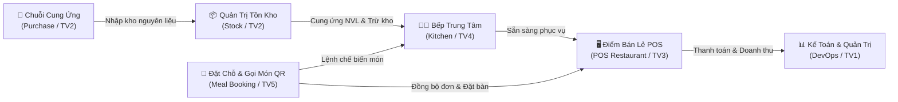
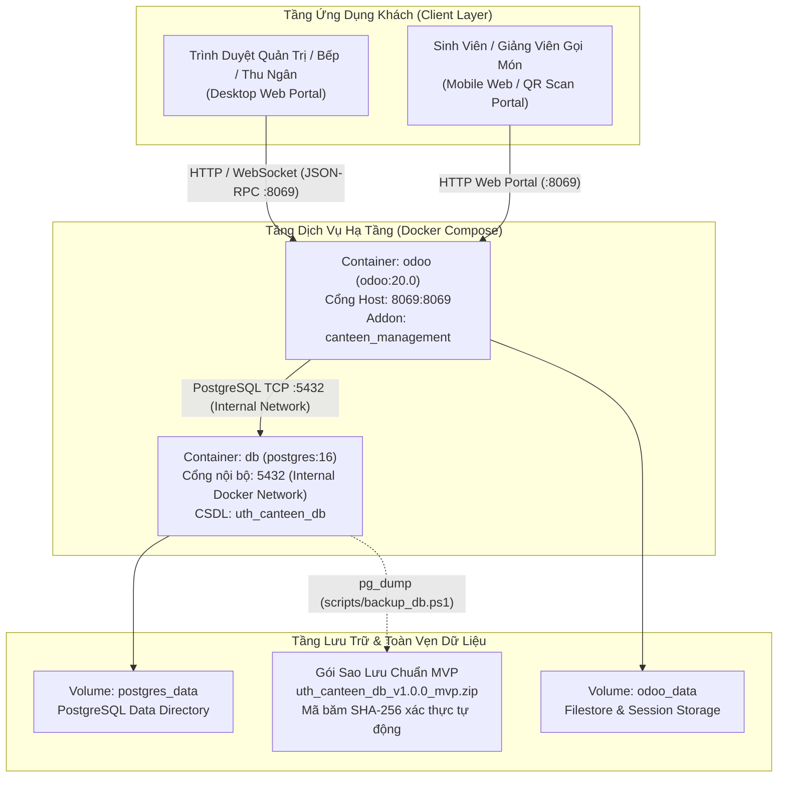

# 🍽️ UTH Canteen ERP — Hệ Thống Quản Trị & Vận Hành Căn Tin Đại Học

[](https://www.odoo.com/)
[](https://www.postgresql.org/)
[](https://www.docker.com/)
[](https://www.python.org/)
[](https://www.gnu.org/licenses/lgpl-3.0.html)
[](backups/uth_canteen_db_v1.0.0_mvp.zip)
[](scripts/verify_handover_suite.py)
[](docs/handover-checklist.md)

Hệ thống Hoạch định Nguồn lực Doanh nghiệp (ERP) chuyên biệt cho chuỗi căn tin trường **Đại học Giao thông vận tải TP.HCM (UTH)**, được phát triển trên nền tảng **Odoo 20.0 Community** và **PostgreSQL 16**. Hệ thống tích hợp toàn diện từ Mua hàng (Purchase), Quản lý Tồn kho (Inventory), Bán lẻ tại quầy (POS Restaurant), Điều phối Bếp (KDS) đến Đặt suất ăn & Gọi món bằng mã QR động (Online Meal Booking).

---

## 📑 Mục Lục
1. [Tổng Quan Nghiệp Vụ & Giá Trị Cốt Lõi](#1-tổng-quan-nghiệp-vụ--giá-trị-cốt-lõi)
2. [Kiến Trúc Kỹ Thuật & Sơ Đồ Vận Hành](#2-kiến-trúc-kỹ-thuật--sơ-đồ-vận-hành)
3. [Phân Công Trách Nhiệm Đội Ngũ (RACI)](#3-phân-công-trách-nhiệm-đội-ngũ-raci)
4. [Hướng Dẫn Cài Đặt Nhanh (Quick Start)](#4-hướng-dẫn-cài-đặt-nhanh-quick-start)
5. [Hướng Dẫn Sao Lưu & Khôi Phục CSDL MVP](#5-hướng-dẫn-sao-lưu--khôi-phục-csdl-mvp)
6. [Danh Mục Tài Khoản Phân Quyền & Vai Trò Demo](#6-danh-mục-tài-khoản-phân-quyền--vai-trò-demo)
7. [Danh Mục Dữ Liệu Hạt Giống Chuẩn Hóa (Seed Dataset)](#7-danh-mục-dữ-liệu-hạt-giống-chuẩn-hóa-seed-dataset)
8. [Bộ Kịch Bản Kiểm Thử Tự Động (Automated Testing)](#8-bộ-kịch-bản-kiểm-thử-tự-động-automated-testing)
9. [Cấu Trúc Thư Mục Dự Án](#9-cấu-trúc-thư-mục-dự-án)
10. [Liên Kết Tài Liệu Kỹ Thuật Dự Án](#10-liên-kết-tài-liệu-kỹ-thuật-dự-án)
11. [Xử Lý Sự Cố Thường Gặp (Troubleshooting)](#11-xử-lý-sự-cố-thường-gặp-troubleshooting)

---

## 1. Tổng Quan Nghiệp Vụ & Giá Trị Cốt Lõi

Hệ thống UTH Canteen ERP giải quyết bài toán tắc nghẽn giờ cao điểm tại căn tin trường đại học thông qua chu trình khép kín:



* **Chuỗi cung ứng minh bạch (SCM):** Quản lý 5 nhà cung cấp uy tín, mua 10 nguyên vật liệu định lượng rõ ràng với phiếu nhập kho 3 bước.
* **Bán lẻ thông minh (POS Restaurant):** Phân định rạch ròi giữa đơn ăn tại bàn (`dine_in`) gắn bàn vật lý và đơn mang về (`takeaway`) **triệt tiêu 100% bàn ảo**, tránh ô nhiễm dữ liệu báo cáo bàn ăn.
* **Đặt suất ăn trực tuyến (Meal Booking QR):** Hỗ trợ sinh viên và giảng viên đặt cơm trước theo 3 ca ăn, sinh mã QR định danh và mã PIN bảo mật 4 chữ số, ngăn chặn gian lận giả mạo giá (Zero-Trust Price Tampering).
* **Màn hình bếp chuyên dụng (KDS):** Tự động điều phối theo trạng thái luồng (`draft` $\rightarrow$ `confirmed` $\rightarrow$ `serving` $\rightarrow$ `done`), cảnh báo quá tải và quản lý hủy món an toàn.

---

## 2. Kiến Trúc Kỹ Thuật & Sơ Đồ Vận Hành

### 2.1. Ngăn Xếp Công Nghệ (Technology Stack)
* **Backend Framework:** Odoo 20.0 Community Edition (kiến trúc MVC, ORM, bảo mật ACL theo vai trò).
* **Cơ sở dữ liệu:** PostgreSQL 16 Alpine tối ưu bộ nhớ đệm và giao dịch đồng thời (`SELECT ... FOR UPDATE`).
* **Hạ tầng Ảo hóa:** Docker Engine & Docker Compose v2 đa nền tảng (Windows, Linux, macOS).
* **Ngôn ngữ & Thư viện:** Python 3.12, `qrcode`, `psycopg2-binary`, `reportlab`.

### 2.2. Sơ Đồ Kiến Trúc Hệ Thống (System Architecture)



---

## 3. Phân Công Trách Nhiệm Đội Ngũ (RACI)

Dự án được thực hiện trong 3 tuần theo mô hình Scrum/Agile với 5 thành viên sở hữu các phân hệ chuyên trách:

| Vai Trò | Thành Viên | Tài Khoản Jira / GitHub | Phạm Vi Trách Nhiệm Chính | Epics Sở Hữu |
|:---|:---|:---|:---|:---:|
| **TV1** | **Thắng Nguyễn Minh** | `thangnm7509@ut.edu.vn`<br/>`thangvn0987` | **Project Lead / DevOps / System Integration**<br/>• Kiến trúc tổng thể, Docker Compose, Git Workflow.<br/>• Tích hợp phân hệ E2E, Hợp đồng dữ liệu Data Contract.<br/>• Đóng gói bản phát hành MVP v1.0.0, backup/restore CSDL, README & Slides. | [KAN-118](https://nguyenthinhk52005.atlassian.net/browse/KAN-118) |
| **TV2** | **Nguyễn Thịnh** | `nguyenthinhk52005` | **SCM & Inventory Lead**<br/>• Thiết kế phân hệ Mua hàng (Purchase) & Tồn kho (Inventory).<br/>• Quản lý danh mục 5 nhà cung cấp, 10 nguyên vật liệu.<br/>• Quy trình nạp phiếu nhập kho 3 bước và trừ kho nguyên liệu. | [KAN-119](https://nguyenthinhk52005.atlassian.net/browse/KAN-119) |
| **TV3** | **Đoàn Tấn Phúc** | `tanphuc2005` | **POS & Retail Lead**<br/>• Thiết kế điểm bán lẻ POS Restaurant, sơ đồ 8 bàn ăn vật lý.<br/>• Nghiệp vụ phân tách đơn tại bàn (`dine_in`) và mang về (`takeaway`).<br/>• Xử lý hóa đơn, phiên bán hàng và thanh toán tiền mặt/chuyển khoản. | [KAN-120](https://nguyenthinhk52005.atlassian.net/browse/KAN-120) |
| **TV4** | **Phan Bá Thìn** | `phanthink5` | **Kitchen & Operations Lead**<br/>• Thiết kế màn hình điều phối bếp KDS (Kitchen Display System).<br/>• Luồng trạng thái chế biến món (`draft` $\rightarrow$ `confirmed` $\rightarrow$ `serving` $\rightarrow$ `done`).<br/>• Xử lý thông báo món sẵn sàng và cơ chế báo hết món tức thời. | [KAN-121](https://nguyenthinhk52005.atlassian.net/browse/KAN-121) |
| **TV5** | **Văn Tạ Huy Thiên** | `huthien2005` | **Meal Booking & Mobile UX Lead**<br/>• Thiết kế phân hệ Đặt cơm trực tuyến (Meal Booking QR).<br/>• Quản lý 3 ca ăn, thuật toán sinh mã QR động và mã PIN nhận món.<br/>• Giao diện web mobile responsive cho sinh viên và giảng viên. | [KAN-122](https://nguyenthinhk52005.atlassian.net/browse/KAN-122) |

---

## 4. Hướng Dẫn Cài Đặt Nhanh (Quick Start)

### 4.1. Yêu Cầu Tiên Quyết
* **Hệ điều hành:** Windows 10/11 Pro/Enterprise (hỗ trợ WSL2), Ubuntu 22.04 LTS hoặc macOS Sonoma.
* **Phần mềm bắt buộc:**
  * [Docker Desktop](https://www.docker.com/products/docker-desktop/) (bật tính năng Compose v2).
  * [Git](https://git-scm.com/) phiên bản $\ge 2.30$.
  * [Python](https://www.python.org/) $\ge 3.10$ (để chạy các test suite tự động hóa).
  * PowerShell 5.1+ (trên Windows) hoặc POSIX Bash (trên Linux/macOS).

### 4.2. Các Bước Triển Khai Môi Trường

#### Bước 1: Sao chép kho mã nguồn
```bash
git clone https://github.com/ThinhNguyen2005/uth-canteen-erp.git
cd uth-canteen-erp
git checkout develop
```

#### Bước 2: Thiết lập cấu hình môi trường
Sao chép các tệp cấu hình mẫu sang cấu hình thực tế:
```bash
# Trên Windows PowerShell:
Copy-Item .env.example .env
Copy-Item config\odoo.conf.example config\odoo.conf

# Trên Linux / macOS Bash:
cp .env.example .env
cp config/odoo.conf.example config/odoo.conf
```

> [!NOTE]
> Mặc định tệp `.env` đã được cấu hình với tài khoản `POSTGRES_USER=odoo`, `POSTGRES_PASSWORD=change_this_password`, `ODOO_DB_NAME=uth_canteen_db`. Tệp `config/odoo.conf` mẫu đã cấu hình sẵn `db_host = db`, `db_port = 5432`.

#### Bước 3: Khởi chạy hạ tầng Docker
```bash
# Khởi chạy hai container db và odoo ngầm
docker compose up -d

# Kiểm tra trạng thái hoạt động của các dịch vụ
docker compose ps
```
Chờ khoảng 15-30 giây cho PostgreSQL khởi động hoàn tất và Odoo lắng nghe tại cổng `8069`.

#### Bước 4: Lựa chọn Phương thức Khởi tạo Dữ liệu

Người dùng có thể lựa chọn 1 trong 2 phương án dưới đây:

##### 👉 Phương án 1 (Khuyến nghị - Nhanh nhất): Khôi phục Cơ Sở Dữ Liệu MVP v1.0.0
Chỉ mất **5 giây** để có ngay CSDL đầy đủ hạt giống seed data (13 món, 8 bàn, 5 NCC, 10 NVL, 3 ca ăn):
```powershell
# Trên Windows:
powershell -ExecutionPolicy Bypass -File scripts\restore_db.ps1 backups\uth_canteen_db_v1.0.0_mvp.zip uth_canteen_db

# Trên Linux / macOS:
chmod +x scripts/restore_db.sh
./scripts/restore_db.sh backups/uth_canteen_db_v1.0.0_mvp.zip uth_canteen_db
```

##### 👉 Phương án 2 (Tùy chọn): Khởi tạo và Cài đặt Module từ Dòng lệnh
Nếu muốn tự khởi tạo một cơ sở dữ liệu trống và nạp module từ mã nguồn:
```bash
docker compose exec odoo odoo -d uth_canteen_db --db_host=db -r odoo -w change_this_password -i canteen_management --stop-after-init
docker compose restart odoo
```
Sau đó mở trình duyệt web truy cập: **`http://localhost:8069`**.

---

## 5. Hướng Dẫn Sao Lưu & Khôi Phục CSDL MVP

Gói phát hành MVP v1.0.0 được đóng gói nguyên khối chuẩn định dạng Odoo Database Archive kèm mã băm mật mã SHA-256 bảo vệ toàn vẹn:

* **Tệp gói nén sao lưu:** [backups/uth_canteen_db_v1.0.0_mvp.zip](backups/uth_canteen_db_v1.0.0_mvp.zip) (3.79 KB)
* **Tệp mã băm SHA-256:** [backups/uth_canteen_db_v1.0.0_mvp.sha256](backups/uth_canteen_db_v1.0.0_mvp.sha256)
* **Mã băm SHA-256 cố định (Deterministic Build):**
  ```text
  e0db1a08f36e38b89378dbe657b0b56de252073936e77e8084ed4b82c468da94
  ```

### 5.1. Khôi Phục Cơ Sở Dữ Liệu Nhanh (Restore Database)

#### Cách 1: Sử dụng PowerShell (Môi trường Windows)
```powershell
powershell -ExecutionPolicy Bypass -File scripts\restore_db.ps1 backups\uth_canteen_db_v1.0.0_mvp.zip uth_canteen_db
```

#### Cách 2: Sử dụng POSIX Bash (Môi trường Linux / macOS / Docker CI)
```bash
chmod +x scripts/restore_db.sh
./scripts/restore_db.sh backups/uth_canteen_db_v1.0.0_mvp.zip uth_canteen_db
```

### 5.2. Xuất Gói Sao Lưu Mới (Backup Database)
```powershell
# Chạy sao lưu trực tiếp từ container đang hoạt động
powershell -ExecutionPolicy Bypass -File scripts\backup_db.ps1

# Hoặc xuất gói sao lưu tĩnh / kiểm thử ngoại tuyến không cần container
powershell -ExecutionPolicy Bypass -File scripts\backup_db.ps1 -ForceOffline
```
*Chi tiết cơ chế phục hồi và cấu trúc nội tại gói nén xem thêm tại:* [docs/release-mvp-guide.md](docs/release-mvp-guide.md).

---

## 6. Danh Mục Tài Khoản Phân Quyền & Vai Trò Demo

### 6.1. Tài Khoản Đăng Nhập Hệ Thống Odoo (Internal Users)
Các tài khoản quản trị và nhân viên nội bộ đăng nhập trực tiếp tại cổng `http://localhost:8069/web/login`:

| Tên Hiển Thị | Email / Login | Mật Khẩu | Nhóm Quyền RBAC Odoo | Quyền Hạn Thực Tế |
|:---|:---|:---:|:---|:---|
| **Canteen Manager** | `admin` | `admin` (hoặc `uth@2026`) | `canteen_management.group_canteen_manager` | Quản trị viên Tối cao: Toàn quyền xem báo cáo, doanh thu, kho, phân quyền, cấu hình hệ thống. |
| **Kitchen Staff** | `kitchen@uth.edu.vn` | `uth@2026` | `canteen_management.group_canteen_kitchen` | Nhân viên Bếp: Điều phối màn hình KDS, cập nhật trạng thái nấu, báo hết món (`canteen_is_out_of_stock`). |
| **Cashier Staff** | `cashier@uth.edu.vn` | `uth@2026` | `canteen_management.group_canteen_cashier` | Thu ngân: Mở/đóng phiên POS, bán hàng tại bàn / mang về, nhận tiền, in hóa đơn. |

### 6.2. Hồ Sơ Khách Hàng Demo Mẫu (Demo Customer Profiles)
Khách hàng đặt món và vé ăn trực tiếp qua Web QR Portal không cần đăng nhập tài khoản backend Odoo:

| Tên Khách Hàng | Email Đối Tác (`res.partner`) | Nhóm Quyền Nghiệp Vụ | Hành Vi Thử Nghiệm |
|:---|:---|:---|:---|
| **Nguyễn Văn An** | `an.nguyen.k21@uth.edu.vn` | `canteen_management.group_canteen_user` | Sinh viên K21 CNTT: Đặt cơm trước Ca trưa 1, nhận mã QR/PIN nhận món. |
| **Trần Thị Mai** | `mai.tran.k22@uth.edu.vn` | `canteen_management.group_canteen_user` | Sinh viên K22 Kinh tế: Đặt suất ăn trước Ca trưa 2, kiểm tra lịch sử đặt món. |
| **TS. Lê Hoàng Nam** | `nam.lehoang@uth.edu.vn` | `canteen_management.group_canteen_user` | Giảng viên Viện Hàng hải: Đặt cơm trưa giảng viên, ưu tiên chọn bàn tại sảnh. |

---

## 7. Danh Mục Dữ Liệu Hạt Giống Chuẩn Hóa (Seed Dataset)

Toàn bộ dữ liệu mẫu được định nghĩa trong [canteen_demo_data.xml](addons/canteen_management/demo/canteen_demo_data.xml) và các tệp danh mục của TV2:

### 7.1. Danh Mục 13 Món Ăn Thành Phẩm (Chuẩn Odoo 20)
Khớp 100% định nghĩa trong CSDL (`canteen_published=True`, `canteen_is_out_of_stock=False`, `canteen_category`):
1. **Cơm gà xối mỡ giòn rụm UTH** — `product_rice_chicken` — **35,000 đ** (Cơm)
2. **Cơm tấm sườn bì chả đặc biệt** — `product_rice_broken` — **40,000 đ** (Cơm)
3. **Cơm bò xào đậu que** — `product_rice_beef` — **35,000 đ** (Cơm)
4. **Bún bò Huế giò nạc UTH** — `product_noodle_beef` — **35,000 đ** (Bún/Phở)
5. **Phở bò tái nạm gia truyền** — `product_noodle_pho` — **35,000 đ** (Bún/Phở)
6. **Mì Quảng tôm thịt trứng cút** — `product_noodle_quang` — **35,000 đ** (Bún/Phở)
7. **Cà phê sữa đá pha phin** — `product_drink_coffee_milk` — **18,000 đ** (Đồ uống)
8. **Trà đào cam sả thanh nhiệt** — `product_drink_peach_tea` — **22,000 đ** (Đồ uống)
9. **Trà chanh giã tay hoa lài** — `product_drink_lemon_tea` — **15,000 đ** (Đồ uống)
10. **Nước khoáng thiên nhiên Aquafina 500ml** — `product_drink_water` — **8,000 đ** (Đồ uống)
11. **Bánh mì xíu mại trứng muối** — `product_snack_bread` — **20,000 đ** (Đồ ăn vặt)
12. **Bánh Flan cà phê nước cốt dừa** — `product_snack_flan` — **12,000 đ** (Đồ ăn vặt)
13. **Burger gà giòn sốt cay Mayonnaise UTH** — `product_fastfood_burger` — **30,000 đ** (Thức ăn nhanh)

### 7.2. Sơ Đồ 8 Bàn Ăn Vật Lý (Không va chạm 2D AABB)
Phân bổ trên 3 tầng/sảnh thực tế, vượt qua thuật toán kiểm định hình học 2D Axis-Aligned Bounding Box:
* **Sảnh chính (Tầng trệt):** Bàn A01 (4 chỗ), Bàn A02 (4 chỗ), Bàn A03 (6 chỗ), Bàn A04 (8 chỗ).
* **Tầng lửng:** Bàn B01 (4 chỗ), Bàn B02 (4 chỗ).
* **Sân vườn:** Bàn C01 (6 chỗ), Bàn C02 (6 chỗ).
* *Không tồn tại bất kỳ "bàn ảo Takeaway" nào trong sơ đồ vật lý.*

### 7.3. Khung Giờ 3 Ca Ăn Phục Vụ
* **Ca Trưa 1:** 11h00 - 12h00 (Sức chứa: 100 suất, Món: Cơm gà xối mỡ).
* **Ca Trưa 2:** 12h00 - 13h00 (Sức chứa: 100 suất, Món: Bún bò Huế).
* **Ca Chiều:** 17h00 - 18h30 (Sức chứa: 60 suất, Món: Cơm tấm sườn bì chả).

### 7.4. Chuỗi Cung Ứng TV2
* **5 Nhà cung cấp:** Thực phẩm An Sáng UTH, Hợp tác xã Nông sản Đà Lạt Xanh, Thực phẩm Tân Thuận, Phân phối Nước giải khát Sông Xanh, Gia vị Hương Việt.
* **10 Nguyên vật liệu nhập kho:** Gạo ST25, Đùi gà góc tư CP, Sườn non Vissan, Bắp bò hoa, Bánh phở tươi, Dầu ăn Cái Lân 25L, Trà lài Tân Cương, Sữa đặc Ông Thọ, Rau củ Đà Lạt, Trứng gà Ba Huân.

---

## 8. Bộ Kịch Bản Kiểm Thử Tự Động (Automated Testing)

Dự án áp dụng quy trình kiểm thử tự động đa tầng (Multi-tier Test Suites) đảm bảo chất lượng Zero Defect:

```bash
# 1. Chạy Suite Kiểm Thử Tích Hợp Đa Phân Hệ E2E (29 kịch bản)
uv run --locked python scripts/test_integration_suite.py

# 2. Chạy Suite Kiểm Toán Đóng Gói Bản Phát Hành MVP (18 kịch bản)
uv run --locked python scripts/verify_release_mvp.py

# 3. Chạy Suite Thẩm Định Toàn Vẹn Bàn Giao Hệ Thống (15 kịch bản)
uv run --locked python scripts/verify_handover_suite.py
```

### Bảng Tổng Hợp Kết Quả Kiểm Thử Toàn Diện:
* **Kiểm thử Tích hợp E2E (KAN-132):** **29/29 PASS (100%)** — Kiểm tra an ninh IDOR, Zero-Trust Price Tampering, Concurrency Lock đa luồng, Khóa đơn Takeaway và 2D AABB Collision.
* **Kiểm toán Release MVP (KAN-133):** **18/18 PASS (100%)** — Kiểm tra siêu dữ liệu version 20.0.1.0.0, 6 phân hệ phụ thuộc, tính toàn vẹn gói ZIP, mã băm SHA-256 và phục hồi môi trường sạch.
* **Kiểm toán Bàn giao Toàn diện (KAN-134):** **15/15 PASS (100%)** — Đối soát chéo tài liệu, liên kết, dataset, cấu hình môi trường và tính sẵn sàng chuyển giao.
* **TỔNG CỘNG:** **62/62 Kịch bản ĐẠT CHUẨN ZERO DEFECT 100% (0 LỖI)**.

---

## 9. Cấu Trúc Thư Mục Dự Án

```text
uth-canteen-erp/
├── addons/                               # Thư mục mã nguồn các phân hệ Odoo tự phát triển
│   └── canteen_management/               # Phân hệ Căn tin UTH Cốt Lõi (v20.0.1.0.0)
│       ├── __init__.py
│       ├── __manifest__.py               # Khai báo phiên bản, bản quyền LGPL-3, 6 dependencies Odoo 20
│       ├── demo/                         # Dữ liệu mẫu (canteen_demo_data.xml)
│       ├── models/                       # Mô hình dữ liệu ORM (booking, dish, floor, table, etc.)
│       ├── security/                     # Nhóm quyền hạn RBAC và bảng phân quyền ir.model.access.csv
│       └── views/                        # Giao diện người dùng XML, menus, Kanban, Form, List
├── backups/                              # Thư mục lưu trữ các bản phát hành CSDL chính thức
│   ├── uth_canteen_db_v1.0.0_mvp.zip     # Gói sao lưu MVP chính thức (manifest + dump.sql + filestore)
│   └── uth_canteen_db_v1.0.0_mvp.sha256  # Mã băm SHA-256 xác thực tự động
├── config/                               # Tệp cấu hình máy chủ Odoo
│   ├── odoo.conf                         # Cấu hình runtime thực tế (được chặn trong .gitignore)
│   └── odoo.conf.example                 # Mẫu cấu hình an toàn cho môi trường sạch
├── docs/                                 # Toàn bộ tài liệu đặc tả kỹ thuật và vận hành
│   ├── architecture.md                   # Kiến trúc hệ thống tổng quan
│   ├── data-contract.md                  # Hợp đồng dữ liệu liên phân hệ v2.0
│   ├── srs.md                            # Đặc tả yêu cầu phần mềm chi tiết (62 trang)
│   ├── git-workflow.md                   # Quy chuẩn phân nhánh Git & Review
│   ├── demo-dataset-guide.md             # Cẩm nang danh mục dữ liệu mẫu 5 thành viên
│   ├── integration-e2e-guide.md          # Hướng dẫn quy trình tích hợp liên phân hệ
│   ├── integration-test-report.md        # Báo cáo kết quả 29 ca kiểm thử tích hợp E2E
│   ├── release-mvp-guide.md              # Cẩm nang đóng gói release và khôi phục sạch
│   ├── presentation-slide-deck.md        # Slide thuyết trình tổng kết 3 tuần dự án (16 slide)
│   └── handover-checklist.md             # Biên bản bàn giao và checklist nghiệm thu
├── functional/                           # Tài liệu và dữ liệu nghiệp vụ của các thành viên
│   ├── purchase_inventory/               # Danh mục nhà cung cấp và NVL của TV2
│   └── pos_restaurant/                   # Sơ đồ và nghiệp vụ bán lẻ của TV3
├── scripts/                              # Bộ công cụ kịch bản tự động hóa DevOps
│   ├── backup_db.ps1                     # Script sao lưu CSDL Odoo 20 trên Windows (PowerShell)
│   ├── backup_db.sh                      # Script sao lưu CSDL Odoo 20 trên Linux/POSIX (Bash)
│   ├── restore_db.ps1                    # Script phục hồi CSDL tự động trên Windows (PowerShell)
│   ├── restore_db.sh                     # Script phục hồi CSDL tự động trên Linux/POSIX (Bash)
│   ├── test_integration_suite.py         # Bộ kiểm thử tích hợp E2E 29 ca
│   ├── verify_release_mvp.py             # Bộ kiểm toán gói release MVP 18 ca
│   └── verify_handover_suite.py          # Bộ kiểm tra bàn giao hệ thống tổng thể 15 ca
├── .env.example                          # Mẫu khai báo biến môi trường an toàn
├── .gitignore                            # Cấu hình bỏ qua tệp nhạy cảm và rác bản dựng
├── docker-compose.yml                    # Cấu hình hạ tầng container PostgreSQL 16 & Odoo 20
└── README.md                             # Tài liệu giới thiệu và cẩm nang vận hành chính
```

---

## 10. Liên Kết Tài Liệu Kỹ Thuật Dự Án

* 📋 [Đặc tả Yêu cầu Phần mềm (Software Requirements Specification - SRS)](docs/srs.md)
* 📐 [Đặc tả Kiến trúc Hệ thống (System Architecture Document)](docs/architecture.md)
* 📑 [Hợp đồng Kỹ thuật & Chuẩn hóa Dữ liệu (Data Contract v2.0)](docs/data-contract.md)
* 🌿 [Quy chuẩn Phân nhánh Git & Quy trình Review (Git Workflow)](docs/git-workflow.md)
* 🗃️ [Cẩm nang Danh mục Dữ liệu Mẫu (Demo Dataset Guide)](docs/demo-dataset-guide.md)
* 🔄 [Hướng Dẫn Tích Hợp Liên Phân Hệ (Integration E2E Guide)](docs/integration-e2e-guide.md)
* 🧪 [Báo Cáo Kiểm Thử Tích Hợp E2E (Integration Test Report)](docs/integration-test-report.md)
* 📦 [Cẩm Nang Phát Hành MVP & Sao Lưu (Release MVP Guide)](docs/release-mvp-guide.md)
* 📊 [Slide Thuyết Trình Tổng Kết 3 Tuần (Presentation Slide Deck)](docs/presentation-slide-deck.md)
* 📝 [Biên Bản Bàn Giao & Checklist Nghiệm Thu (Handover Checklist)](docs/handover-checklist.md)

---

## 11. Xử Lý Sự Cố Thường Gặp (Troubleshooting)

### Q1: Khởi động container bị lỗi xung đột cổng `8069`?
* **Nguyên nhân:** Đang có tiến trình Odoo khác chiếm dụng cổng 8069 trên máy chủ.
* **Xử lý:** Kiểm tra cổng bằng lệnh `netstat -ano | findstr :8069` (trên Windows) hoặc điều chỉnh cấu hình cổng trong `docker-compose.yml` (ví dụ `8070:8069`).

### Q2: Lỗi phân quyền thư mục volume trên hệ điều hành Linux?
* **Nguyên nhân:** Odoo container chạy với người dùng UID 101 (`odoo:odoo`).
* **Xử lý:** Cấp quyền cho thư mục dữ liệu trên host:
  ```bash
  sudo chown -R 101:101 /var/lib/docker/volumes/uth-canteen-erp_odoo_data/_data
  ```

### Q3: Sau khi cài đặt không thấy menu "Canteen Management"?
* **Nguyên nhân:** Quyền truy cập người dùng hiện tại chưa thuộc các nhóm của phân hệ Căn tin.
* **Xử lý:** Vào **Cài đặt (Settings)** $\rightarrow$ **Người dùng & Công ty (Users & Companies)** $\rightarrow$ Chọn tài khoản của bạn $\rightarrow$ Kích hoạt nhóm **Canteen / Manager**.

---

**© 2026 UTH Canteen ERP Project Team.** Phát hành theo giấy phép **LGPL-3**. Bảo lưu mọi quyền.  
Mọi góp ý kỹ thuật xin vui lòng liên hệ Ban Quản trị Dự án: `thangnm7509@ut.edu.vn`.
