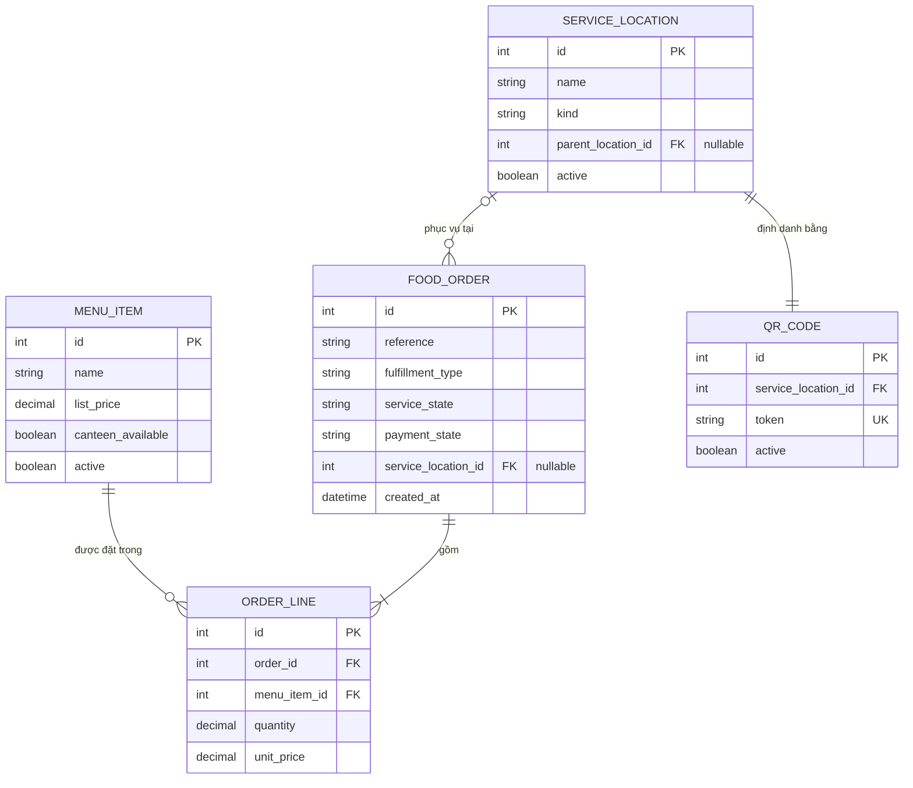

# KAN-157 — Phân tích dữ liệu đặt món qua QR (bản nháp)

> Bản nháp theo MVP đặt món qua QR do nhóm đang xem xét. Chưa thay thế `docs/data-contract.md` và chưa được TV1/TV5 duyệt. KAN-121 hiện vẫn mô tả booking theo ca và sức chứa; cần cập nhật backlog trước khi triển khai.

## Phạm vi MVP

- Khách quét QR để xem menu và gửi đơn, không cần tài khoản.
- Nhân viên chủ động đánh dấu món đang bán/hết món. Món hết chỉ bị chặn ở đơn mới; đơn đã gửi không tự thay đổi.
- Đơn chọn mang đi hoặc ăn tại bàn. QR của bàn/khu vực gắn vị trí phục vụ vào đơn.
- Nhân viên theo dõi đơn và cập nhật trạng thái phục vụ.
- Không có ca ăn, quota chỗ ngồi, đặt trước theo khung giờ, hồ sơ sinh viên bắt buộc hoặc cổng thanh toán trực tuyến trong MVP.

## ERD đề xuất

`QR_CODE` có thể chỉ là trường/token trên model vị trí nếu mỗi bàn/khu vực chỉ cần một QR đang hoạt động. Tách thành entity riêng chỉ khi cần lưu lịch sử, thay mã hoặc quản lý nhiều mã cho một vị trí.

## Từ điển dữ liệu đề xuất

| Entity / model Odoo dự kiến | Trường logic | Kiểu | Bắt buộc | Quy tắc / ghi chú |
|---|---|---|---|---|
| Món / `product.template` | `name` | Char | Có | Tên hiển thị trong menu; dùng sản phẩm chuẩn Odoo, không tạo model món trùng lặp. |
| Món / `product.template` | `list_price` | Monetary | Có | Giá hiện tại; dòng đơn lưu lại giá tại lúc đặt. |
| Món / `product.template` | `canteen_available` | Boolean, bổ sung nếu cần | Có | Nhân viên bật/tắt bán. Không bán khi false; backend kiểm tra lại lúc nhận đơn. |
| Đơn / `pos.order` nếu POS phù hợp | `name` / reference | Char | Có | Mã đơn do hệ thống sinh, không dùng dữ liệu sinh viên để định danh. |
| Đơn / `pos.order` | `fulfillment_type` | Selection | Có | `takeaway` hoặc `dine_in`. |
| Đơn / `pos.order` | `service_location_id` | Many2one, nullable | Có điều kiện | Bắt buộc với đơn dine-in tạo từ QR bàn/khu vực; để trống với takeaway. Dùng model bàn/tầng chuẩn nếu module POS Restaurant được duyệt. |
| Đơn / `pos.order` | `service_state` | Selection | Có | Trạng thái phục vụ đề xuất: `received`, `preparing`, `ready`, `completed`, `cancelled`; TV1/TV5 cần chốt trạng thái và quyền chuyển. |
| Đơn / POS payment | `payment_state` | Theo POS chuẩn nếu dùng được | Có | MVP giả định nhân viên ghi nhận đã thanh toán thủ công; không thêm tích hợp cổng thanh toán. |
| Dòng đơn / `pos.order.line` | `order_id` | Many2one | Có | Liên kết tới đơn. |
| Dòng đơn / `pos.order.line` | `product_id` | Many2one | Có | Liên kết sản phẩm; từ chối sản phẩm không còn được bán khi gửi đơn mới. |
| Dòng đơn / `pos.order.line` | `qty` | Float | Có | Phải lớn hơn 0. |
| Dòng đơn / `pos.order.line` | `price_unit` | Monetary | Có | Chụp giá tại thời điểm đặt để thay đổi giá menu không sửa đơn cũ. |
| Vị trí / POS Restaurant nếu được duyệt | `name`, `kind` | Char, Selection | Có | Bàn hoặc khu vực; có thể dùng floor/table chuẩn thay model tùy chỉnh. |
| Vị trí / mapping QR | `token` | Char | Có với QR vị trí | Duy nhất, khó đoán; QR chỉ định vị trí, không cấp quyền xem/sửa đơn khác. |
| Vị trí / mapping QR | `active` | Boolean | Có | Có thể vô hiệu hóa QR khi bàn/khu vực ngừng phục vụ. |

### Quan hệ và ràng buộc

- Một đơn có một hoặc nhiều dòng; mỗi dòng thuộc đúng một đơn và tham chiếu đúng một món.
- Một món có thể xuất hiện ở nhiều dòng đơn. Giá trên dòng đơn là giá chụp tại lúc đặt.
- Một vị trí có thể gắn với nhiều đơn theo thời gian; mỗi đơn dine-in từ QR gắn một vị trí. Đơn takeaway không gắn vị trí.
- Chặn `quantity <= 0`; không nhận dòng món đang hết hàng khi khách gửi đơn. Nếu món bị đánh dấu hết sau khi đơn đã nhận, đơn hiện có vẫn giữ nguyên để nhân viên xử lý.
- Không yêu cầu `partner_id`/đăng nhập để đặt món. Không lưu thông tin cá nhân khách trong MVP nếu chưa có yêu cầu nghiệp vụ.
- Endpoint khách không đăng nhập chỉ được xem menu đang bán, tạo đơn và xem thông tin tối thiểu của đơn vừa tạo; không được đọc/sửa đơn khác bằng ID tuần tự. TV5 cần review ACL và cơ chế token.

## Dữ liệu mẫu (giả lập)

| Bản ghi | Giá trị ví dụ |
|---|---|
| Món | Bánh mì trứng — 25.000 VND — đang bán |
| Vị trí | Khu A / Bàn 03 — QR đang hoạt động |
| Đơn | `ORD-0001` — dine-in — vị trí Khu A / Bàn 03 — received — chưa thanh toán |
| Dòng đơn | `ORD-0001` — Bánh mì trứng — 2 phần — giá chụp 25.000 VND/phần |
| Đơn mang đi | `ORD-0002` — takeaway — không có vị trí — received — chưa thanh toán |

## Cần TV1/TV5 xác nhận trước khi khóa contract

1. Có dùng `point_of_sale` và `pos_restaurant` trong addon hay chưa; manifest hiện chỉ phụ thuộc `base`, TV1 sở hữu manifest.
2. MVP ghi nhận thanh toán thủ công tại quầy như giả định ở trên hay cần thanh toán trước khi gửi đơn.
3. Có cần QR riêng cho từng bàn, QR cho khu vực, hay cả hai; model chuẩn nào đáp ứng được.
4. Danh sách trạng thái đơn và ai được chuyển từng trạng thái.
5. Cơ chế route công khai để khách không đăng nhập gửi đơn; TV5 review quyền và cách giới hạn truy cập dữ liệu đơn.

## Tiêu chí hoàn tất KAN-157

- TV1 xác nhận quy tắc nghiệp vụ và TV5 xác nhận dữ liệu phục vụ giao diện/quyền.
- ERD, từ điển dữ liệu, khóa, quan hệ, trường bắt buộc, ràng buộc và ví dụ dữ liệu được rà soát.
- Sau khi nhóm duyệt phạm vi QR, cập nhật contract dùng chung và các task phụ thuộc; chưa triển khai model trong KAN-157.
