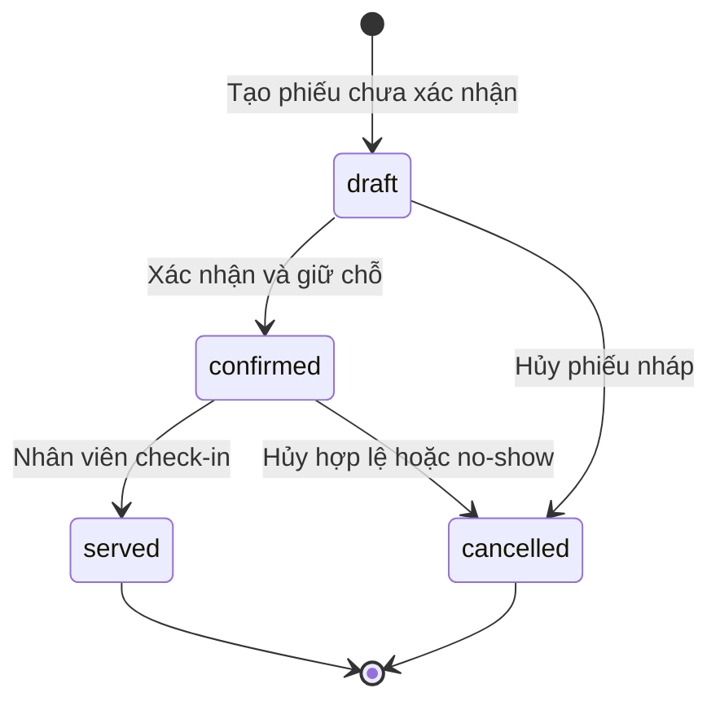

# KAN-159 — Workflow trạng thái đặt trước suất ăn

> **Trạng thái:** Bản nháp TV4 để TV1/TV5 review.
> **Nguồn:** KAN-159, `docs/data-contract.md` và `docs/srs.md` trên `develop` tại `a89bef3`.
> **Phạm vi:** `canteen.meal.booking` và `canteen.meal.slot` của luồng đặt trước theo ca (KAN-121). Không dùng `pos.order.service_state` của luồng gọi món QR.

## 1. State diagram

Không cho chuyển ngược `served` hoặc `cancelled` về trạng thái hoạt động. Không cho `draft → served` hoặc `served → cancelled`.

## 2. Transition matrix

| Từ → đến | Tác nhân | Điều kiện trước khi chuyển | Tác động dữ liệu | Gọi lặp / idempotency |
|---|---|---|---|---|
| Tạo → `draft` | Sinh viên/cán bộ hoặc nhân viên được phép tạo hộ | Có người đặt, ca và số lượng hợp lệ (`1..3`) | Tạo phiếu; chưa chiếm sức chứa vì `booked_count` chỉ tính `confirmed` và `served` | Nếu cùng người đặt đã có phiếu `draft`/`confirmed` cho cùng ca, không tạo phiếu hoạt động thứ hai; trả phiếu hiện hữu hoặc báo đã đặt. |
| `draft` → `confirmed` | Người đặt gửi xác nhận; nếu luồng yêu cầu duyệt thì nhân viên được phân quyền | Ca đang `open`, còn hiệu lực; phiếu chưa xác nhận; số lượng hợp lệ; chưa có booking hoạt động khác của cùng người đặt trong ca | Khóa dòng `canteen.meal.slot` (`SELECT ... FOR UPDATE`), kiểm tra `booked_count + quantity <= capacity`, cập nhật trạng thái và để `booked_count` tính lại từ booking | Nếu phiếu đã `confirmed`, trả kết quả hiện tại; không cộng sức chứa thêm lần nữa. Nếu hết chỗ, giữ phiếu ở `draft` hoặc từ chối theo chính sách đã chốt; không ghi nhận xác nhận nửa chừng. |
| `draft` → `cancelled` | Người đặt hoặc nhân viên | Phiếu còn `draft` | Đánh dấu hủy; không trả chỗ vì nháp chưa được tính vào `booked_count` | Gọi lại không đổi dữ liệu lần nữa. |
| `confirmed` → `served` | Thu ngân/nhân viên phục vụ (`group_canteen_cashier`) | Phiếu còn `confirmed`; đúng ca và trong thời gian check-in; mã phiếu hợp lệ | Ghi nhận thời gian nhận nếu có field được thống nhất; giữ booking ở trạng thái `served`, vẫn tính trong sức chứa ca | Gọi lại với phiếu `served` trả trạng thái đã nhận, không phát phần ăn lần hai. |
| `confirmed` → `cancelled` (khách hủy) | Chính người đặt; nhân viên xử lý ngoại lệ nếu được phép | Trước giờ bắt đầu ca ít nhất 30 phút theo SRS; phiếu thuộc người gọi và còn `confirmed` | Đổi state; booking không còn được tính vào `booked_count`. Nếu ca `full` và vẫn còn mở nhận đặt, cho ca về `open` sau khi tính lại | Gọi lại không trừ sức chứa lần hai. Hủy sau hạn bị từ chối. |
| `confirmed` → `cancelled` (no-show) | Cron/nhân viên được phân quyền | Ca đã kết thúc quá 15 phút; phiếu chưa `served` | Hủy phiếu, ghi lý do no-show; ca đã qua giờ thì vẫn giữ `closed` | Cron chạy lại không tạo side effect khác; phiếu đã `cancelled` được bỏ qua. |

## 3. Quy tắc sức chứa và giao dịch

- `booked_count` được tính từ tổng `quantity` của booking ở `confirmed` hoặc `served`; `draft` và `cancelled` không tính.
- Xác nhận phải khóa dòng slot trước khi kiểm tra sức chứa và ghi booking, trong cùng transaction. Nếu không đủ chỗ, không xác nhận booking.
- Khi xác nhận thành công, slot chuyển `open → full` nếu đạt sức chứa.
- Khi một booking `confirmed` bị hủy trước giờ phục vụ, tính lại sức chứa; chỉ mở lại `full → open` nếu slot còn trong thời gian nhận đặt.
- Vì `booked_count` là field tính từ trạng thái booking, không vừa đổi sang `cancelled` vừa trừ số đếm thủ công. Làm cả hai có thể trả chỗ hai lần.
- Constraint duy nhất `(partner_id, slot_id)` cho state `draft`/`confirmed` ngăn cùng người đặt giữ nhiều phiếu hoạt động trong một ca. Việc check constraint vẫn cần xử lý trong transaction để trả thông báo dễ hiểu.

## 4. Quyền thao tác đề xuất

| Vai trò | Tạo/xem | Xác nhận | Check-in `served` | Hủy |
|---|---|---|---|---|
| Người đặt (`group_canteen_user`) | Tạo và xem phiếu của mình | Xác nhận phiếu của mình nếu dùng bước draft | Không | Hủy phiếu của mình trước hạn |
| Thu ngân/phục vụ (`group_canteen_cashier`) | Tra cứu phiếu cần phục vụ | Không duyệt thay người đặt trong luồng thường | Check-in tại quầy | Xử lý hủy theo quyền được TV1/TV5 chốt |
| Quản lý (`group_canteen_manager`) | Xem/quản lý phiếu | Xử lý ngoại lệ theo chính sách | Check-in/điều chỉnh khi được giao | Hủy ngoại lệ; mọi ghi đè phải được ghi nhận |
| Cron hệ thống | Đọc ca và booking hết hạn | Không | Không | Tự hủy no-show theo ngưỡng đã chốt |

Backend phải kiểm tra quyền sở hữu phiếu, vai trò và điều kiện trạng thái; ẩn nút giao diện không thay cho kiểm tra quyền phía server.

## 5. Ca hợp lệ/không hợp lệ cần nghiệm thu

1. Xác nhận booking khi còn chỗ: một booking chuyển `draft → confirmed`; `booked_count` tăng đúng `quantity`.
2. Hai request đồng thời tranh suất cuối: chỉ request đủ điều kiện xác nhận; không vượt `capacity`.
3. Gọi xác nhận lại cùng booking: trả booking đã xác nhận; không tăng `booked_count` lần nữa.
4. Gọi check-in lặp: không cấp phần ăn lần hai.
5. Hủy booking đã xác nhận trước hạn: `booked_count` giảm đúng một lần; slot `full` mở lại nếu vẫn nhận đặt.
6. Hủy booking nháp: không thay đổi `booked_count`.
7. Hủy sau hạn hoặc check-in booking đã hủy: từ chối, giữ nguyên dữ liệu.
8. Cron chạy lại trên no-show đã hủy: bỏ qua, không thay đổi số chỗ lần nữa.

Đây là kịch bản chấp nhận cho thiết kế; chưa phải kết quả automated test.

## 6. Điểm cần chốt trước triển khai

1. **`draft` có phải trạng thái lưu bền không?** Jira yêu cầu `draft → confirmed`, nhưng UC đặt suất trên SRS hiện tạo booking `confirmed` ngay trong transaction sau khi khóa slot. Đề xuất MVP: người đặt gửi yêu cầu thì backend kiểm tra sức chứa và tạo `confirmed` ngay; giữ `draft` cho phiếu chưa gửi/nội bộ nếu thật sự cần. Nếu muốn lưu draft cho khách, cập nhật SRS, xác định ai bấm xác nhận và draft có chiếm chỗ hay không.
2. **Quyền xác nhận/hủy:** SRS hiện chưa chốt nhân viên có quyền xác nhận thay người đặt hoặc hủy ngoại lệ. Ma trận ở trên đánh dấu các điểm này cần TV1/TV5 thống nhất.
3. **Idempotency khi tạo mới:** unique active booking theo `(partner_id, slot_id)` chặn đơn hoạt động trùng; backend cần quyết định trả phiếu hiện hữu hay lỗi “đã đặt” khi client gửi lại. Không thêm trường idempotency mới nếu uniqueness hiện tại đáp ứng nghiệp vụ.

KAN-159 chỉ thiết kế workflow và transition matrix. Code, automated test, ảnh/video chạy thật thuộc task triển khai sau; PR của bản nháp cần TV1/TV5 review trước khi đưa vào tài liệu chính.
