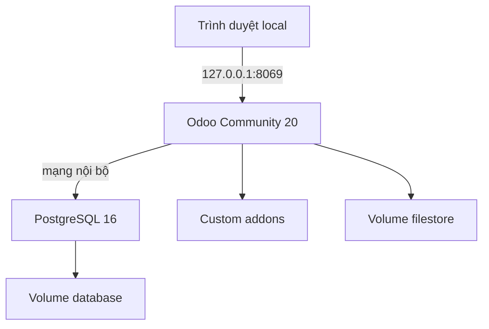

# Kiến trúc dự thảo

Ưu tiên ứng dụng chuẩn mua hàng, kho, POS, báo cáo sau khi kiểm chứng phù hợp Community; addon chỉ mở rộng nghiệp vụ còn thiếu. Database không publish cổng. Tag image có thể thay đổi; nhóm cần chốt digest sau kiểm thử thực tế.
