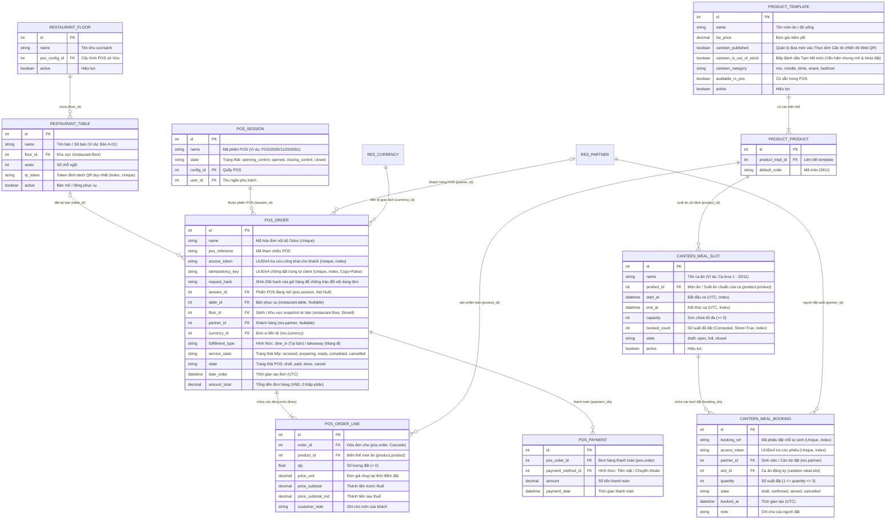
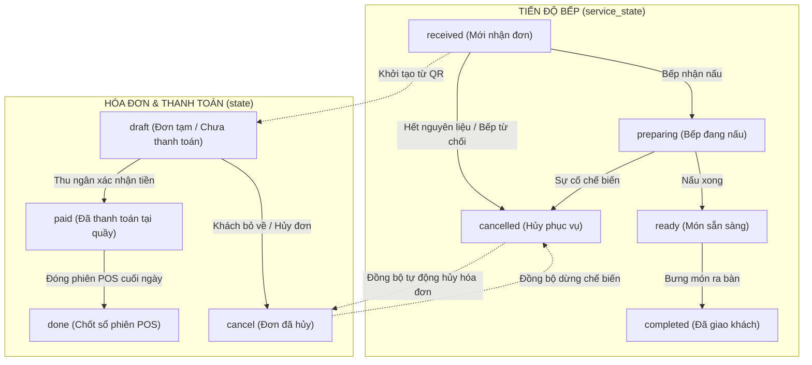
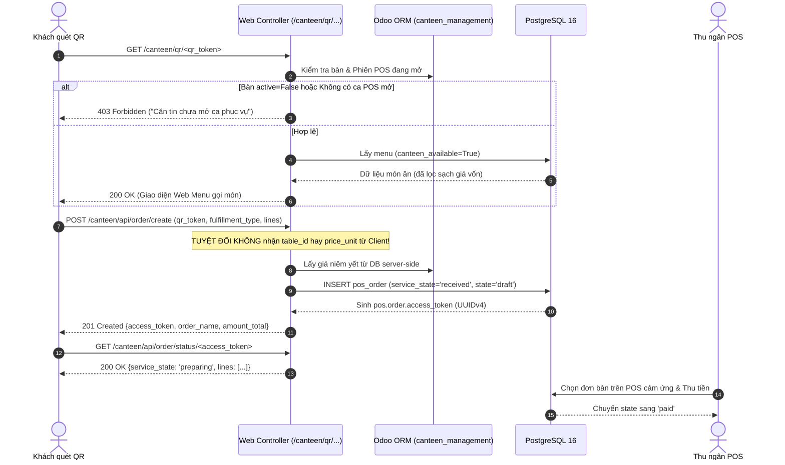

# Data Contract — Chuẩn Dữ liệu & Kiến trúc An ninh UTH Canteen ERP

> **Phiên bản:** 2.0 (Zero-Defect Enterprise Architecture Specification)  
> **Áp dụng cho:** Toàn bộ thành viên phát triển module `canteen_management` (TV1 - DevOps/Integration, TV4 - Backend Models, TV5 - Views/Security/APIs).  
> **Nền tảng mục tiêu:** Odoo Community 20.0 (Python 3.12, Werkzeug WSGI) & PostgreSQL 16.  
> **Tiêu chuẩn chất lượng:** ZERO DEFECT — Toàn vẹn tham chiếu, chuẩn hóa kiểu dữ liệu ORM, an toàn tuyệt đối xử lý đồng thời (Concurrency Safe), bảo vệ chống IDOR & rò rỉ dữ liệu (Zero Data Leakage).

---

## 1. Nguyên tắc Thiết kế & Phạm vi Tích hợp MVP

1. **Chuẩn hóa Kế thừa Odoo 20:**
   * Kế thừa chặt chẽ các model chuẩn: `product.template`, `product.product`, `pos.order`, `pos.order.line`, `restaurant.table`, `restaurant.floor`, `pos.session`, `pos.payment`.
   * Tạo mới 2 model nghiệp vụ độc lập quản lý suất ăn theo ca: `canteen.meal.slot`, `canteen.meal.booking`.
2. **Nguyên tắc Tích hợp POS Session & Kế toán Odoo:**
   * Mọi đơn hàng gọi món qua QR (`pos.order`) bắt buộc phải gắn kết với một phiên POS (`pos.session`) đang hoạt động (`state = 'opened'`). Tuyệt đối không cho phép tạo đơn mồ côi (orphaned order) gây vỡ luồng chốt sổ ca và hạch toán kho/kế toán.
   * Nếu căn tin chưa mở phiên POS (ngoài giờ phục vụ hoặc quầy chưa mở ca), hệ thống chặn nhận đơn ngay từ tầng Controller/API.
3. **Thanh toán MVP tại quầy:**
   * Đơn từ QR tạo ra ở trạng thái chưa thanh toán (`state = 'draft'`).
   * Thu ngân xác nhận thu tiền mặt (Cash) hoặc chuyển khoản ngân hàng (Bank) trên màn hình POS, hệ thống sinh bản ghi `pos.payment` chuẩn và chuyển đơn sang `state = 'paid'`.
4. **An ninh Route Public (Zero-Trust Client Data):**
   * Client (Web QR di động) là môi trường không tin cậy. Tuyệt đối không nhận `price_unit`, `amount_total`, hay `table_id` trực tiếp từ client.
   * Định danh bàn thông qua `qr_token` (bảo mật, khó đoán). Định danh đơn hàng trả về cho khách thông qua `access_token` (UUIDv4) để chống lộ ID số tự tăng (IDOR).
5. **Kiểm soát Đồng thời (Concurrency-Safe Booking):**
   * Đặt suất ăn có giới hạn sức chứa (`capacity`) bắt buộc phải thực thi khóa bi quan (Pessimistic Row Lock: `SELECT ... FOR UPDATE`) theo đúng thứ tự khóa tài nguyên (Lock Ordering) để triệt tiêu hoàn toàn Race Condition và Deadlock.

---

## 2. Sơ đồ Thực thể - Mối quan hệ (ERD Toàn diện)



---

## 3. Từ điển Dữ liệu Chi tiết (Data Dictionary & ORM Specification)

### 3.1. Phân hệ Bàn ăn & Sảnh (`restaurant.table` & `restaurant.floor`)
Kế thừa module `pos_restaurant`. Quản lý bàn ăn và mã định danh QR.

> [!IMPORTANT]
> **Quy chuẩn Định danh Mã QR (Table-Only QR Spec):**
> 1. **Chỉ dùng QR theo từng bàn:** Mã QR được dán cố định trên từng mặt bàn ăn (`restaurant.table.qr_token`). Tuyệt đối **không dùng mã QR chung theo khu vực/sảnh** để tránh nhập nhằng vị trí thực khách ngồi.
> 2. **Khu vực / Sảnh tự động suy dẫn:** Mọi thông tin về sảnh phục vụ được tự động truy xuất thông qua mối quan hệ Many2one `restaurant.table.floor_id`.
> 3. **Mô hình Bàn ảo Quầy Mang đi (Virtual Takeaway Table Pattern):** Để phục vụ khách hàng mua mang về (Takeaway) mà không ngồi vào bàn vật lý, hệ thống khởi tạo sẵn một bản ghi Bàn ảo hệ thống trong bảng `restaurant.table`:
>    - `name = "Quầy Mang Đi (Takeaway)"`
>    - `floor_id = [ID Sảnh chính]`
>    - `qr_token = "uth-qr-takeaway-counter-vtable"` (Mã QR cố định in dán tại quầy chờ)
>    - `seats = 999`, `active = True`
>    Khi khách quét mã QR tại quầy này, client tự động khóa hình thức phục vụ `fulfillment_type = 'takeaway'`.

| Tên trường (Field) | Tên kỹ thuật Odoo | Kiểu dữ liệu ORM | Bắt buộc | Default / Attributes | Quy tắc nghiệp vụ & Ràng buộc Kỹ thuật |
| :--- | :--- | :--- | :---: | :--- | :--- |
| Tên bàn | `name` | `fields.Char` | Có | size=64 | Tên bàn hiển thị trên POS và màn hình QR (VD: "Bàn A-01"). |
| Khu vực / Sảnh | `floor_id` | `fields.Many2one` | Có | comodel='restaurant.floor', ondelete='restrict', index=True | Bàn bắt buộc thuộc một khu vực cụ thể trong căn tin. |
| Số chỗ ngồi | `seats` | `fields.Integer` | Có | default=4 | Sức chứa vật lý của bàn. Ràng buộc SQL: `CHECK(seats > 0)`. |
| Mã Token QR | `qr_token` | `fields.Char` | Có | size=64, index=True, copy=False, readonly=True | Chuỗi token ngẫu nhiên an toàn (secrets.token_urlsafe(24)). Ràng buộc SQL: `UNIQUE(qr_token)`. |
| Trạng thái phục vụ | `active` | `fields.Boolean` | Có | default=True | `False` khi bàn đang hỏng hoặc tạm ngừng đón khách. QR của bàn bị tắt sẽ bị chặn đặt món. |

* **SQL Constraints (`restaurant.table`):**
  ```python
  _sql_constraints = [
      ('unique_qr_token', 'UNIQUE(qr_token)', 'Mã QR Token của bàn phải là duy nhất trên toàn hệ thống!'),
      ('check_seats_positive', 'CHECK(seats > 0)', 'Số chỗ ngồi của bàn phải lớn hơn 0!'),
  ]
  ```

---

### 3.2. Phân hệ Món ăn & Thực đơn (`product.template` & `product.product`)
Kế thừa model chuẩn `product.template` của Odoo.

| Tên trường (Field) | Tên kỹ thuật Odoo | Kiểu dữ liệu ORM | Bắt buộc | Default / Attributes | Quy tắc nghiệp vụ & Ràng buộc Kỹ thuật |
| :--- | :--- | :--- | :---: | :--- | :--- |
| Tên món ăn | `name` | `fields.Char` | Có | translate=True, index=True | Tên món hiển thị trên Web QR và hóa đơn POS. |
| Giá niêm yết | `list_price` | `fields.Monetary` | Có | currency_field='currency_id' | Giá bán cho khách (VND). Ràng buộc SQL: `CHECK(list_price >= 0)`. |
| Tiền tệ | `currency_id` | `fields.Many2one` | Có | related='company_id.currency_id', store=True | Tiền tệ mặc định hệ thống (VND, 0 chữ số thập phân). |
| Bật bán trên Menu | `canteen_published` | `fields.Boolean` | Có | default=True, index=True, tracking=True | **Chỉ Quản lý (Manager) được phép sửa.** Quyết định món có xuất hiện trên Web QR và POS hay không. |
| Tạm hết món (Bếp) | `canteen_is_out_of_stock` | `fields.Boolean` | Có | default=False, index=True, tracking=True | **Nhân viên Bếp (Kitchen) được phép thao tác.** Khi bật `True`, món vẫn hiển thị trên Menu QR nhưng tự động làm mờ (opacity 0.5), gắn nhãn "HẾT MÓN" và vô hiệu hóa nút đặt. |
| Phân loại món | `canteen_category` | `fields.Selection` | Có | default='rice', index=True | Lựa chọn: `[('rice', 'Cơm'), ('noodle', 'Bún/Phở/Mì'), ('drink', 'Đồ uống'), ('snack', 'Ăn vặt'), ('fastfood', 'Đồ ăn nhanh')]`. |
| Có sẵn trong POS | `available_in_pos` | `fields.Boolean` | Có | default=True | Bắt buộc `True` để món xuất hiện trên POS của thu ngân. |
| Hiệu lực | `active` | `fields.Boolean` | Có | default=True | Ẩn món khi ngừng kinh doanh dài hạn. |

---

### 3.3. Phân hệ Đơn đặt món QR & Bán hàng POS (`pos.order`)
Kế thừa model `pos.order` chuẩn Odoo. Kết nối trực tiếp với nhà bếp và màn hình thu ngân.

| Tên trường (Field) | Tên kỹ thuật Odoo | Kiểu dữ liệu ORM | Bắt buộc | Default / Attributes | Quy tắc nghiệp vụ & Ràng buộc Kỹ thuật |
| :--- | :--- | :--- | :---: | :--- | :--- |
| Mã tham chiếu nội bộ | `name` | `fields.Char` | Có | readonly=True, copy=False, default='/' | Sinh tự động theo quy tắc POS sequence Odoo (VD: `Order 00001-001-0001`). |
| Token tra cứu công khai | `access_token` | `fields.Char` | Có | size=64, index=True, copy=False, readonly=True | UUIDv4 ngẫu nhiên cấp cho khách quét QR để theo dõi tiến độ món mà không lộ `id` đơn. |
| Khóa chống đặt trùng | `idempotency_key` | `fields.Char` | Có | size=64, index=True, copy=False, readonly=True | UUIDv4 do Client sinh ra. Bắt buộc `copy=False` để không lỗi Unique khi nhân bản đơn trên Odoo. Chống tạo 2 đơn khi khách bấm đúp hoặc mạng lag retry. |
| Băm giỏ hàng đối soát | `request_hash` | `fields.Char` | Có | size=64, copy=False, readonly=True | SHA-256 hash của JSON dòng món. Dùng để phát hiện hành vi tái sử dụng key nhưng tráo đổi giỏ hàng (Payload Tampering). |
| Phiên POS phụ trách | `session_id` | `fields.Many2one` | Có | comodel='pos.session', ondelete='restrict', index=True | Liên kết phiên làm việc đang mở. Ràng buộc: bắt buộc phải là phiên có `state = 'opened'`. |
| Bàn phục vụ | `table_id` | `fields.Many2one` | ĐK | comodel='restaurant.table', ondelete='set null', index=True | Bắt buộc nếu `fulfillment_type = 'dine_in'`. Với đơn mang đi, trỏ tới Bàn ảo quầy Takeaway. |
| Khu vực / Sảnh | `floor_id` | `fields.Many2one` | Có | comodel='restaurant.floor', related='table_id.floor_id', store=True, readonly=True, index=True | Snapshot khu vực phục vụ tại thời điểm tạo đơn, chống mất dấu vết lịch sử khi bàn bị sửa/xóa. |
| Khách hàng | `partner_id` | `fields.Many2one` | Không | comodel='res.partner', ondelete='set null', index=True | Người đặt món (nếu có tài khoản hoặc cung cấp SĐT/Tên). |
| Hình thức phục vụ | `fulfillment_type` | `fields.Selection` | Có | default='dine_in', index=True | `[('dine_in', 'Ăn tại bàn'), ('takeaway', 'Mang đi')]`. |
| Trạng thái bếp | `service_state` | `fields.Selection` | Có | default='received', index=True, tracking=True | `[('received', 'Mới nhận'), ('preparing', 'Đang nấu'), ('ready', 'Sẵn sàng phục vụ'), ('completed', 'Đã giao khách'), ('cancelled', 'Đã hủy món')]`. |
| Trạng thái hóa đơn POS | `state` | `fields.Selection` | Có | default='draft', index=True, tracking=True | Theo chuẩn Odoo: `[('draft', 'Đơn tạm/Chưa thanh toán'), ('paid', 'Đã thanh toán'), ('done', 'Đã chốt sổ ca'), ('cancel', 'Đã hủy')]`. |
| Tiền tệ | `currency_id` | `fields.Many2one` | Có | related='session_id.currency_id', store=True | Tiền tệ thanh toán. |
| Thời gian tạo đơn | `date_order` | `fields.Datetime` | Có | default=fields.Datetime.now, readonly=True, index=True | Lưu UTC chuẩn trong PostgreSQL; format `Asia/Ho_Chi_Minh` khi render. |
| Tổng tiền đơn hàng | `amount_total` | `fields.Monetary` | Có | currency_field='currency_id', readonly=True | Tự động tính toán = tổng `price_subtotal_incl` của các dòng món. |

* **SQL Constraints (`pos.order`):**
  ```python
  _sql_constraints = [
      ('unique_access_token', 'UNIQUE(access_token)', 'Access token của đơn hàng phải là duy nhất!'),
      ('unique_idempotency_key', 'UNIQUE(idempotency_key)', 'Idempotency Key của đơn hàng phải là duy nhất trên toàn hệ thống!'),
  ]
  ```

---

### 3.4. Chi tiết Dòng món trong đơn (`pos.order.line`)
Kế thừa model `pos.order.line` chuẩn Odoo.

| Tên trường (Field) | Tên kỹ thuật Odoo | Kiểu dữ liệu ORM | Bắt buộc | Default / Attributes | Quy tắc nghiệp vụ & Ràng buộc Kỹ thuật |
| :--- | :--- | :--- | :---: | :--- | :--- |
| Mã đơn hàng | `order_id` | `fields.Many2one` | Có | comodel='pos.order', ondelete='cascade', index=True | Đơn hàng sở hữu. Xóa đơn tạm sẽ xóa liên đới các dòng món. |
| Biến thể sản phẩm | `product_id` | `fields.Many2one` | Có | comodel='product.product', ondelete='restrict', index=True | Món được chọn. Bắt buộc là `product.product` (chuẩn Odoo POS). |
| Số lượng đặt | `qty` | `fields.Float` | Có | default=1.0, digits='Product Unit of Measure' | Số lượng món. Ràng buộc SQL: `CHECK(qty > 0)`. |
| Đơn giá chụp | `price_unit` | `fields.Monetary` | Có | currency_field='currency_id' | Chụp cố định từ `list_price` lúc gửi đơn; không bị đổi nếu quản lý sửa giá sau đó. `CHECK(price_unit >= 0)`. |
| Tiền tệ | `currency_id` | `fields.Many2one` | Có | related='order_id.currency_id', store=True | Đồng bộ từ đơn hàng cha. |
| Thành tiền trước thuế | `price_subtotal` | `fields.Monetary` | Có | currency_field='currency_id', compute='_compute_amount', store=True | Thành tiền trước thuế. |
| Thành tiền sau thuế | `price_subtotal_incl` | `fields.Monetary` | Có | currency_field='currency_id', compute='_compute_amount', store=True | Thành tiền thanh toán thực tế của món. |
| Ghi chú của khách | `customer_note` | `fields.Char` | Không | size=255 | Yêu cầu riêng của khách (VD: "Ít cơm, không lấy ớt, đá riêng"). |

* **SQL Constraints (`pos.order.line`):**
  ```python
  _sql_constraints = [
      ('check_positive_qty', 'CHECK(qty > 0)', 'Số lượng món đặt phải lớn hơn 0!'),
      ('check_non_negative_price', 'CHECK(price_unit >= 0)', 'Đơn giá món không được âm!'),
  ]
  ```

---

### 3.5. Phân hệ Ca ăn Căn tin (`canteen.meal.slot`)
Model mới quản lý khung giờ phục vụ suất ăn theo ca (KAN-121).

| Tên trường (Field) | Tên kỹ thuật Odoo | Kiểu dữ liệu ORM | Bắt buộc | Default / Attributes | Quy tắc nghiệp vụ & Ràng buộc Kỹ thuật |
| :--- | :--- | :--- | :---: | :--- | :--- |
| Tên ca ăn | `name` | `fields.Char` | Có | size=128, index=True | Tên hiển thị (VD: "Ca trưa 1 (11h00 - 12h00) - 20/11/2026"). |
| Món / Suất ăn chuẩn | `product_id` | `fields.Many2one` | Có | comodel='product.product', ondelete='restrict', index=True | Suất ăn được phục vụ trong ca này. |
| Thời điểm bắt đầu | `start_at` | `fields.Datetime` | Có | index=True | Giờ bắt đầu ca (lưu UTC). Ràng buộc SQL: `CHECK(start_at < end_at)`. |
| Thời điểm kết thúc | `end_at` | `fields.Datetime` | Có | index=True | Giờ kết thúc ca (lưu UTC). |
| Sức chứa tối đa | `capacity` | `fields.Integer` | Có | default=50 | Tổng số suất bếp có thể phục vụ trong ca. `CHECK(capacity >= 0)`. |
| Số suất đã đặt | `booked_count` | `fields.Integer` | Có | compute='_compute_booked_count', store=True, index=True | Tổng số suất của các booking ở trạng thái `confirmed` hoặc `served`. |
| Trạng thái ca ăn | `state` | `fields.Selection` | Có | default='draft', index=True, tracking=True | `[('draft', 'Nháp'), ('open', 'Mở đặt chỗ'), ('full', 'Đã hết chỗ'), ('closed', 'Đã kết thúc')]`. |
| Danh sách đặt chỗ | `booking_ids` | `fields.One2many` | Không | comodel_name='canteen.meal.booking', inverse_name='slot_id' | Quan hệ One2many tới các phiếu đặt suất của ca. |
| Hiệu lực | `active` | `fields.Boolean` | Có | default=True | Cho phép ẩn ca ăn. |

* **SQL Constraints (`canteen.meal.slot`):**
  ```python
  _sql_constraints = [
      ('check_time_range', 'CHECK(start_at < end_at)', 'Thời gian bắt đầu ca ăn phải trước thời gian kết thúc!'),
      ('check_non_negative_capacity', 'CHECK(capacity >= 0)', 'Sức chứa tối đa của ca ăn không được âm!'),
      ('check_booked_within_capacity', 'CHECK(booked_count <= capacity)', 'Số lượng suất đã đặt không được vượt quá sức chứa tối đa!'),
  ]
  ```

---

### 3.6. Phân hệ Phiếu đặt trước Suất ăn (`canteen.meal.booking`)
Model mới quản lý lượt đăng ký giữ chỗ suất ăn của Sinh viên / Cán bộ UTH (KAN-121).

| Tên trường (Field) | Tên kỹ thuật Odoo | Kiểu dữ liệu ORM | Bắt buộc | Default / Attributes | Quy tắc nghiệp vụ & Ràng buộc Kỹ thuật |
| :--- | :--- | :--- | :---: | :--- | :--- |
| Mã phiếu đặt | `booking_ref` | `fields.Char` | Có | size=64, index=True, copy=False, readonly=True | Mã phiếu định danh tự sinh qua ir.sequence (VD: `BKG-20261120-0001`). |
| Token tra cứu | `access_token` | `fields.Char` | Có | size=64, index=True, copy=False, readonly=True | UUIDv4 cho phép người đặt xem lại vé nhận món mà không cần đăng nhập lại. |
| Người đặt suất | `partner_id` | `fields.Many2one` | Có | comodel='res.partner', ondelete='restrict', index=True | Tài khoản sinh viên / cán bộ thực hiện đặt chỗ. |
| Ca ăn đăng ký | `slot_id` | `fields.Many2one` | Có | comodel='canteen.meal.slot', ondelete='restrict', index=True | Ca ăn được chọn. |
| Số suất đặt | `quantity` | `fields.Integer` | Có | default=1 | Số lượng suất ăn. Ràng buộc SQL: `CHECK(quantity >= 1 AND quantity <= 3)`. |
| Trạng thái phiếu | `state` | `fields.Selection` | Có | default='draft', index=True, tracking=True | `[('draft', 'Tạm'), ('confirmed', 'Đã xác nhận'), ('served', 'Đã nhận phần ăn'), ('cancelled', 'Đã hủy')]`. |
| Thời điểm đặt | `booked_at` | `fields.Datetime` | Có | default=fields.Datetime.now, readonly=True | Thời gian giao dịch được xác nhận (UTC). |
| Ghi chú suất ăn | `note` | `fields.Char` | Không | size=255 | Ghi chú thêm (VD: "Lấy phần cơm chay"). |

* **SQL Constraints & Chống Đặt Trùng (`canteen.meal.booking`):**
  ```python
  _sql_constraints = [
      ('check_quantity_limit', 'CHECK(quantity >= 1 AND quantity <= 3)', 'Mỗi lượt đặt chỉ được phép từ 1 đến 3 suất ăn!'),
      ('unique_booking_ref', 'UNIQUE(booking_ref)', 'Mã phiếu đặt suất ăn phải là duy nhất!'),
      ('unique_booking_access_token', 'UNIQUE(access_token)', 'Access token của phiếu đặt suất ăn phải là duy nhất!'),
  ]
  ```
* **PostgreSQL Partial Unique Index (Chống spam đặt trùng ca ăn cho 1 đối tượng):**
  ```sql
  -- Chặn 1 đối tượng tạo nhiều booking còn hiệu lực trên cùng 1 ca ăn
  CREATE UNIQUE INDEX idx_unique_active_partner_meal_slot 
  ON canteen_meal_booking (partner_id, slot_id) 
  WHERE state IN ('draft', 'confirmed');
  ```

---

## 4. Ma trận Chuyển đổi Trạng thái (State Transition Matrix)

Đơn hàng QR tích hợp 2 chiều trạng thái độc lập nhưng đồng bộ chặt chẽ:
1. `service_state`: Quản lý tiến độ chế biến và phục vụ tại nhà Bếp.
2. `state`: Quản lý nghiệp vụ tài chính, thanh toán và chốt sổ POS Odoo.



### Bảng Quy tắc Đồng bộ Trạng thái Bắt buộc:

| Sự kiện Nghiệp vụ | Tác nhân | `service_state` (Bếp) | `state` (POS) | Hành vi Hệ thống & Kiểm tra Điều kiện |
| :--- | :--- | :---: | :---: | :--- |
| **Khách quét QR bấm "Gửi đơn"** | Khách hàng | $\rightarrow$ `received` | $\rightarrow$ `draft` | Sinh `access_token`, kiểm tra phiên POS đang mở, bắn tín hiệu chuông tới màn hình Bếp. |
| **Bếp bấm "Nhận nấu"** | Bếp | `received` $\rightarrow$ `preparing` | Giữ nguyên `draft` | Khách xem link tra cứu thấy trạng thái "Bếp đang nấu". |
| **Bếp bấm "Nấu xong"** | Bếp | `preparing` $\rightarrow$ `ready` | Giữ nguyên `draft` | Màn hình hiển thị "Mời lấy món" hoặc phục vụ mang ra bàn. |
| **Khách thanh toán tại quầy** | Thu ngân | Giữ nguyên | `draft` $\rightarrow$ `paid` | Tạo bản ghi `pos.payment`, in hóa đơn GTGT / bill thanh toán. Cho phép thanh toán trước hoặc sau khi ăn. |
| **Phục vụ giao món cho khách** | Phục vụ | `ready` $\rightarrow$ `completed` | Giữ nguyên | Hoàn tất chu trình phục vụ món ăn. |
| **Bếp từ chối / Hết món** | Bếp | `*` $\rightarrow$ `cancelled` | `draft` $\rightarrow$ `cancel` | Tự động chuyển đơn POS sang `cancel`. Nếu khách đã thanh toán trước (`paid`), hệ thống yêu cầu thu ngân lập phiếu hoàn tiền (Refund). |
| **Đóng ca POS cuối ngày** | Thu ngân | Bắt buộc = `completed` hoặc `cancelled` | `paid` $\rightarrow$ `done` | Odoo POS chuẩn: Chỉ chốt sổ phiên kế toán khi toàn bộ đơn đã thanh toán hoặc đã hủy. Không được để đơn `received/preparing` tồn đọng qua ca. |

---

## 5. Đặc tả Xử lý Đồng thời & Khóa Dữ liệu (Concurrency & Anti-Deadlock)

### 5.1. Thách thức Race Condition trong Đặt suất ăn theo Ca
Vào giờ cao điểm (ví dụ 10h00 sáng khi mở cổng đăng ký ca trưa), hàng trăm sinh viên cùng nhấn nút "Đặt suất ăn" đồng thời cho một ca chỉ còn 1 suất trống duy nhất. Nếu đọc dữ liệu thông thường (`SELECT booked_count`), nhiều transaction cùng thấy `booked_count < capacity`, dẫn tới việc đều INSERT thành công $\rightarrow$ **Vỡ công suất phục vụ (Overbooking), Bếp không thể chuẩn bị đủ thức ăn.**

### 5.2. Giải pháp: Bi quan hóa Transaction bằng PostgreSQL Row-Level Lock

#### Quy tắc Bắt buộc:
1. Mọi nghiệp vụ đăng ký suất ăn phải thực hiện bên trong 1 Database Transaction duy nhất.
2. Khóa dòng bản ghi `canteen.meal.slot` bằng mệnh đề `SELECT ... FOR UPDATE` trước khi thực hiện bất kỳ phép so sánh hoặc ghi dữ liệu nào.
3. **Thứ tự khóa tài nguyên (Lock Ordering) triệt tiêu Deadlock 100%:**
   * **BƯỚC 1:** Khóa bảng cha `canteen.meal.slot` theo thứ tự `id ASC`.
   * **BƯỚC 2:** Tính toán và kiểm tra điều kiện sức chứa: `slot.booked_count + requested_qty <= slot.capacity`.
   * **BƯỚC 3:** Tạo bản ghi `canteen.meal.booking`.
   * **BƯỚC 4:** Tự động cập nhật `booked_count` trên `canteen.meal.slot` và chuyển `state = 'full'` nếu đạt hạn mức.
   * **BƯỚC 5:** Commit giao dịch giải phóng khóa dòng.

#### Cấu trúc Code Mẫu Chuẩn Odoo 20 ORM (Tham chiếu triển khai cho TV4):

```python
# addons/canteen_management/models/canteen_meal_booking.py
from odoo import models, fields, api, _
from odoo.exceptions import UserError, ValidationError
import psycopg2
import logging

_logger = logging.getLogger(__name__)

class CanteenMealBooking(models.Model):
    _name = 'canteen.meal.booking'
    _description = 'Canteen Meal Booking'

    @api.model
    def create_booking_safe(self, partner_id, slot_id, quantity=1, note=False):
        """
        Tạo lượt đặt suất ăn an toàn đồng thời tuyệt đối (Concurrency-Safe).
        Sử dụng SELECT ... FOR UPDATE trên PostgresSQL 16.
        """
        if quantity < 1 or quantity > 3:
            raise ValidationError(_("Số lượng suất đặt phải từ 1 đến 3!"))

        cr = self.env.cr

        # BƯỚC 1: Khóa dòng canteen_meal_slot bằng FOR UPDATE để tuần tự hóa các transaction đồng thời
        query = """
            SELECT id, capacity, booked_count, state 
            FROM canteen_meal_slot 
            WHERE id = %s 
            FOR UPDATE NOWAIT
        """
        try:
            cr.execute(query, (slot_id,))
        except psycopg2.OperationalError as e:
            # Bắt lỗi lock timeout hoặc lock conflict khi hàng đợi quá dài
            _logger.warning("Lock contention on slot_id %s: %s", slot_id, str(e))
            raise UserError(_("Hệ thống đang xử lý lượt đặt khác cho ca ăn này, vui lòng thử lại sau 2 giây!"))

        slot_data = cr.dictfetchone()
        if not slot_data:
            raise UserError(_("Ca ăn không tồn tại trong hệ thống!"))

        if slot_data['state'] != 'open':
            raise UserError(_("Ca ăn hiện không mở nhận đặt chỗ!"))

        # BƯỚC 2: Kiểm tra sức chứa an toàn tuyệt đối
        new_booked_count = slot_data['booked_count'] + quantity
        if new_booked_count > slot_data['capacity']:
            raise UserError(_("Ca ăn đã hết suất trống! Hiện chỉ còn %s suất.") % (slot_data['capacity'] - slot_data['booked_count']))

        # BƯỚC 3: Tạo bản ghi booking
        booking = self.create({
            'partner_id': partner_id,
            'slot_id': slot_id,
            'quantity': quantity,
            'note': note,
            'state': 'confirmed',
        })

        # BƯỚC 4: Cập nhật booked_count và state ngay trong transaction
        new_state = 'full' if new_booked_count >= slot_data['capacity'] else 'open'
        cr.execute("""
            UPDATE canteen_meal_slot 
            SET booked_count = %s, state = %s 
            WHERE id = %s
        """, (new_booked_count, new_state, slot_id))

        return booking
```

---

## 6. Đặc tả An ninh Hệ thống & Route Public (Security Specification)

Khách hàng quét mã QR tại bàn là đối tượng công khai (Public User), không cần đăng nhập tài khoản Odoo. Do đó, tầng ứng dụng phải áp dụng nguyên tắc **Zero-Trust Input Validation** và **Least Privilege Data Exposure**.



### 6.1. Danh mục Endpoint Công khai & Ràng buộc Dữ liệu

#### 1. Endpoint Tải Thực đơn QR
* **Route:** `GET /canteen/qr/<string:qr_token>`
* **Quyền truy cập:** `auth='public'`, `type='http'`
* **Kiểm tra Điều kiện Tiên quyết:**
  * `restaurant.table` ứng với `qr_token` phải tồn tại và `active = True`.
  * Phải tồn tại ít nhất 1 phiên POS `pos.session` thuộc cấu hình Căn tin đang ở trạng thái `state = 'opened'`. Nếu không có, hiển thị thông báo: *"Căn tin hiện chưa mở ca bán hàng. Vui lòng liên hệ thu ngân!"*.
* **Quy tắc Hiển thị Thực đơn (Menu Display & Out-of-Stock UX):**
  * Hệ thống truy vấn toàn bộ món ăn thỏa mãn điều kiện: `canteen_published = True` và `active = True`.
  * **Món đã hết hàng (`canteen_is_out_of_stock = True`) vẫn được trả về và hiển thị trên giao diện**, nhưng kèm theo cờ `is_out_of_stock = True` để client tự động làm mờ (opacity 0.5), gắn nhãn cảnh báo **"HẾT MÓN"** và vô hiệu hóa nút thêm vào giỏ. Điều này giúp khách biết căn tin có phục vụ món này nhưng hiện đã hết suất, nâng cao trải nghiệm khách hàng.
* **Bảo vệ Dữ liệu (Zero Data Leakage):**
  * Chỉ tuần tự hóa các trường công khai: `id`, `name`, `list_price`, `canteen_category`, `is_out_of_stock`.
  * **CẤM TUYỆT ĐỐI** trả về: `standard_price` (giá vốn), `qty_available` (số lượng tồn kho kho tổng), `seller_ids` (nhà cung cấp nguyên liệu), các ghi chú nội bộ.

#### 2. Endpoint Khách Gửi Đơn Gọi món (Chống Trùng Lặp & Kiểm Tra Nguyên Tử)
* **Route:** `POST /canteen/api/order/create`
* **Quyền truy cập:** `auth='public'`, `type='json'`, `methods=['POST']`
* **Contract Payload gửi lên (Client Request):**
  ```json
  {
    "idempotency_key": "c73a038b-8743-4140-8438-f13e77b18671",
    "qr_token": "aBcD_1234_TokenBàn_XyZ",
    "fulfillment_type": "dine_in",
    "customer_name": "Nguyễn Văn A",
    "customer_phone": "0901234567",
    "lines": [
      {
        "product_id": 15,
        "qty": 2.0,
        "expected_price_unit": 35000,
        "customer_note": "Ít cay, không lấy hành tây"
      },
      {
        "product_id": 28,
        "qty": 1.0,
        "expected_price_unit": 15000,
        "customer_note": "Đá riêng"
      }
    ]
  }
  ```
  *(Ghi chú: `expected_price_unit` là đơn giá tại thời điểm khách bấm chọn món trên client, dùng để server đối soát chống sai lệch giá; Server **TUYỆT ĐỐI** không lấy giá này để lưu vào hóa đơn mà luôn dùng `list_price` của server).*

* **Quy trình Xử lý Kiểm tra 4 Bước Phía Server (Strict Server-Side Validation Pipeline):**
  1. **Bước 1 — Xác thực Định danh & Khóa Idempotency:**
     * Validate `idempotency_key` bắt buộc phải là chuỗi UUIDv4 hợp lệ.
     * Tính mã băm `request_hash = SHA256(canonical_sorted_lines_json)`.
     * Tra cứu `pos.order` theo `idempotency_key`:
       * *Nếu đã tồn tại và trùng `request_hash`:* Đây là yêu cầu gửi lại do mạng lag $\rightarrow$ Trả về ngay **`HTTP 200 OK` (Idempotent Replay)** kèm dữ liệu đơn cũ, tuyệt đối không tạo đơn mới.
       * *Nếu đã tồn tại nhưng khác `request_hash`:* Khách hàng tái sử dụng key cũ cho giỏ hàng khác $\rightarrow$ Từ chối và trả về **`HTTP 409 Conflict` (Lỗi `IDEMPOTENCY_PAYLOAD_MISMATCH`)**.
  2. **Bước 2 — Khớp Bàn & Phiên POS:**
     * Tìm `restaurant.table` theo `qr_token`. Nếu không tìm thấy $\rightarrow$ Trả về mã lỗi **`HTTP 400 Bad Request`**.
     * Tự động gán `session_id` là phiên POS `opened` hiện hành.
     * Tự động snapshot `floor_id = table.floor_id` vào `pos.order`.
  3. **Bước 3 — Kiểm tra Nguyên tử Toàn vẹn (Atomic Validation - All-or-Nothing):**
     * Truy vấn thông tin mới nhất của toàn bộ `product_id` từ CSDL trong Savepoint.
     * Khởi tạo danh sách `invalid_items = []`.
     * Với từng dòng món:
       * Nếu món bị tắt bán (`canteen_published == False` hoặc `active == False`) hoặc bếp báo hết hàng (`canteen_is_out_of_stock == True`) $\rightarrow$ Thêm vào danh sách lỗi với mã `OUT_OF_STOCK`.
       * Nếu giá niêm yết hiện thời `product.list_price != line.expected_price_unit` $\rightarrow$ Thêm vào danh sách lỗi với mã `PRICE_MISMATCH` kèm `expected_price` và `current_price`.
     * **NẾU DANH SÁCH `invalid_items` CÓ ÍT NHẤT 1 PHẦN TỬ:**
       * **TỪ CHỐI TOÀN BỘ ĐƠN HÀNG (Atomic Rollback)**, tuyệt đối không tạo đơn hàng một phần.
       * Trả về mã lỗi **`HTTP 409 Conflict`** theo chuẩn RFC 7807 kèm danh sách chi tiết các món lỗi để client thông báo khách sửa lại giỏ hàng.
  4. **Bước 4 — Khởi tạo Đơn hàng An toàn Đa luồng (Multi-Worker Concurrency Guard):**
     * Chụp giá niêm yết `list_price` vào `price_unit` của từng dòng `pos.order.line`.
     * Thực hiện lệnh `INSERT` trong khối `try...except` bắt ngoại lệ `psycopg2.errors.UniqueViolation` trên `idempotency_key` (phòng ngừa 2 Odoo worker cùng tiếp nhận request song song trong 1 mili-giây).
     * Nếu xảy ra va chạm UniqueViolation: Rollback transaction của worker này, SELECT lại bản ghi do worker kia vừa tạo và trả về **`HTTP 200 OK`**, đảm bảo không bao giờ phát sinh lỗi 500 Unhandled Exception.

* **Contract Kết quả Trả về Thành công (Server Success Response — HTTP 201 Created):**
  ```json
  {
    "status": "success",
    "order_name": "Order 00001-002-0004",
    "access_token": "9b1deb4d-3b7d-4bad-9bdd-2b0d7b3dcb6d",
    "idempotency_key": "c73a038b-8743-4140-8438-f13e77b18671",
    "amount_total": 75000,
    "currency": "VND",
    "service_state": "received",
    "message": "Đơn đặt món của bạn đã được gửi tới nhà bếp thành công!"
  }
  ```

* **Contract Kết quả Trả về Khi Gửi lại Đơn cũ (Idempotent Replay Response — HTTP 200 OK):**
  ```json
  {
    "status": "replayed",
    "order_name": "Order 00001-002-0004",
    "access_token": "9b1deb4d-3b7d-4bad-9bdd-2b0d7b3dcb6d",
    "idempotency_key": "c73a038b-8743-4140-8438-f13e77b18671",
    "amount_total": 75000,
    "currency": "VND",
    "service_state": "received",
    "message": "Đơn hàng này đã được tiếp nhận trước đó."
  }
  ```

* **Contract Kết quả Trả về Khi Lỗi Kiểm tra Nguyên tử (Atomic Validation Failure — HTTP 409 Conflict theo RFC 7807):**
  ```json
  {
    "type": "https://canteen.uth.edu.vn/errors/atomic-validation-failed",
    "title": "Atomic Order Validation Failed",
    "status": 409,
    "error_code": "ATOMIC_VALIDATION_ERROR",
    "message": "Đơn hàng không thể khởi tạo do có món đã hết hoặc thay đổi giá niêm yết. Toàn bộ đơn đã được hủy an toàn.",
    "invalid_items": [
      {
        "product_id": 15,
        "product_name": "Cơm sườn nướng",
        "error_type": "OUT_OF_STOCK",
        "message": "Món ăn vừa hết hàng trong bếp."
      },
      {
        "product_id": 28,
        "product_name": "Trà đào cam sả",
        "error_type": "PRICE_MISMATCH",
        "expected_price": 15000,
        "current_price": 18000,
        "message": "Giá niêm yết đã được cập nhật thành 18.000 VND."
      }
    ]
  }
  ```

* **Contract Kết quả Trả về Khi Tráo đổi Giỏ hàng Trùng Key (Idempotency Payload Mismatch — HTTP 409 Conflict):**
  ```json
  {
    "type": "https://canteen.uth.edu.vn/errors/idempotency-payload-mismatch",
    "title": "Idempotency Key Conflict",
    "status": 409,
    "error_code": "IDEMPOTENCY_PAYLOAD_MISMATCH",
    "message": "Mã idempotency_key này đã được sử dụng cho một đơn hàng khác với nội dung giỏ hàng không trùng khớp. Vui lòng tạo yêu cầu mới với mã idempotency_key khác."
  }
  ```

#### 3. Endpoint Tra cứu Tiến độ Đơn hàng (Anti-IDOR)
* **Route:** `GET /canteen/api/order/status/<string:access_token>`
* **Quyền truy cập:** `auth='public'`, `type='json'`
* **Cơ chế Chống IDOR:**
  * Tra cứu đơn hàng **duy nhất** qua chuỗi `access_token` (UUIDv4 độ phức tạp $2^{128}$ bit, bất khả đoán).
  * Nghiêm cấm nhận `order_id` (số nguyên tự tăng 1, 2, 3...) để truy vấn trạng thái.
* **Dữ liệu trả về:** Chỉ bao gồm mã đơn, bàn, hình thức, danh sách món kèm số lượng, thành tiền, và trạng thái phục vụ của bếp (`received`, `preparing`, `ready`, `completed`).

### 6.2. Cơ chế Phòng thủ Tấn công (Defensive Controls)
1. **Rate Limiting:**
   * Giới hạn tối đa **10 request/phút/IP** đối với route tạo đơn `/canteen/api/order/create` nhằm triệt tiêu hành vi dùng script spam đơn ảo làm tê liệt nhà bếp.
   * Giới hạn tối đa **60 request/phút/IP** đối với route xem menu và tra cứu trạng thái.
2. **Cơ chế Thu hồi & Tái tạo Token Bàn (Token Invalidation):**
   * Trong giao diện Quản trị Bàn (`restaurant.table`), cung cấp nút hành động `Regenerate QR Token` (chỉ dành cho Quản lý Căn tin - Manager) để vô hiệu hóa mã cũ và in lại mã QR mới khi phát hiện token cũ bị phát tán chụp trộm ngoài phạm vi khuôn viên trường.

---

## 7. Quy chuẩn Múi giờ, Định dạng Tiền tệ & Hạ tầng

### 7.1. Tiền tệ Việt Nam Đồng (VND Spec)
* **Đơn vị chuẩn:** Toàn bộ hệ thống kế toán và bán hàng căn tin sử dụng đồng tiền mặc định là **VND** (Việt Nam Đồng).
* **Số chữ số thập phân:** Cấu hình tiền tệ VND trong `res.currency` có `decimal_places = 0`.
* **Ràng buộc trường:**
  * Các trường `Monetary` (`list_price`, `amount_total`, `price_unit`, `price_subtotal`, `price_subtotal_incl`) không lưu trữ phần thập phân (luôn làm tròn đến số nguyên).
  * Mọi model chứa trường `fields.Monetary` bắt buộc phải có trường `currency_id` liên kết tương ứng.

### 7.2. Quy chuẩn Múi giờ (UTC vs Local Time Spec)
* **Lưu trữ CSDL (PostgreSQL 16 Engine):** Toàn bộ trường `fields.Datetime` (`date_order`, `start_at`, `end_at`, `booked_at`) được lưu trữ theo chuẩn giờ quốc tế phối hợp **UTC** (`+00:00:00Z`).
* **Hiển thị Giao diện & Trả về API (Public & Backend):**
  * Backend Odoo tự động chuyển đổi theo múi giờ tài khoản người dùng (`Asia/Ho_Chi_Minh` - UTC+7).
  * Đối với các Route Web Controller công khai (khách quét QR không có context session user), Controller **BẮT BUỘC** sử dụng hàm format chuẩn để chuyển đổi giờ UTC sang giờ Việt Nam trước khi render HTML hoặc serialize JSON:
  ```python
  import pytz
  from odoo import fields

  def format_vietnam_time(utc_datetime):
      if not utc_datetime:
          return ""
      vn_tz = pytz.timezone('Asia/Ho_Chi_Minh')
      return fields.Datetime.context_timestamp(self.with_context(tz='Asia/Ho_Chi_Minh'), utc_datetime).strftime('%H:%M %d/%m/%Y')
  ```

---

## 8. Bảng Phân công Trách nhiệm Triển khai (Contract Execution Matrix)

| Vai trò | Phụ trách | Phạm vi Công việc Cam kết theo Data Contract | Trạng thái Nghiệm thu |
| :---: | :--- | :--- | :---: |
| **TV1** | Thắng Nguyễn Minh (Lead / DevOps) | Khóa hạ tầng Docker Compose, nạp dependencies `point_of_sale`, `pos_restaurant`, giám sát tiến độ và kiểm duyệt tích hợp PR. | **ĐÃ PHÊ DUYỆT & KHÓA CONTRACT** |
| **TV4** | Đức Dịch Viết (Backend / Data Models) | Viết toàn bộ mã nguồn Python trong `addons/canteen_management/models/`: kế thừa `product.template`, `restaurant.table`, `pos.order`, `pos.order.line` và tạo mới `canteen.meal.slot`, `canteen.meal.booking`. Cài đặt đầy đủ `_sql_constraints`, `create_booking_safe` với `SELECT ... FOR UPDATE`. | **CAM KẾT THỰC THI (PR #2)** |
| **TV5** | (Views / Security / Controllers) | Xây dựng Form/Tree/Kanban views, ma trận bảo mật `ir.model.access.csv`, Record Rules và viết các Public Web Controllers an toàn chống IDOR tuân thủ đúng Contract này. | **CAM KẾT THỰC THI** |