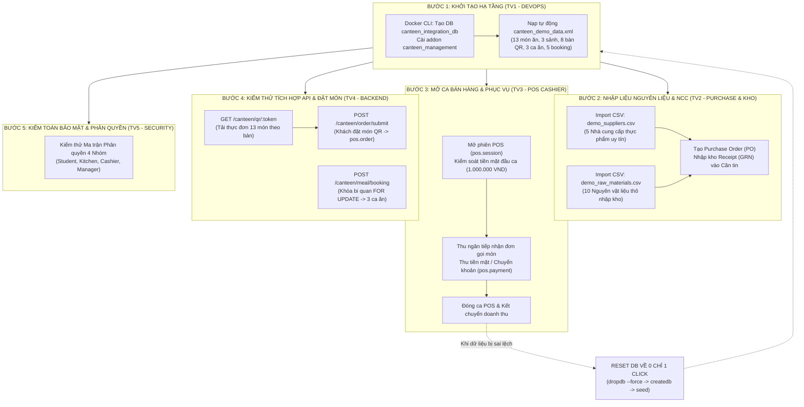

# Hướng dẫn Quản trị Cơ sở Dữ liệu Tích hợp & Bộ Dữ liệu Mẫu (Dataset Demo)

> **Mã nhiệm vụ Jira:** [KAN-131](https://nguyenthinhk52005.atlassian.net/browse/KAN-131) — [ERP-09][TV1] Lập database tích hợp và dataset demo  
> **Áp dụng cho:** Toàn bộ thành viên nhóm dự án UTH Canteen ERP (TV1 đến TV5)  
> **Nền tảng mục tiêu:** Odoo Community 20.0 & PostgreSQL 16 trên Docker Container  
> **Tài liệu tham chiếu:**  
> - [docs/data-contract.md](file:///G:/0duanmobile/uth-canteen-erp/docs/data-contract.md) (Data Contract v2.0)  
> - [docs/architecture.md](file:///G:/0duanmobile/uth-canteen-erp/docs/architecture.md) (Kiến trúc Hạ tầng & Multi-tier)  
> - [docs/srs.md](file:///G:/0duanmobile/uth-canteen-erp/docs/srs.md) (Đặc tả Yêu cầu Phần mềm SRS)  
> - [addons/canteen_management/demo/canteen_demo_data.xml](file:///G:/0duanmobile/uth-canteen-erp/addons/canteen_management/demo/canteen_demo_data.xml)  
> - [functional/purchase_inventory/demo_suppliers.csv](file:///G:/0duanmobile/uth-canteen-erp/functional/purchase_inventory/demo_suppliers.csv)  
> - [functional/purchase_inventory/demo_raw_materials.csv](file:///G:/0duanmobile/uth-canteen-erp/functional/purchase_inventory/demo_raw_materials.csv)  

---

## 1. Mục đích và Phạm vi Áp dụng (Scope & Objectives)

Cơ sở dữ liệu tích hợp (`canteen_integration_db`) cùng bộ dữ liệu mẫu (Dataset Demo) là môi trường kiểm thử trung tâm được thiết kế nhằm mục đích:
1. **Kiểm thử Liên phân hệ Khép kín (End-to-End Cross-functional Testing):** Cung cấp dữ liệu nền tảng dùng chung giúp TV2 (Thu mua & Kho), TV3 (POS & Bán lẻ), TV4 (Backend & API QR), TV5 (Giao diện & Phân quyền) kiểm chứng nghiệp vụ không bị phân mảnh.
2. **Kịch bản Nghiệm thu Đồ án (Acceptance Demo):** Trình diễn trực quan toàn bộ chu trình nghiệp vụ căn tin trường đại học (từ nhập kho nguyên liệu $\rightarrow$ chế biến $\rightarrow$ mở ca POS $\rightarrow$ khách quét QR gọi món $\rightarrow$ đặt suất ăn theo ca) cho Giảng viên hướng dẫn và Hội đồng bảo vệ.
3. **Tự động hóa Tái tạo (Seed) và Làm sạch (Reset):** Cho phép mọi thành viên khôi phục cơ sở dữ liệu về trạng thái chuẩn chỉ bằng một lệnh duy nhất khi dữ liệu phát sinh lỗi trong quá trình thử nghiệm.
4. **Bảo vệ Dữ liệu Cá nhân (Privacy by Design):** 100% dữ liệu mô phỏng (sinh viên, giảng viên, nhà cung cấp, món ăn) đều là dữ liệu giả định chuẩn mực, tuyệt đối không chứa thông tin định danh cá nhân thật (CCCD, SĐT cá nhân, tài khoản ngân hàng thực tế).

---

## 2. Sơ đồ Luồng Tích hợp & Vận hành Dữ liệu Mẫu



---

## 3. Danh mục Dữ liệu Mẫu (Demo Data Catalog)

Toàn bộ dữ liệu được định nghĩa tại tệp [addons/canteen_management/demo/canteen_demo_data.xml](file:///G:/0duanmobile/uth-canteen-erp/addons/canteen_management/demo/canteen_demo_data.xml).

### 3.1. Danh mục Món ăn & Đồ uống Bán lẻ (`product.product` / `product.template`)
Các món ăn được kích hoạt sẵn `canteen_available = True`, `available_in_pos = True`, đơn vị tiền tệ VND (13 món phủ đủ 5 nhóm danh mục):

| Mã XML ID | Tên Món ăn / Đồ uống | Phân loại (`canteen_category`) | Giá niêm yết (VND) | Loại sản phẩm (`type`) | Mã SKU (`default_code`) | Mô tả chi tiết món ăn |
| :--- | :--- | :---: | :---: | :---: | :---: | :--- |
| `product_rice_chicken` | Cơm gà xối mỡ giòn rụm UTH | `rice` | 35.000 | `consu` | `UTH-RICE-01` | Đùi gà góc tư chiên giòn, cơm chiên tỏi, canh rau. |
| `product_rice_broken` | Cơm tấm sườn bì chả đặc biệt | `rice` | 40.000 | `consu` | `UTH-RICE-02` | Sườn nướng mật ong, bì, chả trứng hấp, mỡ hành. |
| `product_rice_beef` | Cơm bò xào đậu que | `rice` | 35.000 | `consu` | `UTH-RICE-03` | Thịt bò xào đậu que giòn ngọt kèm canh rong biển. |
| `product_noodle_beef` | Bún bò Huế giò nạc UTH | `noodle` | 35.000 | `consu` | `UTH-NOODLE-01` | Bún bò nước dùng đậm đà, thịt bò nạc, chả cua. |
| `product_noodle_pho` | Phở bò tái nạm gia truyền | `noodle` | 35.000 | `consu` | `UTH-NOODLE-02` | Bánh phở mềm, bò tái nạm tươi, nước hầm xương. |
| `product_noodle_quang` | Mì Quảng tôm thịt trứng cút | `noodle` | 35.000 | `consu` | `UTH-NOODLE-03` | Mì Quảng chuẩn vị miền Trung, tôm tươi, bánh tráng. |
| `product_drink_coffee_milk` | Cà phê sữa đá pha phin | `drink` | 18.000 | `consu` | `UTH-DRINK-01` | Cà phê Robusta Đắk Lắk pha phin, sữa đặc Ông Thọ. |
| `product_drink_peach_tea` | Trà đào cam sả thanh nhiệt | `drink` | 22.000 | `consu` | `UTH-DRINK-02` | Trà thảo mộc kết hợp đào giòn và sả tươi. |
| `product_drink_lemon_tea` | Trà chanh giã tay hoa lài | `drink` | 15.000 | `consu` | `UTH-DRINK-03` | Trà lài kết hợp chanh vàng tươi giã tay. |
| `product_drink_water` | Nước khoáng Aquafina 500ml | `drink` | 8.000 | `consu` | `UTH-DRINK-04` | Nước uống đóng chai tinh khiết. |
| `product_snack_bread` | Bánh mì xíu mại trứng muối | `snack` | 20.000 | `consu` | `UTH-SNACK-01` | Bánh mì nóng giòn, xíu mại sốt cà chua đậm đà. |
| `product_snack_flan` | Bánh Flan cà phê cốt dừa | `snack` | 12.000 | `consu` | `UTH-SNACK-02` | Bánh flan mềm mịn, cốt dừa Bến Tre béo ngậy. |
| `product_fastfood_burger` | Burger gà giòn sốt cay Mayonnaise UTH | `fastfood` | 30.000 | `consu` | `UTH-FAST-01` | Bánh mì burger mè, đùi gà phi-lê giòn rụm, xà lách tươi và sốt cay. |

---

### 3.2. Phân vùng Sảnh & Bàn ăn gắn mã QR (`restaurant.floor` & `restaurant.table`)

Hệ thống mô phỏng 3 phân vùng sảnh phục vụ tại khuôn viên Căn tin UTH:
1. **Sảnh A - Tầng Trệt (`floor_sanh_chinh`):** 4 bàn ăn (`table_a01` đến `table_a04`), sức chứa từ 4 đến 8 chỗ ngồi.
2. **Sảnh B - Tầng Lửng Máy Lạnh (`floor_tang_lung`):** 2 bàn ăn (`table_b01`, `table_b02`), sức chứa 4 chỗ ngồi.
3. **Khu C - Khuôn Viên Sân Vườn (`floor_san_vuon`):** 2 bàn ăn ngoài trời (`table_c01`, `table_c02`), sức chứa 6 chỗ ngồi.

**Bảng tra cứu Token QR kiểm thử (Dùng để gọi API `/canteen/qr/<token>`):**

| Tên Bàn | Thuộc Sảnh | Số chỗ ngồi | Mã Token QR Duy Nhất | URL Khách quét thực tế (Minh họa) |
| :--- | :--- | :---: | :--- | :--- |
| **Bàn A-01** | Sảnh A - Tầng Trệt | 4 | `uth-qr-table-a01-f89a2b71` | `http://localhost:8069/canteen/qr/uth-qr-table-a01-f89a2b71` |
| **Bàn A-02** | Sảnh A - Tầng Trệt | 4 | `uth-qr-table-a02-c43e71d9` | `http://localhost:8069/canteen/qr/uth-qr-table-a02-c43e71d9` |
| **Bàn A-03** | Sảnh A - Tầng Trệt | 6 | `uth-qr-table-a03-91b5c824` | `http://localhost:8069/canteen/qr/uth-qr-table-a03-91b5c824` |
| **Bàn A-04** | Sảnh A (Bàn nhóm) | 8 | `uth-qr-table-a04-5e26d03a` | `http://localhost:8069/canteen/qr/uth-qr-table-a04-5e26d03a` |
| **Bàn B-01** | Sảnh B - Tầng Lửng | 4 | `uth-qr-table-b01-a187f342` | `http://localhost:8069/canteen/qr/uth-qr-table-b01-a187f342` |
| **Bàn B-02** | Sảnh B - Tầng Lửng | 4 | `uth-qr-table-b02-76dc085e` | `http://localhost:8069/canteen/qr/uth-qr-table-b02-76dc085e` |
| **Bàn C-01** | Khu C - Sân Vườn | 6 | `uth-qr-table-c01-38cb4190` | `http://localhost:8069/canteen/qr/uth-qr-table-c01-38cb4190` |
| **Bàn C-02** | Khu C - Sân Vườn | 6 | `uth-qr-table-c02-d92e541b` | `http://localhost:8069/canteen/qr/uth-qr-table-c02-d92e541b` |

---

### 3.3. Khung giờ Ca ăn & Phiếu đặt suất mẫu (`canteen.meal.slot` & `canteen.meal.booking`)

* **Ca Trưa 1 (`slot_lunch_shift_1`):** 11h00 - 12h00 (Sức chứa: 100 suất, trạng thái: `open`).
* **Ca Trưa 2 (`slot_lunch_shift_2`):** 12h00 - 13h00 (Sức chứa: 100 suất, trạng thái: `open`).
* **Ca Chiều (`slot_dinner_shift`):** 17h00 - 18h30 (Sức chứa: 60 suất, trạng thái: `open`).

**Phiếu đặt suất mẫu đã khởi tạo sẵn (Bao quát toàn bộ Use Case):**
* `booking_sample_01`: Mã `BKG-20261121-0001` — Sinh viên Nguyễn Văn An — Ca Trưa 1 (1 suất, `confirmed`, cơm gà xối mỡ) — *Phục vụ kiểm thử UC06 (Đặt trước).*
* `booking_sample_02`: Mã `BKG-20261121-0002` — Sinh viên Trần Thị Mai — Ca Trưa 1 (1 suất, `confirmed`, cơm tấm sườn nướng) — *Phục vụ kiểm thử UC06 (Đặt trước).*
* `booking_sample_03`: Mã `BKG-20261121-0003` — TS. Lê Hoàng Nam — Ca Trưa 2 (2 suất, `confirmed`, bún bò Huế) — *Phục vụ kiểm thử UC06 (Đặt trước nhiều suất).*
* `booking_sample_04`: Mã `BKG-20261121-0004` — Sinh viên Nguyễn Văn An — Ca Trưa 2 (1 suất, `served`, bún bò Huế) — *Phục vụ kiểm thử UC07 (Check-in nhận phần ăn).*
* `booking_sample_05`: Mã `BKG-20261121-0005` — Sinh viên Trần Thị Mai — Ca Chiều (1 suất, `cancelled`, cơm tấm sườn) — *Phục vụ kiểm thử UC08 (Xử lý hủy đơn / No-show).*

---

## 4. Bảng Tài khoản Đăng nhập Dùng chung (Shared Test Accounts)

Toàn bộ thành viên TV2 – TV5 đăng nhập trên cùng một cơ sở dữ liệu `canteen_integration_db`:
* **Địa chỉ truy cập Web:** `http://localhost:8069`
* **Cơ sở dữ liệu chọn:** `canteen_integration_db`

| Thành viên đảm trách | Vai trò hệ thống | Tên đăng nhập (Login) | Mật khẩu mặc định | Nhóm quyền Odoo gán |
| :--- | :--- | :--- | :--- | :--- |
| **TV1 (Lead/DevOps)** | Quản trị viên Tối cao | `admin` | `admin` | Administrator / Technical / Canteen Manager |
| **TV2 (Purchase/Kho)** | Nhân viên Thu mua & Kho | `purchaser@uth.edu.vn` | `uth@2026` | Purchase / User, Inventory / User |
| **TV3 (POS/Thu ngân)** | Thu ngân & Phục vụ Căn tin | `cashier@uth.edu.vn` | `uth@2026` | Point of Sale / User, Canteen Cashier |
| **TV4 (Backend/API)** | Tích hợp QR & Lập trình | `developer@uth.edu.vn`| `uth@2026` | Canteen Manager (Full Models Access) |
| **TV5 (QA/Security)** | Kiểm định Giao diện & Quyền | `auditor@uth.edu.vn` | `uth@2026` | Canteen User / Kitchen Staff / Cashier |

> [!NOTE]
> Mật khẩu tài khoản `admin` có thể được thiết lập lúc khởi tạo database hoặc đổi trong giao diện Odoo Users. Với các tài khoản TV2 - TV5, TV1 có thể tạo nhanh qua menu **Settings $\rightarrow$ Users & Companies $\rightarrow$ Users** hoặc chạy kịch bản phân quyền ở Mục 5.4.

---

## 5. Kịch bản Vận hành & Kiểm thử Tích hợp Chi tiết (TV2 – TV5)

### 5.1. Kịch bản TV2: Import CSV Nhà cung cấp & Nguyên vật liệu Kho

Để chuẩn bị dữ liệu đầu vào cho chuỗi cung ứng căn tin, TV2 thực hiện import 2 tệp CSV mẫu đã được chuẩn bị sẵn trong thư mục dự án:
- Tệp Nhà cung cấp: [functional/purchase_inventory/demo_suppliers.csv](file:///G:/0duanmobile/uth-canteen-erp/functional/purchase_inventory/demo_suppliers.csv)
- Tệp Nguyên vật liệu: [functional/purchase_inventory/demo_raw_materials.csv](file:///G:/0duanmobile/uth-canteen-erp/functional/purchase_inventory/demo_raw_materials.csv)

#### Bước 1: Import Danh mục Nhà cung cấp (Vendors)
1. Đăng nhập tài khoản `purchaser@uth.edu.vn` (hoặc `admin`).
2. Điều hướng tới phân hệ **Purchase $\rightarrow$ Orders $\rightarrow$ Vendors** (hoặc **Contacts**).
3. Nhấp vào nút **Favorites** (Yêu thích) bên dưới thanh tìm kiếm $\rightarrow$ chọn **Import records** (Nhập bản ghi).
4. Nhấp **Upload File** và chọn tệp `demo_suppliers.csv`.
5. Odoo tự động nhận diện ánh xạ các cột:
   - `id` $\rightarrow$ External ID
   - `name` $\rightarrow$ Vendor Name
   - `is_company` $\rightarrow$ Is a Company (`True`)
   - `supplier_rank` $\rightarrow$ Supplier Rank (`1`)
   - `email`, `phone`, `street`, `city` $\rightarrow$ Thông tin liên hệ.
6. Nhấp **Test** $\rightarrow$ Hệ thống báo *"Everything seems valid"*.
7. Nhấp **Import** $\rightarrow$ Nạp thành công 5 nhà cung cấp uy tín (An Sáng UTH, Rau Sạch Đà Lạt Green, Thịt Tươi Tân Thuận, Nước Khoáng Vĩnh Hảo, Gia Vị Việt).

#### Bước 2: Import Danh mục Nguyên vật liệu Thô (Raw Materials)
1. Điều hướng tới phân hệ **Inventory $\rightarrow$ Products $\rightarrow$ Products** (hoặc **Purchase $\rightarrow$ Products $\rightarrow$ Products**).
2. Nhấp **Favorites $\rightarrow$ Import records $\rightarrow$ Upload File** $\rightarrow$ Chọn tệp `demo_raw_materials.csv`.
3. Kiểm tra ánh xạ các cột quan trọng:
   - `detailed_type` $\rightarrow$ Product Type (chọn `Consumable` hoặc `Storable Product`).
   - `purchase_ok` = `True` (Có thể mua).
   - `sale_ok` = `False` (Không bán lẻ trực tiếp qua POS).
   - `standard_price` $\rightarrow$ Cost (Giá vốn dự toán).
   - `uom_id/id` $\rightarrow$ Unit of Measure (`kg`, `Units`, `Litre`).
4. Nhấp **Test** $\rightarrow$ Nhấp **Import** $\rightarrow$ Nạp thành công 10 loại nguyên liệu thô (Gạo ST25, Đùi gà CP, Bắp bò Úc, Sườn non, Dầu ăn Cái Lân can 25L, Trà lài, Trứng Ba Huân...).

#### Bước 3: Kịch bản Kiểm thử Chu trình Mua hàng & Nhập kho
1. Vào **Purchase $\rightarrow$ Orders $\rightarrow$ Requests for Quotation $\rightarrow$ New**.
2. Chọn Nhà cung cấp: `Công ty TNHH Cung ứng Thịt Tươi Tân Thuận`.
3. Thêm dòng sản phẩm: `Đùi gà tươi góc tư công nghiệp CP` — Số lượng: 50 kg — Đơn giá: 46.000 VND.
4. Nhấp **Confirm Order** $\rightarrow$ Trạng thái chuyển thành **Purchase Order**.
5. Nhấp nút thông minh **Receive Products** (Nhận hàng) $\rightarrow$ Nhấp **Validate** để hoàn tất nhập kho vào kho Căn tin UTH.

---

### 5.2. Kịch bản TV3: Vận hành Ca POS Bán lẻ & Thanh toán tại Quầy

TV3 chịu trách nhiệm kiểm thử toàn bộ vòng đời của một ca bán hàng căn tin:

#### Bước 1: Mở phiên bán hàng POS (Opening Cash Control)
1. Đăng nhập tài khoản `cashier@uth.edu.vn`.
2. Điều hướng tới phân hệ **Point of Sale**.
3. Tại điểm bán hàng **Canteen Bar/Restaurant**, nhấp nút **Open Session** (Mở phiên).
4. Hệ thống hiển thị bảng kiểm soát tiền mặt đầu ca:
   - Nhập số tiền quỹ lẻ ban đầu: `1.000.000 VND` (để thối tiền cho sinh viên).
   - Nhấp **Open Session** để chính thức vào màn hình bán hàng.

#### Bước 2: Tiếp nhận và Xử lý Đơn gọi món từ Bàn QR
1. Khi khách hàng quét mã QR tại bàn (ví dụ Bàn A-01) và gửi đơn qua API, đơn hàng sẽ xuất hiện trên màn hình POS với trạng thái `draft`.
2. Thu ngân nhấp vào Bàn A-01:
   - Kiểm tra các món khách đã chọn (Ví dụ: 1 Cơm gà xối mỡ giòn rụm + 1 Trà chanh giã tay).
   - Kiểm tra ghi chú của khách: *"Xin thêm canh, trà ít đá"*.
   - Nhấp gửi lệnh Bếp (Order to Kitchen) để chuyển trạng thái đơn sang `preparing`.

#### Bước 3: Thu tiền & Hoàn tất Hóa đơn
1. Khách hàng tới quầy thanh toán hoặc thanh toán tại bàn:
   - Nhấp nút **Payment** trên giao diện POS.
   - Chọn phương thức: **Cash** (Tiền mặt) hoặc **Bank Transfer** (VietQR Chuyển khoản ngân hàng).
   - Nhập số tiền nhận từ khách $\rightarrow$ Hệ thống tự động tính tiền thối lại.
   - Nhấp **Validate** $\rightarrow$ Hóa đơn chuyển trạng thái sang `paid` và in phiếu thanh toán.

#### Bước 4: Đóng ca POS & Kết chuyển Doanh thu (Closing Control)
1. Khi kết thúc ca phục vụ, nhấp biểu tượng Menu góc trên bên phải POS $\rightarrow$ Chọn **Close Session**.
2. Nhập số tiền mặt thực tế kiểm đếm trong két.
3. Hệ thống đối soát chênh lệch (Difference = 0 VND).
4. Nhấp **Close Session & Post Entries** để tự động hạch toán vào sổ nhật ký kế toán và trừ tồn kho các món đã bán.

---

### 5.3. Kịch bản TV4: Kiểm thử API Menu QR & Cơ chế Khóa Suất ăn theo Ca

TV4 thực hiện kiểm thử tự động các RESTful Endpoint được định nghĩa trong [docs/data-contract.md](file:///G:/0duanmobile/uth-canteen-erp/docs/data-contract.md) bằng lệnh cURL hoặc PowerShell:

#### Ca 1: Tra cứu Thực đơn theo Mã Token Bàn QR (`GET /canteen/qr/<token>`)
```powershell
# Kiểm thử tải thực đơn cho Bàn A-01 (Sảnh A)
$response = Invoke-RestMethod -Uri "http://localhost:8069/canteen/qr/uth-qr-table-a01-f89a2b71" -Method Get
$response | ConvertTo-Json -Depth 4
```
* **Kỳ vọng:** Trả về HTTP 200, mã bàn `table_name: "Bàn A-01"`, tên sảnh `floor_name: "Sảnh A - Tầng Trệt Căn tin"`, danh sách 13 món ăn kèm giá niêm yết và URL ảnh món.

#### Ca 2: Đặt món trực tiếp từ Bàn QR (`POST /canteen/order/submit`)
```powershell
$headers = @{ "Content-Type" = "application/json" }
$body = @{
    qr_token = "uth-qr-table-a01-f89a2b71"
    fulfillment_type = "dine_in"
    customer_note = "Ăn tại bàn A-01, cho xin thêm nước sốt gà"
    lines = @(
        @{ product_id = 1; qty = 2; customer_note = "Cơm gà xối mỡ đùi góc tư" },
        @{ product_id = 7; qty = 2; customer_note = "Cà phê sữa đá ít ngọt" }
    )
} | ConvertTo-Json -Depth 4

$orderRes = Invoke-RestMethod -Uri "http://localhost:8069/canteen/order/submit" -Method Post -Headers $headers -Body $body
$orderRes | ConvertTo-Json -Depth 4
```
* **Kỳ vọng:** Trả về HTTP 200, sinh bản ghi `pos.order` gắn đúng phiên POS đang mở của TV3, cấp mã bảo mật chống lộ ID tự tăng `access_token` (UUIDv4), trạng thái bếp ban đầu `service_state: "received"`.

#### Ca 3: Kiểm tra Trạng thái Bếp (`GET /canteen/order/status/<access_token>`)
```powershell
$accessToken = $orderRes.data.access_token
Invoke-RestMethod -Uri "http://localhost:8069/canteen/order/status/$accessToken" -Method Get
```
* **Kỳ vọng:** Phản hồi trạng thái tiến trình: `received` $\rightarrow$ `preparing` $\rightarrow$ `ready` $\rightarrow$ `completed`.

#### Ca 4: Kiểm thử Đặt trước Suất ăn & Khóa Bi quan Chống Overbooking
TV4 kiểm tra kịch bản nhiều người dùng đặt đồng thời vào Ca Trưa 1 (`slot_lunch_shift_1`, sức chứa 100 suất).
Đảm bảo phương thức đăng ký thực thi câu lệnh SQL:
```sql
SELECT id, capacity, booked_count FROM canteen_meal_slot WHERE id = %s FOR UPDATE;
```
Khi số lượng đặt cộng dồn vượt quá 100 suất, hệ thống phải trả về lỗi ngoại lệ `ValidationError("Ca ăn đã hết suất, vui lòng chọn ca kế tiếp!")` và hoàn tác (Rollback) giao dịch an toàn.

---

### 5.4. Kịch bản TV5: Kiểm thử Ma trận Phân quyền & An toàn Dữ liệu

TV5 kiểm tra tính toàn vẹn của tệp cấu hình [addons/canteen_management/security/canteen_security.xml](file:///G:/0duanmobile/uth-canteen-erp/addons/canteen_management/security/canteen_security.xml):

| Mã Nhóm Quyền (XML Group ID) | Tên Vai trò Hiển thị | Phạm vi Quyền hạn (Permissions) | Kiểm tra Ranh giới Bảo mật (Boundary Tests) |
| :--- | :--- | :--- | :--- |
| `group_canteen_user` | Customer / Student | Xem danh mục món, xem ca ăn, đặt suất của chính mình. | **CẤM:** Không được truy cập menu Kế toán, Kho, POS backend, không xem được doanh thu. |
| `group_canteen_kitchen` | Kitchen Staff (Bếp) | Xem đơn món đang chờ chế biến, cập nhật trạng thái `service_state` (preparing, ready). | **CẤM:** Không được sửa giá niêm yết món ăn, không được xác nhận thanh toán tiền mặt. |
| `group_canteen_cashier` | Cashier / Waiter (Thu ngân) | Mở ca POS, tạo đơn tại quầy, xác nhận thanh toán (`pos.payment`), in phiếu. | **CẤM:** Không được đổi cấu hình phân quyền hệ thống, không xóa được phiếu hủy đã chốt sổ. |
| `group_canteen_manager` | Canteen Manager (Quản lý) | Toàn quyền cấu hình món, ca ăn, sảnh bàn, chiết khấu và xuất báo cáo doanh số. | Toàn quyền trên các model nghiệp vụ của căn tin. |

**Kịch bản Negative Test kiểm tra lỗ hổng bảo mật IDOR:**
* Sinh viên A đăng nhập, cố tình gửi yêu cầu hủy phiếu đặt ăn `BKG-20261121-0003` của TS. Lê Hoàng Nam.
* **Kỳ vọng:** Hệ thống từ chối với mã lỗi `403 Forbidden` do vi phạm Record Rule: `['|', ('partner_id', '=', user.partner_id.id), (user.has_group('canteen_management.group_canteen_manager'))]`.

---

## 6. Hướng dẫn Lệnh Docker CLI Quản trị Cơ sở Dữ liệu

Mọi thao tác quản trị được thực thi thông qua Docker Compose trên máy trạm phát triển (PowerShell).

> [!IMPORTANT]
> - Luôn chạy lệnh từ thư mục gốc của repository: `G:\0duanmobile\uth-canteen-erp`.
> - Biến `POSTGRES_USER` được đọc trực tiếp từ tệp `.env` (mặc định là `odoo`).
> - Tuyệt đối không sử dụng lệnh `docker compose down -v` vì sẽ xóa sạch toàn bộ volume dữ liệu.

### 6.1. Khởi tạo Cơ sở Dữ liệu Sạch & Nạp Demo Dataset Lần đầu

```powershell
# 1. Khởi động dịch vụ cơ sở dữ liệu PostgreSQL 16 và chờ trạng thái healthy
docker compose up -d db

# 2. Khởi tạo database tích hợp 'canteen_integration_db' và cài đặt module kèm demo data
docker compose run --rm --no-deps odoo odoo -d canteen_integration_db -i canteen_management --stop-after-init

# 3. Khởi động toàn bộ container dịch vụ (Web Odoo phục vụ tại cổng 8069)
docker compose up -d
```

---

### 6.2. Nâng cấp Phân hệ khi có Thay đổi Mã nguồn từ TV4 / TV5

Khi các thành viên TV4 (Models/Controllers) hoặc TV5 (Views/Security) cập nhật mã nguồn mới:

```powershell
# Nâng cấp module canteen_management trên DB tích hợp
docker compose run --rm --no-deps odoo odoo -d canteen_integration_db -u canteen_management --stop-after-init

# Khởi động lại container Odoo để áp dụng các thay đổi trong bộ nhớ cache
docker compose restart odoo
```

---

### 6.3. Làm sạch Hoàn toàn (Reset) Database về Trạng thái Chuẩn trong 1 Lệnh

Khi dữ liệu thử nghiệm bị sai lệch hoặc cần tái lập trạng thái ban đầu để demo nghiệm thu, chạy đoạn mã PowerShell sau:

```powershell
# Đọc tên user PostgreSQL an toàn từ tệp .env (mặc định là odoo)
$PG_USER = "odoo"
if (Test-Path .env) {
    $match = Select-String -Path .env -Pattern "^POSTGRES_USER=(.*)"
    if ($match) { $PG_USER = $match.Matches[0].Groups[1].Value.Trim() }
}

# Tạm dừng container odoo để giải phóng triệt để các phiên kết nối đang mở
docker compose stop odoo

# Xóa database cũ bằng cờ --force (chống lỗi kết nối treo trên Postgres 16)
docker compose exec -T db dropdb -U $PG_USER --if-exists --force canteen_integration_db

# Tạo mới database rỗng với quyền sở hữu của PG_USER
docker compose exec -T db createdb -U $PG_USER -O $PG_USER canteen_integration_db

# Khởi tạo schema và nạp lại toàn bộ Demo Dataset chuẩn
docker compose run --rm --no-deps odoo odoo -d canteen_integration_db -i canteen_management --stop-after-init

# Khởi động lại dịch vụ Odoo để sẵn sàng phục vụ
docker compose up -d odoo

Write-Host ">>> [RESET THÀNH CÔNG] Cơ sở dữ liệu canteen_integration_db đã trở về trạng thái chuẩn!" -ForegroundColor Green
```

---

## 7. Quy trình Thẩm định Toàn vẹn Dữ liệu Sau khi Khởi tạo (Verification Steps)

Sau khi chạy quy trình khởi tạo (Seed) hoặc Làm sạch (Reset), thực hiện kiểm tra đối soát số lượng bản ghi để đảm bảo không có lỗi thiếu sót dữ liệu.

### 7.1. Chạy Truy vấn SQL Kiểm tra Đối soát Trực tiếp

Chạy câu lệnh PowerShell sau để kiểm tra số lượng bản ghi thực tế trong container PostgreSQL:

```powershell
$PG_USER = "odoo"
if (Test-Path .env) {
    $match = Select-String -Path .env -Pattern "^POSTGRES_USER=(.*)"
    if ($match) { $PG_USER = $match.Matches[0].Groups[1].Value.Trim() }
}

docker compose exec -T db psql -U $PG_USER -d canteen_integration_db -c "
SELECT '1. Khách hàng Demo (res_partner)' AS Danh_Muc, COUNT(*) AS So_Luong FROM res_partner WHERE email LIKE '%@uth.edu.vn'
UNION ALL
SELECT '2. Món ăn Căn tin (product_template)', COUNT(*) FROM product_template WHERE canteen_available = TRUE
UNION ALL
SELECT '3. Khu vực / Sảnh (restaurant_floor)', COUNT(*) FROM restaurant_floor
UNION ALL
SELECT '4. Bàn ăn gắn QR (restaurant_table)', COUNT(*) FROM restaurant_table WHERE qr_token IS NOT NULL
UNION ALL
SELECT '5. Khung giờ ca ăn (canteen_meal_slot)', COUNT(*) FROM canteen_meal_slot
UNION ALL
SELECT '6. Phiếu đặt suất mẫu (canteen_meal_booking)', COUNT(*) FROM canteen_meal_booking;
"
```

### 7.2. Tiêu chuẩn Đánh giá Vượt qua (Pass / Fail Criteria)

| Bảng Cơ sở Dữ liệu Kiểm tra | Tiêu chuẩn Số lượng Tối thiểu (Pass Criteria) | Trạng thái Chấp thuận |
| :--- | :---: | :---: |
| `res_partner` (Khách hàng mẫu SV/GV) | $\ge$ 3 bản ghi (An, Mai, Nam) | **PASS** |
| `product_template` (Món ăn bán lẻ) | Đủ 13 món ăn/đồ uống niêm yết (5 nhóm) | **PASS** |
| `restaurant_floor` (Sảnh Căn tin) | Đủ 3 phân vùng (Sảnh A, Sảnh B, Khu C) | **PASS** |
| `restaurant_table` (Bàn ăn gắn QR) | Đủ 8 bàn có mã `qr_token` duy nhất | **PASS** |
| `canteen_meal_slot` (Ca ăn trong ngày) | Đủ 3 ca ăn (Trưa 1, Trưa 2, Ca Chiều) | **PASS** |
| `canteen_meal_booking` (Phiếu đặt trước) | Đủ 5 phiếu đặt mẫu (3 confirmed, 1 served, 1 cancelled) | **PASS** |
| Ràng buộc Khóa ngoại (Foreign Keys) | 0 bản ghi mồ côi (Zero Orphan Records) | **PASS** |

---

## 8. Nguyên tắc An toàn Thông tin & Quyền Riêng tư (Data Privacy Policy)

1. **Tuyệt đối không dùng thông tin cá nhân thật:** Mọi thông tin họ tên, email `@ut.edu.vn`, số điện thoại di động trong dữ liệu mẫu đều là dữ liệu giả định được biên soạn phục vụ mục đích kiểm thử phần mềm đồ án.
2. **Không lưu trữ bí mật (Secrets):** Mật khẩu mẫu (`uth@2026`) chỉ dùng cho môi trường thử nghiệm nội bộ cục bộ (Localhost).
3. **Tuân thủ Chuẩn mực Giáo dục:** Hình ảnh và mô tả món ăn phản ánh đúng văn hóa căn tin sinh viên trường Đại học Giao thông vận tải TP.HCM (giá thành hợp lý, dinh dưỡng cân đối, thông điệp tích cực).
