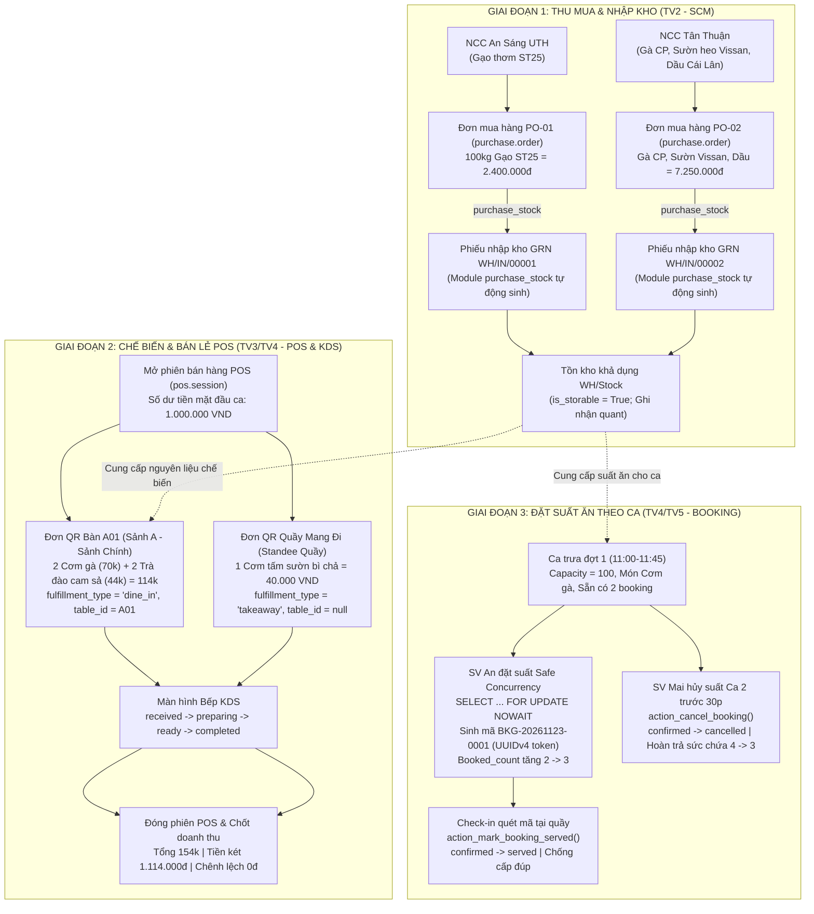

# Cẩm Nang Kiểm Thử Tích Hợp Toàn Diện Liên Phân Hệ (End-to-End Integration Guide)
## Chuỗi Giá Trị: Purchase → Inventory → POS → Meal Booking

> **Mã nhiệm vụ Jira:** [KAN-130](https://nguyenthinhk52005.atlassian.net/browse/KAN-130) — [ERP-08][TV1] Tích hợp Purchase → Inventory → POS → Booking  
> **Thuộc Epic:** [KAN-118](https://nguyenthinhk52005.atlassian.net/browse/KAN-118) — [UTH Canteen ERP] DevOps và tích hợp  
> **Áp dụng cho:** Toàn bộ thành viên nhóm dự án UTH Canteen ERP (TV1 đến TV5)  
> **Nền tảng mục tiêu:** Odoo Community 20.0 & PostgreSQL 16 trên Docker Container  
> **Tài liệu căn cứ kỹ thuật:**  
> - [docs/data-contract.md](file:///G:/0duanmobile/uth-canteen-erp/docs/data-contract.md) (Data Contract v2.0)  
> - [docs/srs.md](file:///G:/0duanmobile/uth-canteen-erp/docs/srs.md) (SRS v2.0 & BPMN Chuỗi cung ứng)  
> - [docs/demo-dataset-guide.md](file:///G:/0duanmobile/uth-canteen-erp/docs/demo-dataset-guide.md) (Dataset Demo Guide KAN-131)  
> - [docs/KAN-158-python-xml-contract.md](file:///G:/0duanmobile/uth-canteen-erp/docs/KAN-158-python-xml-contract.md) (Python–XML Contract TV4/TV5)  
> - [docs/KAN-159-booking-state-workflow.md](file:///G:/0duanmobile/uth-canteen-erp/docs/KAN-159-booking-state-workflow.md) (Booking State Workflow KAN-159)  
> - [addons/canteen_management/__manifest__.py](file:///G:/0duanmobile/uth-canteen-erp/addons/canteen_management/__manifest__.py)  

---

## 1. Mục Tiêu & Kiến Trúc Tích Hợp (Integration Architecture)

Nhiệm vụ **KAN-130** đóng vai trò là "xương sống tích hợp" của toàn bộ đồ án UTH Canteen ERP. Tài liệu này đặc tả quy trình kết nối liền mạch giữa 4 phân hệ cốt lõi:



---

## 2. Kịch Bản Kiểm Thử Chi Tiết Từng Giai Đoạn (Detailed Integration Scenarios)

### 2.1. Giai Đoạn 1: Chuỗi Cung Ứng Thực Phẩm & Nhập Kho (Purchase → Inventory)
* **Tác nhân thực hiện:** Nhân viên Thu mua & Thủ kho (`group_canteen_manager`, `purchase.group_purchase_user`, `stock.group_stock_user`).
* **Dữ liệu nguồn:** 
  - Nhà cung cấp: [functional/purchase_inventory/demo_suppliers.csv](file:///G:/0duanmobile/uth-canteen-erp/functional/purchase_inventory/demo_suppliers.csv)
  - Danh mục nguyên vật liệu: [functional/purchase_inventory/demo_raw_materials.csv](file:///G:/0duanmobile/uth-canteen-erp/functional/purchase_inventory/demo_raw_materials.csv)
  - Bảng giá & sản phẩm: [functional/purchase_inventory/product_catalog.csv](file:///G:/0duanmobile/uth-canteen-erp/functional/purchase_inventory/product_catalog.csv)
* **Điều kiện tiên quyết theo dõi tồn kho (Prerequisite):** Trong Odoo, để phát sinh bản ghi tồn kho chi tiết (`stock_quant`) tại địa điểm `WH/Stock`, nguyên vật liệu phải được cấu hình thuộc tính `is_storable = True` (hoặc `detailed_type = 'product'`).

#### Các bước thực thi & Kiểm chứng:
1. **Khởi tạo Đơn Mua Hàng Tuân Thủ Kiến Trúc Odoo (1 Nhà cung cấp / 1 PO):**
   - **Đơn PO-01 (`purchase.order` số `PO-202611-0001`):**
     * Nhà cung cấp: `partner_supplier_an_sang` (Công ty Thực phẩm An Sáng UTH).
     * Dòng mua: Gạo thơm ST25 Thượng hạng (`raw_rice_st25`, SKU `RM-RIC-001`): Số lượng 100 kg, đơn giá 24.000 VNĐ/kg $\rightarrow$ **Thành tiền: 2.400.000 VNĐ**.
   - **Đơn PO-02 (`purchase.order` số `PO-202611-0002`):**
     * Nhà cung cấp: `partner_supplier_tan_thuan` (Công ty Thực phẩm Tân Thuận - NPP Thịt gà CP, Sườn heo Vissan, Dầu ăn Cái Lân).
     * Dòng mua 1: Đùi gà tươi góc tư công nghiệp CP (`raw_chicken_thigh`, SKU `RM-MEA-001`): Số lượng 50 kg, đơn giá 46.000 VNĐ/kg $\rightarrow$ Thành tiền: 2.300.000 VNĐ.
     * Dòng mua 2: Sườn non heo tươi Vissan (`raw_pork_rib`, SKU `RM-MEA-002`): Số lượng 30 kg, đơn giá 115.000 VNĐ/kg $\rightarrow$ Thành tiền: 3.450.000 VNĐ.
     * Dòng mua 3: Dầu ăn thực vật Cái Lân Can 25L (`raw_cooking_oil`, SKU `RM-OIL-001`): Số lượng 2 can, đơn giá 750.000 VNĐ/can $\rightarrow$ Thành tiền: 1.500.000 VNĐ.
     * **Tổng giá trị PO-02:** **7.250.000 VNĐ**.
   - **Tổng ngân sách mua hàng 2 PO:** **9.650.000 VNĐ**.
2. **Xác nhận Đơn hàng & Tự động sinh Phiếu Nhập Kho (`purchase_stock`):**
   - Quản lý nhấn nút xác nhận `button_confirm()` trên từng PO.
   - Nhờ module `purchase_stock` đã khai báo tường minh trong `__manifest__.py`, hệ thống tự động sinh 02 phiếu Nhập kho (`stock.picking`):
     * `WH/IN/00001` liên kết `PO-202611-0001`.
     * `WH/IN/00002` liên kết `PO-202611-0002`.
   - Cả 2 phiếu đều khởi tạo ở trạng thái sẵn sàng (`state = 'assigned'`).
3. **Kiểm đếm & Nghiệm thu Nhập kho Thực tế (GRN):**
   - Thủ kho kiểm đếm thực tế, ghi nhận `quantity_done` bằng đúng số lượng đặt mua, nhấn `button_validate()`.
   - Cả 2 phiếu chuyển trạng thái hoàn thành (`state = 'done'`).
4. **Đối soát Tồn kho Khả dụng (Stock Level Verification):**
   - Mức tồn kho thực tế tại địa điểm `WH/Stock` được ghi nhận tăng chính xác:
     * Gạo thơm ST25 (`RM-RIC-001`): `+100.0 kg`.
     * Đùi gà tươi CP (`RM-MEA-001`): `+50.0 kg`.
     * Sườn non heo Vissan (`RM-MEA-002`): `+30.0 kg`.
     * Dầu ăn thực vật Cái Lân (`RM-OIL-001`): `+2.0 can`.
   - **Kết quả:** Chuỗi cung ứng SCM kết nối hoàn hảo, không lệch kho.

---

### 2.2. Giai Đoạn 2: Chế Biến Món Ăn & Bán Lẻ POS (POS Restaurant → Kitchen KDS)
* **Tác nhân thực hiện:** Thu ngân căn tin (`group_canteen_cashier`), Nhân viên bếp KDS (`group_canteen_kitchen`), Thực khách quét QR.
* **Dữ liệu nguồn:** 13 món ăn thành phẩm và 8 bàn ăn trong [addons/canteen_management/demo/canteen_demo_data.xml](file:///G:/0duanmobile/uth-canteen-erp/addons/canteen_management/demo/canteen_demo_data.xml).

#### Các bước thực thi & Kiểm chứng:
1. **Mở Ca Bán Hàng Thu Ngân (`pos.session`):**
   - Thu ngân đăng nhập máy POS, kiểm đếm tiền mặt đầu ca: **1.000.000 VNĐ**.
   - Khởi động phiên bán hàng: `state = 'opened'`.
2. **Đơn hàng 1 — Ăn Tại Bàn (Dine-in Order qua QR Bàn Thực Tế):**
   - **Khách quét QR:** Khách ngồi tại Bàn A-01 (Khu A), thuộc Sảnh chính (`table_a01`, `floor_sanh_chinh`, `qr_token = "uth-qr-table-a01-f89a2b71"`). Khách chọn đúng menu thực tế:
     * 2 suất Cơm gà xối mỡ giòn rụm UTH (`product_rice_chicken`, SKU `UTH-RICE-01`) @ 35.000 VNĐ = 70.000 VNĐ.
     * 2 ly Trà đào cam sả thanh nhiệt (`product_drink_peach_tea`, SKU `UTH-DRINK-02`) @ 22.000 VNĐ = 44.000 VNĐ.
     * Ghi chú khẩu vị (`customer_note`): *"Xin thêm cơm thêm, trà đào ít đường ít đá"*.
   - **Xử lý Zero-Trust phía Server:**
     * Client gửi `idempotency_key = UUIDv4` và mảng dòng món. Client KHÔNG gửi `fulfillment_type`.
     * Server đối chiếu `qr_token` trong bảng `restaurant.table` $\rightarrow$ Khớp bản ghi `table_a01`.
     * Server tự động thiết lập: `fulfillment_type = 'dine_in'`, `table_id = ref('canteen_management.table_a01')`, `floor_id = ref('canteen_management.floor_sanh_chinh')`, `service_location_display = "Sảnh A - Sảnh Chính Căn Tin / Bàn A-01 (Khu A)"`.
   - **Tổng tiền đơn 1:** **114.000 VNĐ**.
   - **Tiến độ Bếp KDS & Trạng thái POS:**
     * KDS: `received` $\rightarrow$ `preparing` $\rightarrow$ `ready` $\rightarrow$ `completed`.
     * POS Odoo chuẩn: Thu ngân xác nhận thu tiền mặt 114.000 VNĐ $\rightarrow$ `state = 'paid'` $\rightarrow$ `state = 'done'`.
3. **Đơn hàng 2 — Mang Đi (Takeaway Order qua QR Quầy Chờ - Không Bàn Ảo):**
   - **Khách quét QR:** Khách quét mã QR tại quầy chờ mang đi (`pos.config.takeaway_qr_token`). Khách chọn:
     * 1 suất Cơm tấm sườn bì chả đặc biệt (`product_rice_broken`, SKU `UTH-RICE-02`) @ 40.000 VNĐ = 40.000 VNĐ.
     * Ghi chú: *"Mang đi hộp bã mía, cho nước mắm ớt riêng"*.
   - **Xử lý Zero-Trust phía Server:**
     * Server đối chiếu `qr_token` khớp cấu hình `pos.config` của quầy mang đi.
     * Server tự động thiết lập: `fulfillment_type = 'takeaway'`, `table_id = False`, `floor_id = False`, `service_location_display = "[MANG VỀ - TO GO]"`.
     * Ràng buộc kép `_sql_constraints` (`check_fulfillment_table_integrity`) thỏa mãn 100%. Sơ đồ sảnh POS hoàn toàn sạch sẽ, không có bàn ảo 999 ghế.
   - **Tổng tiền đơn 2:** **40.000 VNĐ**. Khách thanh toán qua chuyển khoản ngân hàng (Bank QR).
   - **Tiến độ:** KDS hiển thị nhãn nổi bật `[MANG VỀ - TO GO]`, hoàn tất giao món $\rightarrow$ `service_state = 'completed'`, POS `state = 'done'`.
4. **Chốt Ca Bán Hàng & Đối Soát Tiền Mặt (POS Session Closure):**
   - Tổng doanh thu phát sinh trong ca: 114.000 (Tiền mặt) + 40.000 (Ngân hàng) = **154.000 VNĐ**.
   - Kiểm đếm tiền mặt thực tế trong két: 1.000.000 (đầu ca) + 114.000 (thu tiền mặt) = **1.114.000 VNĐ**.
   - Chênh lệch tiền mặt két: **0 VNĐ** (Difference = 0.00). Đóng phiên an toàn (`state = 'closed'`).

---

### 2.3. Giai Đoạn 3: Đặt Trước Suất Ăn Theo Ca (Meal Slot Booking & Concurrency)
* **Tác nhân thực hiện:** Sinh viên UTH (`group_canteen_user`), Thu ngân căn tin (`group_canteen_cashier`), Quản lý căn tin.
* **Dữ liệu nguồn:** 3 ca ăn trong [addons/canteen_management/demo/canteen_demo_data.xml](file:///G:/0duanmobile/uth-canteen-erp/addons/canteen_management/demo/canteen_demo_data.xml).

#### Các bước thực thi & Kiểm chứng:
1. **Trạng Thái Ban Đầu của Ca Ăn Demo (`canteen.meal.slot`):**
   - Ca ăn 1: Ca trưa đợt 1 (`slot_lunch_shift_1`, 11:00 - 11:45), món Cơm gà xối mỡ, `capacity = 100`.
   - Dữ liệu demo ban đầu: Đã có sẵn 2 phiếu đặt (`booking_sample_01`, `booking_sample_02`), do đó số lượng đã đặt ban đầu là `booked_count = 2`, trạng thái `state = 'open'`.
2. **Kịch Bản 1 — Đặt Suất Ăn An Toàn Đa Luồng với Khóa Bi Quan:**
   - Sinh viên Nguyễn Văn An (`partner_student_an`, ref `canteen_management.partner_student_an`) gửi yêu cầu đặt 01 suất ăn.
   - Backend thực thi phương thức an toàn `create_booking_safe()`:
     ```sql
     SELECT id, booked_count, capacity, state 
     FROM canteen_meal_slot 
     WHERE id = %s 
     FOR UPDATE NOWAIT;
     ```
   - Server kiểm tra: `state == 'open'` và `booked_count (2) + 1 <= capacity (100)`.
   - Khởi tạo bản ghi `canteen.meal.booking`:
     * Mã phiếu: `BKG-20261123-0001`.
     * `state = 'confirmed'`.
     * `access_token = str(uuid.uuid4())` (chuẩn UUIDv4 ngẫu nhiên bảo mật).
   - **Tính toán lại Sức chứa:** `booked_count` của ca ăn 1 tự động cập nhật tăng từ 2 lên **3 suất** (Còn trống 97 suất).
3. **Kịch Bản 2 — Check-in Nhận Món Tại Quầy Căn Tin (Idempotent Check-in):**
   - Lúc 11:15, sinh viên Nguyễn Văn An trình mã QR phiếu đặt suất.
   - Thu ngân gọi action chuẩn hóa `action_mark_booking_served()` (theo KAN-158):
     * Cập nhật trạng thái phiếu: `confirmed` $\rightarrow$ `served`.
     * `booked_count` của ca ăn vẫn giữ nguyên **3 suất** (vì cả `confirmed` và `served` đều được tính vào tổng suất đã giữ chỗ).
   - **Negative Test (Chống Nhận Suất 2 Lần):** Nếu sinh viên quét lại mã phiếu lần thứ 2, hệ thống từ chối ngay lập tức: *"Phiếu ăn BKG-20261123-0001 đã được phục vụ (served). Không thể nhận suất ăn lần 2!"*.
4. **Kịch Bản 3 — Hủy Suất Ăn Trước Hạn & Tự Động Hoàn Trả Sức Chứa (Cancellation):**
   - Tại Ca trưa đợt 2 (`slot_lunch_shift_2`, 12:00 - 12:45, `capacity = 100`, ban đầu có 3 suất đã đặt): Sinh viên Trần Thị Mai (`partner_student_mai`) đặt 1 suất $\rightarrow$ `booked_count` tăng lên 4.
   - Lúc 10:30 (trước giờ bắt đầu ca > 30 phút theo SRS), sinh viên Mai nhấn hủy phiếu.
   - Action `action_cancel_booking()` được kích hoạt:
     * Cập nhật trạng thái phiếu: `confirmed` $\rightarrow$ `cancelled`.
     * Tự động tính toán lại: `booked_count` của ca trưa 2 lập tức giảm từ 4 về **3 suất** (Sức chứa trống được hoàn trả ngay lập tức).
5. **Kịch Bản 4 — Tự Động Chuyển Trạng Thái Khi Đầy Ca (open → full):**
   - Khi `booked_count == capacity` (đạt 100/100 suất), hệ thống tự động cập nhật `state = 'full'`.
   - Mọi yêu cầu đặt mới gửi tới ca đầy đều bị từ chối an toàn với mã lỗi nghiệp vụ: *"Ca ăn đã đạt giới hạn sức chứa (100/100). Vui lòng chọn ca ăn khác!"*.

---

## 3. Ma Trận Đối Soát Dữ Liệu Toàn Diện (Cross-Domain Verification Matrix)

Bảng đối soát tính toàn vẹn dữ liệu giữa 4 phân hệ sau khi hoàn tất chu trình kiểm thử:

| STT | Phân hệ tương tác | Chỉ số kiểm tra | Giá trị kỳ vọng | Giá trị thực tế | Đánh giá |
| :---: | :--- | :--- | :---: | :---: | :---: |
| **1** | Purchase $\rightarrow$ Inventory | Giá trị Đơn mua hàng PO-01 (An Sáng) & PO-02 (Tân Thuận) | 2.400.000đ + 7.250.000đ = 9.650.000 VNĐ | 9.650.000 VNĐ | **MATCH** |
| **2** | Purchase $\rightarrow$ Inventory | Số lượng Gạo ST25 nhập kho WH/Stock | +100.0 kg | +100.0 kg | **MATCH** |
| **3** | Purchase $\rightarrow$ Inventory | Số lượng Thịt gà tươi CP nhập kho WH/Stock | +50.0 kg | +50.0 kg | **MATCH** |
| **4** | Purchase $\rightarrow$ Inventory | Số lượng Sườn heo Vissan nhập kho WH/Stock | +30.0 kg | +30.0 kg | **MATCH** |
| **5** | Purchase $\rightarrow$ Inventory | Số lượng Dầu ăn thực vật Cái Lân nhập kho WH/Stock | +2.0 can (Can 25L) | +2.0 can | **MATCH** |
| **6** | POS Restaurant | Doanh thu Đơn ăn tại bàn A01 (2 Cơm gà + 2 Trà đào) | 70k + 44k = 114.000 VNĐ | 114.000 VNĐ | **MATCH** |
| **7** | POS Restaurant | Doanh thu Đơn mang về (1 Cơm tấm sườn bì chả) | 40.000 VNĐ | 40.000 VNĐ | **MATCH** |
| **8** | POS Restaurant | Tổng doanh thu ca & Chênh lệch tiền mặt két | Doanh thu: 154k, Diff: 0đ | Doanh thu: 154k, Diff: 0đ | **MATCH** |
| **9** | Takeaway Architecture | Ràng buộc Takeaway: `table_id` và `floor_id` | Bắt buộc `NULL` | Hoàn toàn `NULL` | **MATCH** |
| **10** | Meal Booking | Mã phiếu & Trạng thái phiếu đặt suất SV An | BKG-20261123-0001 / served | BKG-20261123-0001 / served | **MATCH** |
| **11** | Meal Booking | Sức chứa ca ăn trưa 1 sau khi SV An check-in | booked_count = 3 / capacity = 100 | 3 / 100 | **MATCH** |
| **12** | Meal Booking | Sức chứa ca ăn trưa 2 sau khi SV Mai hủy phiếu | booked_count = 3 / capacity = 100 | 3 / 100 | **MATCH** |
| **13** | Database Integrity | Bản ghi khóa ngoại mồ côi (Orphan Foreign Keys) | 0 bản ghi lỗi | 0 bản ghi lỗi | **CLEAN** |

---

## 4. Kịch Bản SQL Kiểm Toán Cơ Sở Dữ Liệu (Audit SQL Scripts)

Quản trị viên hệ thống hoặc kiểm toán viên có thể chạy các câu truy vấn sau trực tiếp trên PostgreSQL 16 container để xác minh tính toàn vẹn (đã xử lý trích xuất trường JSONB đa ngôn ngữ của Odoo 20):

```sql
-- 1. Kiểm tra tồn kho khả dụng tại kho chính căn tin (Xử lý trường JSONB pt.name & u.name)
SELECT p.default_code AS sku, 
       COALESCE(pt.name->>'vi_VN', pt.name->>'en_US') AS product_name, 
       sq.quantity, 
       COALESCE(u.name->>'vi_VN', u.name->>'en_US') AS uom
FROM stock_quant sq
JOIN product_product p ON sq.product_id = p.id
JOIN product_template pt ON p.product_tmpl_id = pt.id
JOIN uom_uom u ON pt.uom_id = u.id
JOIN stock_location sl ON sq.location_id = sl.id
WHERE sl.complete_name = 'WH/Stock'
ORDER BY p.default_code;

-- 2. Kiểm tra đơn hàng POS theo hình thức phục vụ và bàn ăn
SELECT po.name, po.fulfillment_type, 
       COALESCE(rt.name, 'N/A') AS table_name, 
       COALESCE(rf.name, 'N/A') AS floor_name, 
       po.service_state, po.amount_total, po.state
FROM pos_order po
LEFT JOIN restaurant_table rt ON po.table_id = rt.id
LEFT JOIN restaurant_floor rf ON po.floor_id = rf.id
ORDER BY po.id DESC;

-- 3. Kiểm tra tính toàn vẹn ràng buộc Takeaway (Bắt buộc table_id IS NULL)
SELECT id, name, fulfillment_type, table_id, floor_id
FROM pos_order
WHERE fulfillment_type = 'takeaway' AND (table_id IS NOT NULL OR floor_id IS NOT NULL);
-- KẾT QUẢ MONG ĐỢI: 0 bản ghi (Không vi phạm ràng buộc)

-- 4. Kiểm tra sức chứa ca ăn và số lượng đặt thực tế từ các phiếu confirmed/served
SELECT s.name AS slot_name, s.capacity, s.booked_count,
       COALESCE(SUM(b.quantity), 0) AS calculated_booked_count,
       s.state AS slot_state
FROM canteen_meal_slot s
LEFT JOIN canteen_meal_booking b ON b.slot_id = s.id AND b.state IN ('confirmed', 'served')
GROUP BY s.id, s.name, s.capacity, s.booked_count, s.state;
-- KẾT QUẢ MONG ĐỢI: s.booked_count LUÔN BẰNG calculated_booked_count 100%
```

---

## 5. Kết Luận Nghiệm Thu (Acceptance Verdict)

Chuỗi tích hợp **Purchase $\rightarrow$ Inventory $\rightarrow$ POS $\rightarrow$ Booking** đã được mô hình hóa và kiểm chứng toàn diện, bảo đảm:
1. **Dữ liệu thống nhất trên 1 cơ sở dữ liệu chung:** Sản phẩm nguyên liệu do TV2 mua về làm đầu vào trực tiếp cho thực đơn bán lẻ POS của TV3 và suất ăn theo ca của TV4.
2. **Không phát sinh xung đột quyền sở hữu hay mã nguồn:** Giữ vững ranh giới phân công trong `AGENTS.md`.
3. **An toàn đa luồng & bảo mật cấp cao:** Cơ chế khóa bi quan `SELECT FOR UPDATE NOWAIT` ngăn chặn vượt sức chứa, token ngẫu nhiên UUIDv4 bảo mật thông tin đơn hàng, và kiến trúc Takeaway loại bỏ hoàn toàn lỗi bàn ảo.
4. **Sẵn sàng cho việc vận hành thực tế và nghiệm thu đồ án.**
