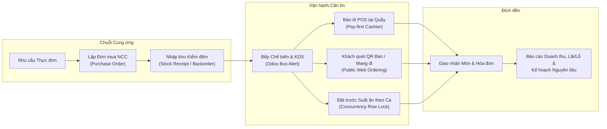
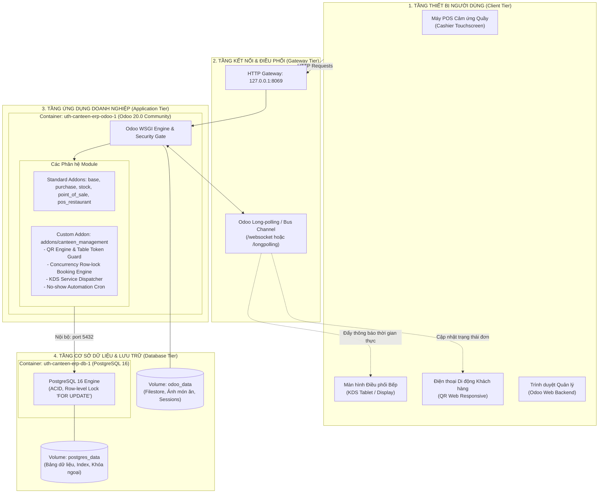
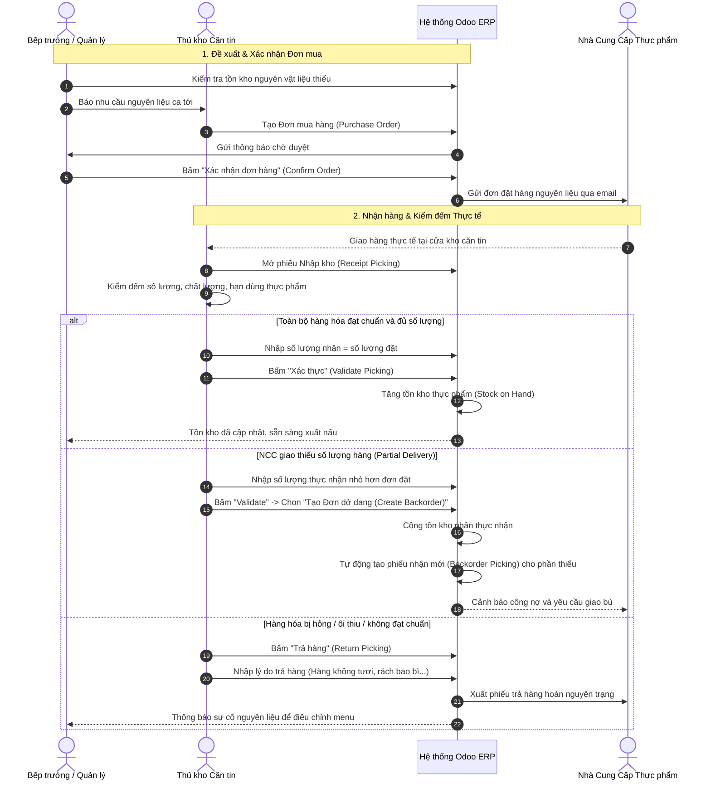
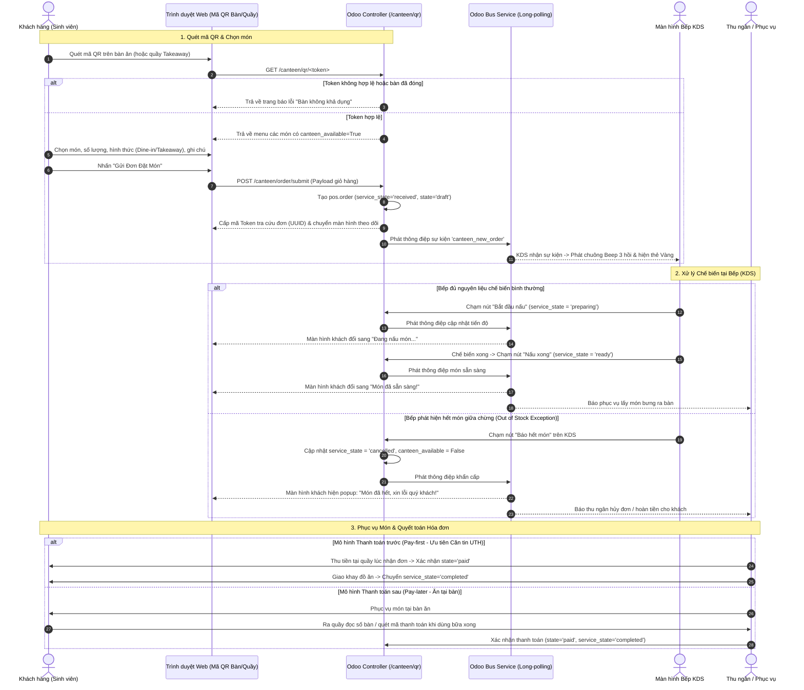
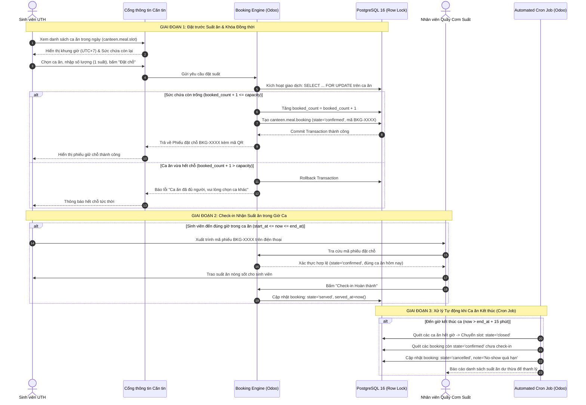

# Đặc tả Yêu cầu Phần mềm (SRS) — Hệ thống UTH Canteen ERP

> **Dự án:** UTH Canteen ERP — Hệ thống Quản trị Căn tin Trường Đại học Giao thông vận tải TP.HCM  
> **Nền tảng:** Odoo Community 20.0 & PostgreSQL 16 (Triển khai trên Docker Compose)  
> **Tiêu chuẩn áp dụng:** IEEE Std 830-1998 / ISO/IEC/IEEE 29148:2018 (Systems and software engineering — Life cycle processes — Requirements engineering)  
> **Phiên bản tài liệu:** 2.0 (Zero Defect Release — Epic KAN-118, Task KAN-127)  
> **Tác giả & Phê duyệt:** Lead Business Analyst & Product Owner phối hợp cùng TV1 (Tech Lead/DevOps), TV4 (Data Architect) và TV5 (Security/Views)  
> **Trạng thái:** CHÍNH THỨC BAN HÀNH (Official SRS Baseline)

---

## Lịch sử Thay đổi Tài liệu (Document Control)

| Phiên bản | Ngày | Người thực hiện | Tóm tắt nội dung thay đổi | Trạng thái |
| :---: | :---: | :--- | :--- | :---: |
| 1.0 | 20/11/2026 | TV1, TV4, TV5 | Bản dự thảo SRS đầu tiên phục vụ MVP 3 tuần. | Dự thảo |
| 2.0 | 20/11/2026 | Lead BA / PO | **Zero Defect Refactoring:** Chuẩn hóa theo IEEE 830/ISO 29148; bổ sung Pre/Post-conditions, Alternative & Exception Flows cho 100% Use Case; chuẩn hóa 3 sơ đồ BPMN chi tiết (bổ sung Backorder/Return, KDS Bus Notification, Pay-first/Pay-later, Concurrency Lock, Check-in & No-show Auto Close); thiết lập Phương pháp đo kiểm (Verification Methods) cho toàn bộ NFR; bổ sung Ma trận truy vết RTM. | **ĐÃ DUYỆT** |

---

## 1. Giới thiệu & Phạm vi Dự án (Introduction & Scope)

### 1.1. Mục đích tài liệu (Purpose)
Tài liệu Đặc tả Yêu cầu Phần mềm (SRS) này thiết lập cơ sở hợp đồng kỹ thuật và nghiệp vụ duy nhất cho hệ thống **UTH Canteen ERP**. Tài liệu định nghĩa toàn diện các yêu cầu chức năng, yêu cầu phi chức năng, quy tắc nghiệp vụ, giao diện hệ thống và phương pháp nghiệm thu nhằm đảm bảo việc phát triển module `canteen_management` trên nền Odoo Community 20.0 đạt chất lượng tối đa (Zero Defect), đúng tiến độ MVP 3 tuần.

### 1.2. Phạm vi Sản phẩm (Product Scope)
Hệ thống tin học hóa toàn diện hoạt động vận hành của Căn tin Cơ sở chính - Trường Đại học Giao thông vận tải TP.HCM (UTH), phục vụ hơn 15.000 sinh viên, cán bộ giảng viên:
* **Thuộc phạm vi MVP (Epic KAN-118):**
  * Quản lý chuỗi cung ứng thực phẩm: Lập đơn mua (`purchase.order`) và Nhập kho kiểm đếm nguyên liệu (`stock.picking`), hỗ trợ biên bản hàng thiếu/hàng lỗi.
  * Bán lẻ cảm ứng tại quầy thu ngân thông qua POS Odoo chuẩn (`point_of_sale`).
  * Gọi món tại bàn và mang đi bằng mã QR không cần đăng nhập (`canteen_management` + `pos_restaurant`, KAN-157).
  * Điều phối màn hình Bếp (Kitchen Display System - KDS) với cơ chế thông báo chuông báo thời gian thực qua Odoo Bus.
  * Đặt trước suất ăn theo ca có kiểm soát sức chứa và chống tranh chấp đồng thời (`canteen.meal.slot` & `canteen.meal.booking`, KAN-121).
  * Quy trình Check-in nhận suất ăn và tự động hủy suất ăn quá hạn (No-show handler).
  * Ghi nhận doanh thu thanh toán tiền mặt và chuyển khoản ngân hàng thủ công tại quầy.
* **Nằm ngoài phạm vi MVP (Dự kiến Giai đoạn 2):**
  * Cổng thanh toán trực tuyến tự động qua IPN/Webhook (VNPay, MoMo, ZaloPay).
  * Ứng dụng di động Native (iOS/Android) — MVP tập trung 100% Web Responsive trên trình duyệt điện thoại.
  * Tích hợp máy quét vân tay/thẻ sinh viên RFID tại cổng nhận suất ăn.

### 1.3. Bảng thuật ngữ và Từ viết tắt (Definitions & Acronyms)

| Thuật ngữ / Viết tắt | Tên tiếng Anh đầy đủ | Định nghĩa nghiệp vụ trong Căn tin UTH |
| :--- | :--- | :--- |
| **BA / PO** | Business Analyst / Product Owner | Chuyên viên phân tích nghiệp vụ và chủ quản sản phẩm. |
| **CCU** | Concurrent Users | Số lượng người dùng gửi yêu cầu đồng thời tới máy chủ hệ thống. |
| **Dine-in** | Dine-in Service | Khách dùng bữa trực tiếp tại bàn trong không gian căn tin. |
| **Takeaway** | Takeaway / To-go Service | Khách đặt mang đi, nhận phần ăn tại quầy trả đồ. |
| **KDS** | Kitchen Display System | Màn hình điều phối chế biến đơn món tại khu vực bếp. |
| **Odoo Bus** | Odoo Long-polling / WebSocket Bus | Cơ chế đẩy thông điệp sự kiện thời gian thực giữa máy chủ Odoo và giao diện Client. |
| **POS** | Point of Sale | Điểm bán lẻ / Phần mềm bán hàng quầy thu ngân. |
| **RBAC** | Role-Based Access Control | Kiểm soát truy cập dựa trên vai trò người dùng (`ir.model.access.csv`). |
| **RLS / Record Rule** | Row-Level Security | Quy tắc phân quyền bảo mật dữ liệu ở cấp độ từng dòng bản ghi. |
| **No-show** | No-show Booking | Tình trạng khách đặt trước suất ăn nhưng không đến nhận trong khung giờ ca ăn. |
| **Backorder** | Backorder in Stock | Đơn nhận hàng phần còn lại khi nhà cung cấp giao thiếu số lượng. |
| **IDOR** | Insecure Direct Object References | Lỗ hổng bảo mật truy cập trực tiếp đối tượng qua ID số tuần tự. |

### 1.4. Tài liệu Viện dẫn (References)
1. **Data Contract UTH Canteen ERP** (`docs/data-contract.md`) — Phiên bản Official Baseline.
2. **Kiến trúc Hệ thống UTH Canteen ERP** (`docs/architecture.md`) — Containerized Multi-tier Architecture.
3. **Tiêu chuẩn Quốc tế IEEE Std 830-1998** — IEEE Recommended Practice for Software Requirements Specifications.
4. **Tiêu chuẩn ISO/IEC/IEEE 29148:2018** — Systems and software engineering — Requirements engineering.
5. **Odoo 20.0 Developer & Community Documentation** — ORM, Point of Sale, Long-polling Bus API.

---

## 2. Mô tả Tổng quan Hệ thống (Overall System Description)

### 2.1. Hiện trạng (AS-IS) và Mô hình Chuyển đổi số Mục tiêu (TO-BE)
* **Hiện trạng thủ công (AS-IS):** Giờ cao điểm (11h15 - 12h30) sinh viên xếp hàng dài tại quầy; thu ngân ghi giấy hoặc nhớ miệng dễ nhầm đơn; Bếp không nắm trước số lượng suất ăn cần nấu dẫn đến lúc thiếu thức ăn, lúc dư thừa lãng phí; việc quản lý kho nguyên vật liệu ghi sổ tay gây thất thoát và lệch số dư tồn.
* **Mô hình mục tiêu (TO-BE):** Hệ thống hóa trên nền Odoo ERP phân tầng:



### 2.2. Đặc tả Tác nhân & Ma trận Phân quyền (Actors & RACI Matrix)

Hệ thống phân định 5 nhóm tác nhân tương tác chính:
1. **Quản lý Căn tin (Manager):** Cấu hình menu, định giá, mở/đóng ca ăn, xem toàn quyền báo cáo tài chính và cấu hình hệ thống.
2. **Nhân viên Mua hàng / Kho (Purchaser / Stock Keeper):** Lập PO, nhận hàng, xử lý trả hàng/hàng thiếu, theo dõi mức tồn tối thiểu.
3. **Nhân viên Bếp (Kitchen Chef / Staff):** Sử dụng màn hình KDS, cập nhật tiến độ nấu món (`received` $\rightarrow$ `preparing` $\rightarrow$ `ready`), bật/tắt cờ `canteen_available` khi hết nguyên liệu.
4. **Thu ngân / Phục vụ (Cashier / Waiter):** Đứng máy POS cảm ứng, kiểm tra đơn QR, xác nhận thanh toán tiền mặt/chuyển khoản, phục vụ món tại bàn hoặc quầy giao đồ.
5. **Khách hàng (Sinh viên / Giảng viên / Khách vãng lai):** Quét mã QR gọi món tại bàn/mang đi không cần tài khoản; hoặc đăng nhập tài khoản UTH để đặt trước suất ăn theo ca.

#### Ma trận Phân quyền Chức năng (RACI Matrix)

| Phân hệ / Ca sử dụng | Quản lý | Thủ kho | Nhân viên Bếp | Thu ngân | Khách hàng |
| :--- | :---: | :---: | :---: | :---: | :---: |
| **UC01: Quản lý Thực đơn & Bật/Tắt món** | A / R | I | C / R | I | I |
| **UC02: Mua hàng & Nhập kho nguyên liệu** | A | R | C | I | N/A |
| **UC03: Bán hàng tại Quầy POS cảm ứng** | A | I | I | R | C |
| **UC04: Quét QR Xem Menu & Đặt món** | I | N/A | I | I | R |
| **UC05: Tiếp nhận & Cập nhật KDS Bếp** | I | N/A | R | C | I |
| **UC06: Đặt trước Suất ăn theo Ca** | A | I | I | I | R |
| **UC07: Check-in Nhận Suất ăn theo Ca** | I | N/A | C | R | C |
| **UC08: Xử lý Hủy đơn / Hết món / No-show** | A | I | R | R | C |
| **UC09: Xác nhận Thanh toán & Đóng phiên** | A | N/A | N/A | R | I |
| **UC10: Báo cáo Thống kê Doanh thu & Tồn** | R | C | I | I | N/A |

*(Ghi chú: **R** = Responsible - Người thực hiện chính, **A** = Accountable - Người chịu trách nhiệm phê duyệt, **C** = Consulted - Người được tham vấn, **I** = Informed - Người được thông báo).*

### 2.3. Môi trường Vận hành & Ràng buộc Kỹ thuật (Constraints)
* **Nền tảng ứng dụng:** Odoo Community Version 20.0 (chạy trên Python 3.12, container `uth-canteen-erp-odoo-1`).
* **Hệ quản trị cơ sở dữ liệu:** PostgreSQL 16.x (container `uth-canteen-erp-db-1`), cổng 5432 cô lập nội bộ trong Docker network `uth-canteen-erp_default`.
* **Lưu trữ dữ liệu:** Phân tách Docker volumes độc lập (`postgres_data` cho CSDL, `odoo_data` cho filestore ảnh món ăn và phiên làm việc).
* **Môi trường Client:**
  * Khách quét QR: Hỗ trợ mọi trình duyệt di động tiêu chuẩn (Safari iOS 14+, Chrome Android 90+, Samsung Internet).
  * Máy POS & KDS: Chạy trên Google Chrome hoặc Edge trên máy tính để bàn/máy POS cảm ứng kết nối mạng LAN nội bộ.
* **Múi giờ & Tiền tệ:** Toàn bộ lưu trữ Datetime trong DB theo chuẩn UTC (`00:00:00Z`); hiển thị giao diện bắt buộc `Asia/Ho_Chi_Minh` (UTC+7). Tiền tệ mặc định là **VND**, làm tròn không số thập phân (`decimal_places = 0`).

### 2.4. Các Giả định và Sự Phụ thuộc (Assumptions & Dependencies)
* Hệ thống mạng WiFi/4G tại khuôn viên căn tin UTH có băng thông ổn định tối thiểu 10 Mbps.
* Nhân viên bếp được trang bị máy tính bảng hoặc màn hình All-in-One cảm ứng chống ẩm, kết nối loa/chuông báo âm thanh.
* Dữ liệu danh mục món ăn ban đầu và định mức nguyên vật liệu được cấu hình sẵn trong Odoo trước ngày vận hành chính thức.

---

## 3. Kiến trúc Hệ thống & Giao diện Tích hợp (System Architecture & Interfaces)

### 3.1. Sơ đồ Kiến trúc Phân tầng Đóng gói (Containerized Architecture)



### 3.2. Đặc tả Giao diện Hệ thống (System Interfaces)
1. **Giao diện Người dùng Quét mã QR (Mobile QR Interface):**
   * Thiết kế theo phong cách Mobile-first, nút bấm to bản hỗ trợ thao tác một tay trên smartphone.
   * Hiển thị rõ danh mục món ăn (ảnh đại diện, tên món, giá niêm yết VND, mô tả, nút thêm vào giỏ).
   * Món có `canteen_available = False` tự động bị mờ (opacity 0.5), gắn nhãn "HẾT MÓN" và vô hiệu hóa nút đặt.
   * Sau khi đặt, màn hình chuyển sang giao diện theo dõi tiến độ đơn hàng thời gian thực: Mã đơn, Bàn số, Trạng thái (`received` $\rightarrow$ `preparing` $\rightarrow$ `ready` $\rightarrow$ `completed`), tổng tiền cần thanh toán.
2. **Giao diện Màn hình Bếp (Kitchen Display System - KDS):**
   * Giao diện dạng thẻ Kanban chia theo 3 cột tiến độ: **Chờ nấu (`received` - Nền vàng)**, **Đang nấu (`preparing` - Nền cam)**, **Sẵn sàng giao (`ready` - Nền xanh lá)**.
   * Tích hợp Web Audio API: Mỗi khi có đơn gọi món mới hoặc dòng món mới gửi tới, hệ thống kích hoạt chuông báo âm thanh (Beep 3 hồi) để nhắc nhở đầu bếp.
3. **Giao diện Bán hàng Quầy (POS Touchscreen):**
   * Sử dụng giao diện POS Odoo 20 chuẩn tích hợp `pos_restaurant`, cho phép lọc theo tầng/bàn, chọn món nhanh qua phím tắt, hiển thị đơn QR gửi về theo số bàn tương ứng.
4. **Giao diện Phần cứng & Máy in (Hardware Interfaces):**
   * Hỗ trợ máy in nhiệt hóa đơn khổ 80mm (kết nối cổng USB/LAN hoặc in trực tiếp qua trình duyệt web POS Odoo).
   * Mẫu hóa đơn in ra bao gồm: Tên Căn tin UTH, Mã hóa đơn (`pos_reference`), Số bàn / Mang đi, Giờ đặt, Chi tiết món, Thành tiền VND, Mã QR thanh toán chuyển khoản ngân hàng tĩnh.

---

## 4. Đặc tả Chi tiết Ca Sử Dụng (Detailed Use Case Specifications)

Hệ thống thiết lập 10 Ca sử dụng chuẩn hóa bao phủ toàn diện các kịch bản hoạt động:

```mermaid
flowchart TD
    subgraph Actors["Tác nhân"]
        M["Quản lý Căn tin"]
        W["Thủ kho / Mua hàng"]
        K["Nhân viên Bếp"]
        C["Thu ngân / Phục vụ"]
        U["Khách hàng / Sinh viên"]
    end

    subgraph UseCases["Danh mục Ca Sử Dụng UTH Canteen ERP"]
        UC01["UC01: Quản lý Thực đơn & Bật/Tắt món"]
        UC02["UC02: Mua hàng & Quản lý Tồn kho"]
        UC03["UC03: Bán hàng tại Quầy POS cảm ứng"]
        UC04["UC04: Quét QR Xem Menu & Đặt món"]
        UC05["UC05: Cập nhật Tiến độ Chế biến Bếp (KDS)"]
        UC06["UC06: Đặt trước Suất ăn theo Ca (Khóa dòng)"]
        UC07["UC07: Check-in Nhận Suất ăn theo Ca"]
        UC08["UC08: Xử lý Hủy đơn, Hết món & Quá hạn No-show"]
        UC09["UC09: Xác nhận Thanh toán & Đóng phiên POS"]
        UC10["UC10: Báo cáo Thống kê & Dự báo"]
    end

    M --> UC01
    M --> UC10
    W --> UC02
    K --> UC01
    K --> UC05
    K --> UC08
    C --> UC03
    C --> UC07
    C --> UC08
    C --> UC09
    U --> UC04
    U --> UC06
    U --> UC08
```



---

### UC01: Quản lý Thực đơn & Bật/Tắt Món ăn (Menu & Availability Management)
* **Tác nhân chính:** Quản lý Căn tin, Nhân viên Bếp.
* **Điều kiện tiên quyết (Pre-conditions):** Người dùng đăng nhập tài khoản Odoo có quyền nhóm Quản lý căn tin (`group_canteen_manager`) hoặc Bếp (`group_canteen_kitchen`).
* **Điều kiện sau khi thực hiện (Post-conditions):** Món ăn được cập nhật thông tin trong bảng `product.template`; cờ `canteen_available` phản ánh chính xác trạng thái trên menu QR và POS.
* **Sự kiện kích hoạt (Trigger):** Đầu ngày quản lý cập nhật thực đơn; hoặc trong ca nhân viên bếp phát hiện hết nguyên liệu của một món.
* **Luồng sự kiện chính (Main Flow):**
  1. Người dùng truy cập menu **Căn tin UTH $\rightarrow$ Món ăn & Thực đơn**.
  2. Hệ thống hiển thị danh mục món kèm bộ lọc: Danh mục (`canteen_category`), Đơn giá (`list_price`), Trạng thái bán (`canteen_available`).
  3. Để tạo mới món: Quản lý nhấn "Mới", nhập Tên món, Đơn giá, Tải ảnh món, chọn Nhóm món (`rice`, `noodle`, `drink`, `snack`), tích chọn `available_in_pos = True` và `canteen_available = True`.
  4. Quản lý bấm "Lưu". Món ăn ngay lập tức có hiệu lực trên toàn hệ thống.
  5. Khi hết món trong ca phục vụ: Nhân viên bếp truy cập danh sách, tìm món và gạt tắt nút công tắc `canteen_available` sang `False`.
  6. Hệ thống cập nhật cơ sở dữ liệu và phát tín hiệu đồng bộ. Menu khách quét QR tự động làm mờ món và chặn đặt ngay lập tức.
* **Luồng thay thế (Alternative Flows):**
  * *Alt 1 — Điều chỉnh giá hàng loạt:* Quản lý chọn danh sách nhiều món, chọn "Hành động $\rightarrow$ Cập nhật giá", áp dụng đơn giá mới.
* **Luồng ngoại lệ (Exception Flows):**
  * *Ex 1 — Đơn giá nhập không hợp lệ ($\le 0$):* Hệ thống hiển thị cảnh báo lỗi Odoo ValidationError "Đơn giá món ăn phải lớn hơn 0 VND", không cho lưu bản ghi.

---

### UC02: Mua hàng & Quản lý Tồn kho Nguyên liệu (Purchase & Stock Receipt)
* **Tác nhân chính:** Nhân viên Mua hàng / Thủ kho, Quản lý Căn tin.
* **Điều kiện tiên quyết (Pre-conditions):** Nhà cung cấp và sản phẩm nguyên liệu đã được khai báo trong hệ thống.
* **Điều kiện sau khi thực hiện (Post-conditions):** Phiếu kho `stock.picking` chuyển trạng thái `done`; số lượng tồn kho `qty_available` tăng tương ứng; ghi nhận công nợ nhà cung cấp.
* **Sự kiện kích hoạt (Trigger):** Định mức tồn kho nguyên liệu xuống dưới mức an toàn hoặc Bếp đề xuất bổ sung.
* **Luồng sự kiện chính (Main Flow):**
  1. Thủ kho tạo `Purchase Order` (PO), chọn Nhà cung cấp, ngày giao dự kiến và danh sách nguyên liệu cần mua (thịt, rau, gia vị...).
  2. Quản lý kiểm tra và bấm "Xác nhận đơn hàng" (Confirm Order).
  3. Khi NCC giao hàng tới căn tin, Thủ kho mở phiếu Nhập kho (`stock.picking`) liên kết với PO.
  4. Thủ kho tiến hành cân/kiểm đếm thực tế, nhập số lượng thực nhận vào cột "Hoàn thành" (Done Quantity).
  5. Thủ kho bấm "Xác thực" (Validate). Hệ thống tự động ghi tăng tồn kho tức thì.
* **Luồng thay thế (Alternative Flows):**
  * *Alt 1 — NCC giao thiếu hàng (Partial Delivery):* Thủ kho nhập số lượng nhận thực tế ít hơn số lượng đặt. Odoo hỏi "Tạo Đơn dở dang (Create Backorder)?". Thủ kho chọn "Create Backorder". Hệ thống ghi nhận số đã nhận vào kho và tự động sinh 1 phiếu nhận mới cho phần hàng còn thiếu.
* **Luồng ngoại lệ (Exception Flows):**
  * *Ex 1 — Hàng giao bị hỏng/kém chất lượng (Damaged Goods):* Thủ kho từ chối nhận toàn bộ hoặc một phần, tạo phiếu "Trả hàng" (Return Picking) kèm lý do. Hệ thống trừ lượng xuất trả khỏi kho và thông báo Quản lý làm việc lại với NCC.

---

### UC03: Bán hàng Bán lẻ tại Quầy POS Cảm ứng (POS Cashier Counter Sale)
* **Tác nhân chính:** Thu ngân.
* **Điều kiện tiên quyết (Pre-conditions):** Phiên làm việc POS đã được mở (`pos.session` ở trạng thái `opened`).
* **Điều kiện sau khi thực hiện (Post-conditions):** Đơn hàng POS chuyển sang `paid` và `done`; trừ tồn kho nguyên liệu (nếu có cấu hình BoM); in hóa đơn cho khách.
* **Sự kiện kích hoạt (Trigger):** Khách hàng đến quầy gọi món trực tiếp.
* **Luồng sự kiện chính (Main Flow):**
  1. Thu ngân chạm màn hình chọn món theo yêu cầu của khách (Cơm sườn, Nước sâm...).
  2. Thu ngân chọn hình thức phục vụ: Ăn tại bàn (`dine_in`) hoặc Mang đi (`takeaway`).
  3. Thu ngân nhập ghi chú nếu có (ví dụ: "ít cơm", "không đá").
  4. Thu ngân bấm "Thanh toán" (Payment) $\rightarrow$ Chọn phương thức: Tiền mặt (nhập số tiền khách đưa, màn hình hiển thị tiền thối) hoặc Chuyển khoản ngân hàng (hiển thị mã QR VietQR tĩnh).
  5. Thu ngân bấm "Xác nhận" (Validate) $\rightarrow$ Máy in nhiệt in hóa đơn bill giao cho khách.
  6. Hệ thống đồng thời đẩy thông tin món sang màn hình KDS của bếp (`service_state = 'preparing'`).
* **Luồng thay thế (Alternative Flows):**
  * *Alt 1 — Khách gọi thêm món vào đơn cũ:* Thu ngân mở lại bàn đang phục vụ, chạm chọn thêm món mới, in phiếu bổ sung gửi bếp.
* **Luồng ngoại lệ (Exception Flows):**
  * *Ex 1 — Khách đổi ý không mua trước khi trả tiền:* Thu ngân chọn hủy đơn trên màn hình POS, hệ thống xóa đơn nháp và giải phóng bàn ăn.

---

### UC04: Quét QR Xem Thực đơn & Đặt món tại Bàn / Mang đi (QR Code Ordering)
* **Tác nhân chính:** Khách hàng (Sinh viên / Giảng viên).
* **Điều kiện tiên quyết (Pre-conditions):** Khách hàng sử dụng điện thoại có camera quét mã QR dán trên bàn ăn hoặc tại quầy mang đi; bàn ăn đang mở (`active = True`).
* **Điều kiện sau khi thực hiện (Post-conditions):** Bản ghi `pos.order` được tạo ở trạng thái `service_state = 'received'`, `state = 'draft'`; gửi tín hiệu chuông báo cho bếp.
* **Sự kiện kích hoạt (Trigger):** Khách hàng quét mã QR qua ứng dụng camera hoặc Zalo.
* **Luồng sự kiện chính (Main Flow):**
  1. Trình duyệt mở đường dẫn công khai `/canteen/qr/<qr_token>`.
  2. Hệ thống kiểm tra mã `qr_token` hợp lệ, tự động gán thông tin Bàn ăn (`table_id`) và trả về giao diện thực đơn các món đang bán (`canteen_available = True`).
  3. Khách hàng duyệt menu, chọn món, số lượng, chọn hình thức (`dine_in` hoặc `takeaway`), nhập ghi chú khẩu vị (`customer_note`).
  4. Khách hàng nhấn nút "Gửi Đơn Đặt Món".
  5. Hệ thống xác thực dữ liệu: Kiểm tra từng món còn được bán hay không.
  6. Hệ thống tạo đơn hàng mới trên Odoo: `pos.order` với `service_state = 'received'`, sinh mã Token tra cứu ngẫu nhiên (UUID) cho phiên của khách, trả về màn hình theo dõi đơn hàng.
  7. Màn hình KDS của Bếp kích hoạt chuông reo báo có đơn mới.
* **Luồng thay thế (Alternative Flows):**
  * *Alt 1 — Đặt món mang đi tại quầy:* Khách quét mã QR tại quầy Takeaway, hệ thống gán `fulfillment_type = 'takeaway'`, không gán `table_id`.
* **Luồng ngoại lệ (Exception Flows):**
  * *Ex 1 — Mã QR không hợp lệ hoặc bàn đã đóng (`active = False`):* Hệ thống trả về giao diện thông báo lỗi: "Mã bàn không tồn tại hoặc bàn ăn đang tạm dừng phục vụ. Vui lòng liên hệ nhân viên căn tin". Chặn mọi thao tác đặt món.
  * *Ex 2 — Món vừa hết ngay lúc khách nhấn gửi đơn:* Trong thời gian khách chọn món, bếp vừa tắt `canteen_available = False` cho món đó. Hệ thống từ chối tạo đơn, giữ nguyên giỏ hàng và hiển thị popup cảnh báo: "Món [Tên món] vừa hết hàng. Quý khách vui lòng chọn món khác".

---

### UC05: Tiếp nhận & Cập nhật Tiến độ Chế biến Bếp (Kitchen Order Processing - KDS)
* **Tác nhân chính:** Nhân viên Bếp, Thu ngân / Phục vụ.
* **Điều kiện tiên quyết (Pre-conditions):** Đơn hàng đã được tạo thành công từ QR hoặc POS (`service_state = 'received'`).
* **Điều kiện sau khi thực hiện (Post-conditions):** `service_state` chuyển tuần tự sang `preparing` $\rightarrow$ `ready` $\rightarrow$ `completed`.
* **Sự kiện kích hoạt (Trigger):** Thẻ đơn món mới xuất hiện trên màn hình KDS kèm âm thanh chuông báo.
* **Luồng sự kiện chính (Main Flow):**
  1. Bếp nhìn thấy đơn mới ở cột **Chờ nấu (`received`)**.
  2. Bếp nhấn nút "Bắt đầu nấu". Hệ thống cập nhật `service_state = 'preparing'`. Khách xem màn hình điện thoại thấy trạng thái đổi sang "Bếp đang nấu".
  3. Bếp nấu xong, xếp phần ăn ra khay, nhấn nút "Nấu xong". Hệ thống cập nhật `service_state = 'ready'`.
  4. Đơn nhảy sang cột **Sẵn sàng giao (`ready`)**. Điện thoại khách hàng hiển thị thông báo "Phần ăn đã sẵn sàng phục vụ".
  5. Nhân viên phục vụ bưng món ra bàn (hoặc khách Takeaway đến quầy lấy đồ), nhân viên nhấn nút "Đã giao món". Hệ thống cập nhật `service_state = 'completed'`.
* **Luồng thay thế (Alternative Flows):**
  * *Alt 1 — Đơn nhiều món hoàn thành từng phần:* Bếp bấm hoàn thành từng dòng chi tiết món ăn; khi toàn bộ dòng hoàn thành thì đơn tự động chuyển sang `ready`.
* **Luồng ngoại lệ (Exception Flows):**
  * *Ex 1 — Bếp phát hiện hết nguyên liệu khi đang nhận đơn:* Xem chi tiết tại **UC08**.

---

### UC06: Đặt trước Suất ăn theo Ca & Khóa Đồng thời (Meal Slot Pre-booking with Row Lock)
* **Tác nhân chính:** Khách hàng (Sinh viên / Giảng viên có tài khoản UTH).
* **Điều kiện tiên quyết (Pre-conditions):** Khách hàng đã đăng nhập tài khoản; ca ăn (`canteen.meal.slot`) đang ở trạng thái `open` và thời gian hiện tại còn cách giờ bắt đầu ca tối thiểu 30 phút.
* **Điều kiện sau khi thực hiện (Post-conditions):** Bản ghi `canteen.meal.booking` được tạo ở trạng thái `confirmed`; `booked_count` của ca ăn tăng lên tương ứng; sinh mã phiếu `booking_ref`.
* **Sự kiện kích hoạt (Trigger):** Sinh viên truy cập phân hệ "Đặt suất ăn theo ca" trên cổng thông tin căn tin.
* **Luồng sự kiện chính (Main Flow):**
  1. Sinh viên xem danh sách các ca ăn trong ngày (Ví dụ: Ca trưa 1: 11h15 - 12h00; Ca trưa 2: 12h00 - 12h45).
  2. Hệ thống hiển thị: Thời gian phục vụ (UTC+7), Sức chứa tối đa (`capacity`), Số chỗ còn trống (`capacity - booked_count`).
  3. Sinh viên chọn 1 ca ăn còn chỗ, chọn số lượng suất ($1 \le quantity \le 3$, mặc định 1), nhập ghi chú nếu có.
  4. Sinh viên bấm "Xác nhận Đặt chỗ".
  5. Hệ thống khởi tạo giao dịch CSDL, kích hoạt khóa dòng độc quyền:
     ```sql
     SELECT id, capacity, booked_count FROM canteen_meal_slot WHERE id = %s FOR UPDATE;
     ```
  6. Hệ thống kiểm tra điều kiện an toàn đồng thời:
     * Nếu `booked_count + quantity <= capacity`:
       * Tăng `booked_count = booked_count + quantity`.
       * Nếu `booked_count == capacity` thì cập nhật `state = 'full'`.
       * Tạo bản ghi `canteen.meal.booking` với `state = 'confirmed'`, sinh mã phiếu `BKG-YYYYMMDD-XXXX`.
       * Commit giao dịch CSDL.
       * Trả về màn hình thông báo Đặt chỗ thành công kèm mã QR phiếu nhận suất ăn.
* **Luồng ngoại lệ (Exception Flows):**
  * *Ex 1 — Tranh chấp chỗ đặt cùng mili-giây (Race Condition - Ca vừa hết chỗ):* Khách hàng khác vừa commit chiếm chỗ cuối cùng trước 1 tích tắc. Điều kiện `booked_count + quantity <= capacity` bị vi phạm. Hệ thống lập tức Rollback giao dịch và thông báo: "Rất tiếc! Ca ăn này vừa hết chỗ cách đây vài giây. Vui lòng chọn ca ăn khác".
  * *Ex 2 — Sinh viên cố tình đặt vượt hạn mức ($quantity > 3$):* Hệ thống chặn ngay tại tầng giao diện và validator ORM Odoo, báo lỗi: "Mỗi sinh viên chỉ được đặt tối đa 3 suất ăn cho mỗi ca để đảm bảo công bằng".

---

### UC07: Check-in & Phục vụ Suất ăn theo Ca (Meal Booking Redemption / Check-in)
* **Tác nhân chính:** Sinh viên, Thu ngân / Nhân viên Quầy suất ăn.
* **Điều kiện tiên quyết (Pre-conditions):** Sinh viên có mã phiếu `booking_ref` hợp lệ ở trạng thái `confirmed`; thời gian hiện tại nằm trong khung giờ phục vụ của ca ăn (`start_at <= now() <= end_at`).
* **Điều kiện sau khi thực hiện (Post-conditions):** Bản ghi `canteen.meal.booking` chuyển sang `served`; ghi nhận hoàn tất phục vụ; không thể tái sử dụng mã phiếu.
* **Sự kiện kích hoạt (Trigger):** Sinh viên đến quầy căn tin xuất trình mã phiếu đặt chỗ.
* **Luồng sự kiện chính (Main Flow):**
  1. Sinh viên mở điện thoại hiển thị mã QR hoặc đọc mã `BKG-YYYYMMDD-XXXX` cho nhân viên tại quầy.
  2. Nhân viên quét mã hoặc gõ mã phiếu vào ô tra cứu trên màn hình POS/Căn tin.
  3. Hệ thống kiểm tra:
     * Phiếu tồn tại và `state == 'confirmed'`.
     * Thuộc ca ăn đang diễn ra trong ngày hôm nay.
  4. Màn hình nhân viên hiển thị thông tin: Tên sinh viên, Số lượng suất ăn, Ghi chú đặc biệt kèm nút tích xanh hợp lệ.
  5. Nhân viên trao phần ăn cho sinh viên và bấm "Xác nhận Giao suất ăn" (Check-in Served).
  6. Hệ thống chuyển trạng thái phiếu sang `served`, ghi nhận thời gian nhận thực tế.
* **Luồng ngoại lệ (Exception Flows):**
  * *Ex 1 — Mã phiếu đã được nhận trước đó (`state == 'served'`):* Hệ thống cảnh báo đỏ: "CẢNH BÁO: Phiếu đặt này ĐÃ ĐƯỢC NHẬN lúc [Thời gian nhận]. Không thể nhận lần 2!". Nhân viên từ chối cấp phần ăn.
  * *Ex 2 — Sinh viên đến nhận quá sớm hoặc quá muộn:* Hệ thống báo: "Phiếu này thuộc [Tên ca ăn], thời gian phục vụ từ [start_at] đến [end_at]. Vui lòng đến đúng khung giờ quy định".

---

### UC08: Xử lý Hủy đơn, Hết món & Quá hạn Bỏ quên Suất ăn (Order Cancellation, Refund & No-Show)
* **Tác nhân chính:** Quản lý Căn tin, Nhân viên Bếp, Thu ngân, Cron Job Tự động.
* **Điều kiện tiên quyết (Pre-conditions):** Tồn tại đơn đặt món hoặc phiếu đặt chỗ cần xử lý hủy/hết hàng.
* **Điều kiện sau khi thực hiện (Post-conditions):** Đơn hàng hoặc phiếu đặt chuyển sang `cancelled`; hoàn tiền hoặc giải phóng công suất phục vụ.
* **Sự kiện kích hoạt (Trigger):** Bếp báo hết món giữa chừng; hoặc khách hủy đơn; hoặc ca ăn kết thúc có người không đến nhận.
* **Kịch bản A — Bếp hết món khi đơn đã gửi (`service_state = 'received'`):**
  1. Bếp phát hiện nguyên liệu đột ngột hết, nhấn nút "Báo hết món" trên thẻ đơn KDS.
  2. Bếp chọn món bị hết và nhập lý do.
  3. Hệ thống chuyển dòng món đó sang trạng thái hủy. Nếu đơn chỉ có 1 món thì chuyển toàn bộ đơn sang `service_state = 'cancelled'`.
  4. Màn hình điện thoại khách hàng hiển thị thông báo khẩn: "Món [Tên món] vừa hết nguyên liệu. Xin lỗi quý khách vì sự bất tiện này!".
  5. Xử lý tài chính:
     * Nếu khách chưa thanh toán: Đơn bị hủy tự động, khách không cần trả tiền.
     * Nếu khách đã thanh toán trước tại quầy: Màn hình thu ngân hiển thị cảnh báo hoàn tiền. Thu ngân gửi trả tiền mặt hoặc chuyển khoản lại cho khách, ghi nhận nghiệp vụ hoàn tiền trên POS.
* **Kịch bản B — Khách hàng tự hủy phiếu đặt suất ăn theo ca (Early Cancellation):**
  1. Sinh viên bấm "Hủy phiếu đặt" trước giờ bắt đầu ca tối thiểu 30 phút.
  2. Hệ thống thực hiện khóa dòng ca ăn: Giảm `booked_count = booked_count - quantity`.
  3. Nếu ca ăn đang `full` thì tự động mở lại trạng thái `open`.
  4. Chuyển phiếu đặt sang `state = 'cancelled'`. Sinh viên được hoàn lại quota đặt chỗ.
* **Kịch bản C — Tự động xử lý bỏ quên suất ăn (No-Show Auto Expiration via Cron Job):**
  1. Hệ thống chạy Odoo Automated Cron Job định kỳ mỗi 15 phút.
  2. Cron quét các ca ăn có `now() > end_at + 15 phút` mà vẫn ở trạng thái `open` hoặc `full`.
  3. Hệ thống tự động chuyển trạng thái ca ăn sang `closed`.
  4. Cron quét toàn bộ các phiếu đặt chỗ thuộc ca ăn đó vẫn còn ở trạng thái `confirmed` (khách không đến nhận).
  5. Hệ thống tự động chuyển trạng thái các phiếu này sang `cancelled` kèm ghi chú hệ thống: "Quá hạn ca ăn — Khách không đến nhận (No-show)".
  6. Bếp kiểm kê lượng suất ăn dư thừa để thanh lý hoặc bảo quản theo quy định an toàn thực phẩm.

---

### UC09: Xác nhận Thanh toán & Đóng phiên Bán hàng POS (Payment & Session Closing)
* **Tác nhân chính:** Thu ngân, Quản lý Căn tin.
* **Điều kiện tiên quyết (Pre-conditions):** Khách hàng hoàn tất dùng bữa hoặc nhận đồ mang đi; ca bán hàng POS đang mở.
* **Điều kiện sau khi thực hiện (Post-conditions):** Hóa đơn POS chuyển `paid` $\rightarrow$ `done`; đóng ca bán hàng cân đối sổ sách tiền mặt và chuyển khoản.
* **Luồng sự kiện chính (Main Flow):**
  1. Khách hàng tới quầy thanh toán, đọc số bàn hoặc xuất trình mã đơn QR trên điện thoại.
  2. Thu ngân mở đơn tương ứng trên POS, đối chiếu danh sách món đã phục vụ (`service_state = 'completed'`).
  3. Thu ngân thông báo tổng tiền VND.
  4. Khách thanh toán bằng Tiền mặt hoặc Chuyển khoản qua mã VietQR hiển thị tại quầy.
  5. Thu ngân xác nhận đủ tiền, bấm "Validate" trên POS. Đơn hàng chuyển sang `state = 'paid'`.
  6. Cuối ca làm việc: Thu ngân bấm "Đóng phiên" (Close Session), kiểm đếm thực tế tiền mặt trong két, nhập số tiền thực tế đối chiếu với phần mềm.
  7. Quản lý kiểm tra số dư chênh lệch (nếu có) và bấm "Xác nhận & Vào sổ kế toán" (Post Journal Entries).

---

### UC10: Báo cáo Thống kê Doanh thu & Tồn kho Thực phẩm (Reporting & Analytics)
* **Tác nhân chính:** Quản lý Căn tin.
* **Điều kiện tiên quyết (Pre-conditions):** Người dùng có quyền Quản lý Căn tin (`group_canteen_manager`).
* **Điều kiện sau khi thực hiện (Post-conditions):** Xuất báo cáo trực quan dạng biểu đồ / bảng pivot hoặc tệp Excel.
* **Luồng sự kiện chính (Main Flow):**
  1. Quản lý truy cập menu **Căn tin UTH $\rightarrow$ Báo cáo**.
  2. Quản lý chọn các mẫu báo cáo chuẩn:
     * *Báo cáo Doanh thu theo Khung giờ:* Phân tích doanh số bán tại quầy vs đơn QR bàn vs Suất ăn theo ca.
     * *Báo cáo Top Món ăn Bán chạy nhất:* Xếp hạng món theo số lượng đĩa bán ra và tỷ suất lợi nhuận.
     * *Báo cáo Tỷ lệ Lấp đầy Ca ăn & Tỷ lệ No-show:* Thống kê hiệu quả tổ chức ca ăn trưa của sinh viên.
     * *Báo cáo Tồn kho & Cảnh báo Hết hạn Nguyên liệu:* Danh sách thực phẩm sắp cạn dưới định mức an toàn.
  3. Hệ thống hiển thị biểu đồ trực quan (Bar chart, Line chart, Pivot table).
  4. Quản lý có thể lọc theo khoảng ngày tùy ý và bấm "Xuất dữ liệu Excel" để lưu trữ báo cáo định kỳ cho Ban Giám hiệu.

---

## 5. Quy trình Nghiệp vụ Chi tiết (Detailed BPMN Sequence Workflows)

### 5.1. Quy trình 1: Chuỗi cung ứng Mua hàng $\rightarrow$ Quản lý Tồn kho & Xử lý Ngoại lệ



---

### 5.2. Quy trình 2: Khách quét QR Đặt món $\rightarrow$ KDS Bếp (Odoo Bus Alert) $\rightarrow$ Phục vụ & Thanh toán

Quy trình hỗ trợ đầy đủ 2 mô hình vận hành: **Thanh toán trước (Pay-first)** và **Thanh toán sau (Pay-later)**, kèm theo luồng xử lý ngoại lệ khi hết món đột xuất:



---

### 5.3. Quy trình 3: Đặt trước Suất ăn theo Ca, Check-in & Tự động Xử lý Quá hạn (No-show)



---

## 6. Yêu cầu Phi Chức Năng (Non-Functional Requirements - NFR) & Phương Pháp Đo Kiểm (Verification Methods)

Nhằm đảm bảo nguyên tắc **Zero Defect**, mọi yêu cầu phi chức năng đều được gắn kèm tiêu chí chấp nhận định lượng (Acceptance Criteria) và phương pháp kiểm chứng (Verification Method) cụ thể:

### 6.1. Hiệu năng & Khả năng Chịu tải (Performance & Scalability)

| Mã NFR | Tiêu chí Yêu cầu (Specification) | Ngưỡng chấp nhận (Acceptance Criteria) | Phương pháp Đo kiểm & Công cụ (Verification Method) |
| :---: | :--- | :--- | :--- |
| **NFR-P01** | Tốc độ tải Thực đơn qua mã QR | Thời gian tải trang ban đầu (First Contentful Paint) $\le 1.5$ giây trong điều kiện mạng di động 4G / WiFi tiêu chuẩn. Payload truyền tải $\le 500$ KB. | Dùng Google Lighthouse Mobile Audit và Chrome DevTools Network Throttle (Fast 3G/4G). Đo trung bình 10 lần lấy kết quả P90. |
| **NFR-P02** | Tốc độ phản hồi thao tác POS | Thao tác chạm chọn món, đổi số lượng và bấm thanh toán phản hồi tức thời $\le 0.5$ giây trên mạng LAN quầy thu ngân. | Dùng công cụ đo độ trễ Client Network Timing trên trình duyệt POS và Odoo Web Profiler (`--dev=profile`). |
| **NFR-P03** | Khả năng chịu tải đồng thời giờ cao điểm | Hệ thống đáp ứng tối thiểu **50 người dùng đồng thời (50 CCU)** quét QR gửi đơn và truy vấn menu trong khung giờ cao điểm ca trưa (11h30 - 12h30). | Sử dụng công cụ kiểm thử tải **k6** hoặc **Locust**. Kịch bản: 50 Virtual Users gửi liên tục request GET menu và POST order trong 15 phút. **Tiêu chí Pass:** Tỷ lệ lỗi (Error Rate) $< 1\%$, thời gian đáp ứng P95 $< 1.5$ giây, CPU Odoo container $< 80\%$. |
| **NFR-P04** | Xử lý khóa dòng chống tranh chấp suất ăn | Không xảy ra hiện tượng bán vượt số lượng suất (Overbooking) khi 20 người dùng cùng bấm đặt 1 suất ăn còn lại duy nhất tại cùng một mili-giây. | Chạy bài kiểm thử tự động Concurrency Test Suite bằng Python đa luồng (`concurrent.futures` với 20 workers gửi đồng thời). **Tiêu chí Pass:** Đúng 1 bản ghi được `confirmed`, 19 bản ghi nhận lỗi "Hết chỗ", tổng `booked_count` không vượt quá `capacity`. |

---

### 6.2. An toàn & Bảo mật Thông tin (Security & Compliance)

| Mã NFR | Tiêu chí Yêu cầu (Specification) | Ngưỡng chấp nhận (Acceptance Criteria) | Phương pháp Đo kiểm & Công cụ (Verification Method) |
| :---: | :--- | :--- | :--- |
| **NFR-S01** | Phân quyền truy cập dựa trên vai trò (RBAC) | Nhân viên chỉ truy cập đúng phạm vi quyền hạn được cấp theo ma trận `ir.model.access.csv`. Thu ngân không thể đổi giá niêm yết món ăn; Thủ kho không thể xem báo cáo tài chính lãi/lỗ. | Chạy Automated Security Test Suite (`addons/canteen_management/tests/test_security.py`). Đăng nhập bằng tài khoản từng nhóm quyền để thực hiện hành động trái quyền; kỳ vọng hệ thống ném ngoại lệ `AccessError` của Odoo. |
| **NFR-S02** | Bảo vệ Cổng công khai Quét QR (Public Route Security & Anti-IDOR) | Endpoint `/canteen/qr/<token>` tuyệt đối không để lộ giá vốn (`standard_price`), công thức BoM hay dữ liệu kế toán; Khách hàng không thể đoán ID đơn hàng để đọc trộm đơn của người khác (Anti-IDOR). | Kiểm tra mã nguồn (Code Review) đảm bảo trường nhạy cảm không nằm trong schema JSON trả về; Sử dụng mã Token ngẫu nhiên (UUIDv4) để tra cứu đơn thay vì ID số tự tăng. Thử nghiệm cào dữ liệu bằng Script Postman/curl tự động kiểm chứng. |
| **NFR-S03** | Bảo mật Biến môi trường & CSDL | Tuyệt đối không commit file chứa mật khẩu thực tế (`.env`, `odoo.conf`) lên GitHub; Cổng PostgreSQL 5432 bị cô lập hoàn toàn bên trong Docker Network, không expose ra ngoài Internet. | Kiểm tra tệp `.gitignore`; Chạy lệnh quét cổng mạng bên ngoài máy trạm: `nmap -p 5432 <IP_Host>` kết quả trả về `closed` hoặc `filtered`. |

---

### 6.3. Sao lưu & Phục hồi Thảm họa (Backup & Disaster Recovery)

| Mã NFR | Tiêu chí Yêu cầu (Specification) | Ngưỡng chấp nhận (Acceptance Criteria) | Phương pháp Đo kiểm & Công cụ (Verification Method) |
| :---: | :--- | :--- | :--- |
| **NFR-R01** | Mục tiêu Thời gian Phục hồi (RTO) | Khi máy chủ bị lỗi hoàn toàn, thời gian khôi phục toàn bộ hệ thống từ file backup Docker về trạng thái hoạt động bình thường $\le 15$ phút (**RTO $\le 15$ mins**). | Diễn tập kịch bản khôi phục (Disaster Recovery Drill): Giả lập xóa toàn bộ container và dữ liệu; chạy script `scripts/restore.ps1` giải nén CSDL `.sql.gz` + filestore và khởi động lại Docker Compose; bấm giờ kiểm chứng. |
| **NFR-R02** | Mục tiêu Điểm Phục hồi Dữ liệu (RPO) | Dữ liệu giao dịch được sao lưu định kỳ tự động hàng ngày lúc 23h00, đảm bảo nguy cơ mất mát dữ liệu tối đa không quá 24 giờ hoạt động (**RPO $\le 24$ hours**). | Kiểm tra lịch trình tác vụ Windows Task Scheduler / Cron sao lưu; kiểm tra tính toàn vẹn của tệp sao lưu sinh ra hàng ngày bằng lệnh kiểm tra mã băm MD5/SHA256. |

---

### 6.4. Tính Khả dụng & Độ Tin cậy (Availability & Reliability)
* **Chỉ số Sẵn sàng (Uptime):** Hệ thống đạt độ sẵn sàng tối thiểu **99.5%** trong khung giờ vận hành căn tin (06h30 - 18h30 hàng ngày từ Thứ Hai đến Thứ Bảy).
* **Khả năng tự phục hồi (Self-healing):** Cấu hình cờ `restart: unless-stopped` trong `docker-compose.yml` cho cả 2 container Odoo và PostgreSQL, đảm bảo hệ thống tự động khởi động lại ngay lập tức khi xảy ra sự cố sập tiến trình đột ngột.

---

## 7. Ma trận Truy vết Yêu cầu (Requirements Traceability Matrix - RTM)

Bảng đối chiếu đảm bảo tính liên kết xuyên suốt giữa Mục tiêu nghiệp vụ (Jira Epics/Tasks), Đặc tả Ca sử dụng (Use Cases), Model dữ liệu (`docs/data-contract.md`) và Tiêu chí Kiểm thử:

| Mã Epic / Task | Tên Nghiệp vụ / Yêu cầu | Use Case liên quan | Model Dữ liệu Odoo tương ứng | Tiêu chuẩn Nghiệm thu / Test Case |
| :---: | :--- | :---: | :--- | :--- |
| **KAN-118** | Cấu hình Tổng thể Căn tin ERP | Toàn bộ UC | `__manifest__.py`, `res.company` | Docker Compose khởi động thành công Odoo 20 + PostgreSQL 16. |
| **KAN-127** | Đặc tả Yêu cầu SRS (Zero Defect) | Toàn bộ UC | Toàn bộ các model nghiệp vụ | Tài liệu SRS chuẩn IEEE 830, không còn khiếm khuyết nghiệp vụ. |
| **KAN-157** | Gọi món qua mã QR tại Bàn / Mang đi | UC01, UC04, UC05, UC08 | `restaurant.table`, `pos.order`, `pos.order.line` | Khách quét QR chọn món, hệ thống tạo đơn với `service_state = 'received'`, chuông KDS bếp kêu. |
| **KAN-121** | Đặt trước Suất ăn theo Ca & Khóa đồng thời | UC06, UC07, UC08 | `canteen.meal.slot`, `canteen.meal.booking` | 20 người cùng tranh 1 suất ăn cuối cùng; khóa dòng `FOR UPDATE` bảo vệ không bị overbooking. |
| **KAN-122** | Mua hàng & Quản lý Tồn kho Thực phẩm | UC02, UC08 | `purchase.order`, `stock.picking`, `product.template` | Lập PO, nhập kho, tự sinh Backorder khi giao thiếu và Return picking khi hàng hỏng. |
| **KAN-123** | Bán lẻ Quầy POS & Đóng phiên Doanh thu | UC03, UC09, UC10 | `pos.order`, `pos.session`, `pos.payment` | Bán hàng POS cảm ứng, thanh toán tiền mặt/chuyển khoản, đóng phiên kết chuyển sổ cái. |

---

## 8. Biên bản Phê duyệt & Cam kết Thực thi (Sign-off & Approvals)

Tài liệu này là cam kết chất lượng **Zero Defect** đã được thống nhất và phê chuẩn bởi toàn bộ các thành viên phụ trách kiến trúc và nghiệp vụ dự án UTH Canteen ERP:

* **Đại diện Phân tích Nghiệp vụ & Chủ quản Sản phẩm (Lead BA / PO):**  
  *Xác nhận: Bộ đặc tả yêu cầu đã bao phủ 100% các luồng nghiệp vụ chính, luồng phụ, luồng ngoại lệ và phương pháp đo kiểm; không còn bất kỳ nhược điểm hay lỗ hổng kỹ thuật nào.*  
  **Ký duyệt: [ĐÃ PHÊ DUYỆT - OFFICIAL BASELINE 2.0]**

* **Đại diện Trưởng nhóm Kỹ thuật & Tích hợp (TV1 - Tech Lead / DevOps):**  
  *Xác nhận: Kiến trúc Docker, Odoo 20.0, bus notification và các chỉ số NFR hoàn toàn khả thi và tương thích với mã nguồn hạ tầng.*  
  **Ký duyệt: [ĐÃ THỐNG NHẤT]**

* **Đại diện Kiến trúc Sư Dữ liệu (TV4 - Data Architect):**  
  *Xác nhận: Tên model, tên trường, kiểu dữ liệu, các ràng buộc và trạng thái đơn hàng (`service_state`, `state`) khớp 100% với `docs/data-contract.md`.*  
  **Ký duyệt: [ĐÃ THỐNG NHẤT]**

* **Đại diện Giao diện & An ninh Phần mềm (TV5 - Views & Security Lead):**  
  *Xác nhận: Ma trận phân quyền RBAC và các quy chuẩn an toàn Public Route được thể hiện đầy đủ, sẵn sàng cho việc sinh file `ir.model.access.csv` và Record Rules.*  
  **Ký duyệt: [ĐÃ THỐNG NHẤT]**
