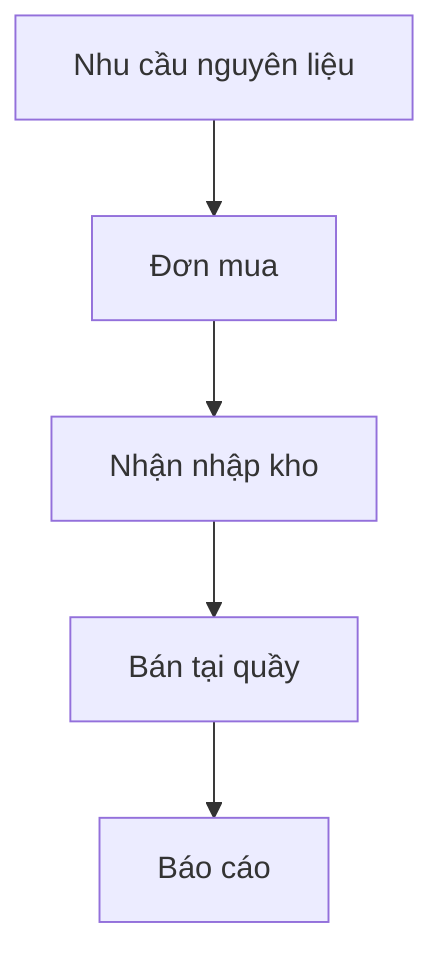
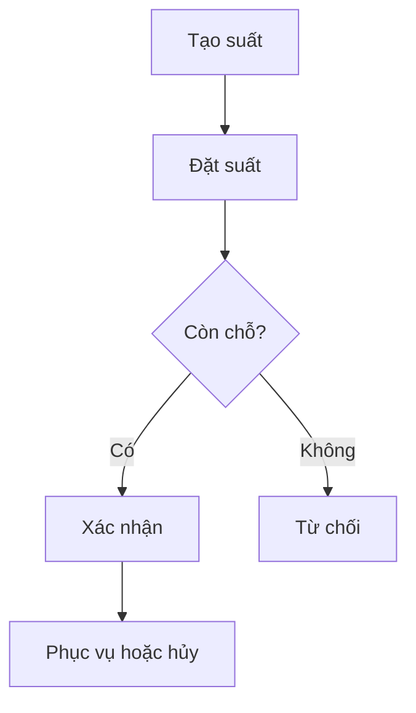

# SRS khởi đầu — cần review

Mục tiêu: quản lý mua nguyên liệu, kho, bán tại quầy, đặt suất ăn. Tuần 1 dựng nền và thống nhất yêu cầu; booking/POS tùy chỉnh chưa triển khai. Hiện trạng AS-IS cần khảo sát, chưa đủ thông tin kết luận.

| Tác nhân | Use case dự kiến |
| --- | --- |
| Quản lý | Quản lý thực đơn, quyền, xem báo cáo |
| Nhân viên kho | Lập mua, nhận hàng, kiểm tra tồn |
| Thu ngân | Bán hàng, ghi nhận thanh toán |
| Người đặt suất | Xem suất, đặt và hủy theo quy định cần xác nhận |

TO-BE dự kiến:

Phi chức năng: phân quyền theo vai trò Odoo; sao lưu database và filestore cùng nhau, thử khôi phục; kiểm thử trên Windows và máy khác. Cần chốt tải, quy tắc hủy, thanh toán, dữ liệu cá nhân và ma trận quyền. Sơ đồ trên mô tả luồng, chưa phải BPMN chính thức.
