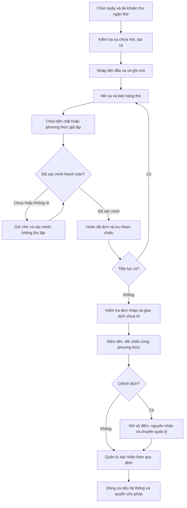

# KAN-148 / ERP-26 — Thiết kế ca bán và thanh toán giả lập

Ghi chú cập nhật: xem `kan148-ket-qua-native-20261126.md` để biết các phiên và điều chỉnh tiền đã kiểm thử qua ORM; các điều kiện review và kiểm thử giao diện vẫn còn.

**Người phụ trách:** Văn Tạ Huy Thiên (TV3). **Trạng thái:** bản thiết kế chờ đối chiếu ERP-24/ERP-25, chạy kiểm thử và review; chưa đề nghị chuyển Done. Không sử dụng giao dịch tiền thật, dữ liệu khách thật hoặc tài khoản thanh toán thật.

## Phạm vi và nguồn

- [KAN-148](https://nguyenthinhk52005.atlassian.net/browse/KAN-148): mở ca, ghi nhận thu ngân, lựa chọn phương thức thanh toán, đóng ca, kiểm tiền và ba tình huống sai lệch.
- [ERP-24 / KAN-146](https://nguyenthinhk52005.atlassian.net/browse/KAN-146) và [ERP-25 / KAN-147](https://nguyenthinhk52005.atlassian.net/browse/KAN-147) là phụ thuộc chưa được nghiệm thu. Giá và chính sách trong ví dụ bên dưới chỉ để tính thử.
- Mã Odoo 20 cục bộ revision `fa2c1d6e67fff519d450f43271717ab1c93dac9b`: `addons/point_of_sale/models/pos_session.py` và `pos_payment_method.py`. Kết quả trước đây tại `canteen-erp/docs/KAN-120_Kiem_thu_2026-11-19.md`: ba phiên **trống** mở/đóng qua API, không chứng minh ca có giao dịch đã chạy.
- [SRS ERP-05](https://github.com/ThinhNguyen2005/uth-canteen-erp/blob/8175fad3e9b28e42c2bdccd9c15a8e8f5f8931b2/docs/srs.md), UC03 và UC09: thu ngân thực hiện bán/nhận tiền, kiểm đếm cuối ca; quản lý kiểm tra chênh lệch. Chính sách và quyền chi tiết cần TV1 xác nhận.

## Luồng ca đề xuất

Đây là quy trình đề xuất, không khẳng định Odoo tự giữ trạng thái chờ hoặc tự kiểm chứng chuyển khoản. Với phương thức giả lập, xác minh dựa trên kết quả mô phỏng và quy trình thủ công đã chấp thuận; không đánh dấu một khoản đã thu khi chưa có bằng chứng.

## Trạng thái phiên và phân công

| Trạng thái trong mã | Ý nghĩa theo tên trường và bước thiết kế | Điều kiện cần kiểm thử |
| --- | --- | --- |
| `opening_control` | Chuẩn bị phiên; nhập số dư đầu ca và ghi chú. | Đúng quầy, người mở ca và tiền đầu ca. |
| `opened` | Ca đang hoạt động, có thể xử lý đơn theo cấu hình. | Người thao tác, phương thức, đơn và số tiền được ghi đúng. |
| `closing_control` | Trạng thái kiểm soát đóng ca có trong mô hình. | Xác định từ giao diện và cấu hình thực tế khi nào hệ thống đi qua trạng thái này; không giả định bắt buộc. |
| `closed` | Phiên đã đóng; mã đóng cập nhật các đơn đã đóng sang `done`. | Đối chiếu số đếm, bút toán và trạng thái thực tế; việc đóng lại phải bị chặn. |

Trong mã revision trên, `set_opening_control` chuyển phiên từ `opening_control` sang `opened`; `close_session_from_ui` kiểm tra đơn nháp và từ chối phiên đã đóng trước khi ghi `closed`. Đây là đọc mã nguồn, không thay thế kiểm thử giao diện hoặc xác nhận phân quyền.

Thu ngân đề xuất: mở ca, nhập tiền đầu ca, chọn món, nhận tiền, ghi chú, kiểm đếm và báo sai lệch. Quản lý đề xuất: kiểm tra sai lệch, xác minh giao dịch chưa rõ và quyết định đóng ca theo chính sách được duyệt. Không khẳng định các quyền đó đã được cấu hình trên Odoo.

## Phương thức và đối soát

| Phương thức | Cách thử | Cần xác nhận trước nghiệm thu |
| --- | --- | --- |
| Tiền mặt | Nhập số tiền khách giả lập đưa, kiểm tra tiền thừa và số tiền được ghi nhận. | Sổ tiền mặt, quyền, số dư đầu ca và đối soát. |
| Chuyển khoản/QR giả lập | Dùng phương thức thử, tham chiếu giả lập và kết quả xác minh giả lập; tuyệt đối không chuyển tiền thật. | Ai xác minh, nguồn bằng chứng, xử lý mất kết nối và thu lặp. Không coi lựa chọn QR là tích hợp ngân hàng. |
| Thẻ sinh viên giả lập (nếu được chọn) | Chỉ ghi nhận mô phỏng theo cấu hình thử. | Phạm vi thẻ, quyền và quy trình xác nhận; không suy ra có tích hợp thẻ. |

Mã nguồn `pos.payment.method` phân loại `cash`, `bank` và `pay_later`; loại `bank` không tự chứng minh có nhà cung cấp thanh toán. Kiểm tra cấu hình thực tế trước khi dùng bất kỳ phương thức nào.

Tiền mặt dự kiến = tiền đầu ca + tiền mặt thực thu − tiền mặt hoàn thực chi + tiền vào khác − tiền ra khác, với từng khoản đều có chứng từ. Chênh lệch = tiền thực đếm − tiền dự kiến. Đối chiếu chuyển khoản riêng theo tham chiếu; không cộng vào tiền trong két. Cần TV1 xác nhận nguồn báo cáo, dấu âm và chính sách xử lý.

## Ba tình huống sai lệch cuối ca — số liệu giả lập

Mỗi trường hợp dùng ca riêng: đầu ca 100.000 VND, bán thu tiền mặt 40.000 VND, không hoàn hoặc thu/chi khác; tiền dự kiến là **140.000 VND**. Không dùng các con số này làm giá đã được phê duyệt.

| ID | Tiền thực đếm | Chênh lệch | Xử lý đề xuất và điểm cần ghi |
| --- | ---: | ---: | --- |
| CL-01 | 140.000 | 0 | Đối chiếu chứng từ, ghi kết quả và đóng ca theo quyền. |
| CL-02 | 139.000 | −1.000 | Ghi thiếu, kiểm tra tiền thừa/chứng từ, báo quản lý; không sửa giao dịch để ép khớp. |
| CL-03 | 141.000 | +1.000 | Ghi thừa, kiểm tra chứng từ và báo quản lý; không tạo doanh thu giả để ép khớp. |

Ba hàng bao gồm một ca đối chiếu khớp làm chuẩn và hai hướng chênh lệch. Để đáp ứng yêu cầu ba tình huống **sai lệch**, bổ sung CL-04: vẫn dự kiến 140.000, thực đếm 130.000, chênh lệch −10.000; giả lập giao nhầm 10.000 tiền thừa, lưu bằng chứng, báo quản lý và áp dụng quyết định đã duyệt. Ngưỡng cho phép đóng ca và định khoản phải được xác nhận, không tự giả định.

## Kế hoạch kiểm chứng

1. Trên môi trường thử độc lập, ghi phiên bản, quầy, người chạy, cấu hình và thời điểm; mở ca với tiền đầu ca giả lập.
2. Thực hiện một đơn tiền mặt và một đơn phương thức giả lập; ghi ID đơn, số tiền, phương thức và bằng chứng; xác minh không phát sinh giao dịch thật.
3. Chạy CL-02, CL-03, CL-04 trên các ca độc lập; đối chiếu số dự kiến với số đếm và kết quả xử lý thực tế. Mỗi ca ghi PASS/FAIL/BLOCKED, ảnh/log và người chạy; nếu không thể mô phỏng thì ghi BLOCKED.
4. Kiểm tra ca có đơn nháp, ca đã đóng và ca có giao dịch chưa xác minh; đối chiếu với quyền quản lý. Không xem việc đọc mã là bằng chứng chạy.
5. TV1 review luồng, phương thức, ngưỡng và 3 sai lệch; liên kết bằng chứng, quyết định review và tài liệu vào Jira trước Done.
